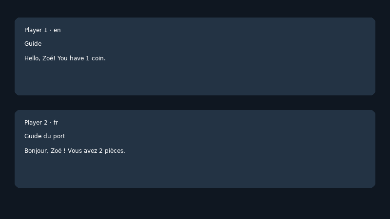

# M1: dialogue localization delivery and verification

Completed 2026-11-23. Implementation: `e773bec4`; allocation follow-up: `370d0725`.
No release version was changed. The game repository was not modified.

## Delivered contracts

- Scalar line/reply localization reuses the existing catalog store, locale fallback
  chain and plural rules. Source prose is the last fallback; arrays remain the
  separate `I18n.t` feature. Named replacement values are inserted literally.
- Each player owns its locale/arguments. Locale refresh preserves visit/generation,
  choice IDs and fired events; renderers receive revision/full-reveal metadata.
- Shared characters may use a plain `name` plus optional `nameKey`. Legacy names
  and unlocalized conversations continue to work without including I18n.
- Compiled schema-1 documents retain text IDs and optional `@document` identity.
  New readers accept legacy structured documents and reject unknown explicit
  versions/fields. Localized hosts use the documented capability guard when
  replacing the runtime; old readers cannot enforce forward compatibility.
- Existing Localization Explorer now shows dialogue source coverage and navigation.
  Shared diagnostics validate shapes, placeholders and plain default-locale drift;
  incomplete translations warn. Unsaved source/catalog edits refresh analysis.
- `tua dialogue-extract` prints a non-executing, sorted source manifest. Catalog
  updates remain reviewed merges; extraction cannot overwrite translator edits.
- Watch revalidates catalog/source dependencies and retains valid outputs after
  placeholder errors. Runtime/typing/editor probes cover copied ownership,
  resolver failure, reentrancy and independent sessions.

The [public guide](../../docs/dialogue.md) owns the API and compatibility details;
[the example](../../examples/dialogue/localization/README.md) is executable.
M2 still owns typed context bindings and argument refresh. M0's two imported-type
probes remain follow-ups; this milestone does not claim to fix them.

## Compiler and runtime provenance

Final compiler: `0.11.0`, clean revision `370d07253a6904aef20fa9d1f823ac00c66e0392`,
`aarch64-apple-darwin` / `release`. SHA-256:
`15ee35ebe4fd9598a7d62ecefa71bfac219224b81efd5dfdb58df4c54f740caf`.

The compiler-emitted dialogue runtime is byte-compared with its repository source
by both replay workflows. No generated Lua was edited or shipped as source.

- [Initial M1 capture](results/m1/initial.json): clean `e773bec4` compiler.
- [Final capture](results/m1/final.json): clean `370d0725` compiler, all fixture/harness
  hashes, interpreter identities, CPU/allocation policy and raw editor samples.
- [Native localization provenance](results/m1/native.json): exact example/oracle
  inputs, compiler/LÖVE hashes and both JIT states.
- [Artifact checksums](results/m1/artifacts.json).

## Matching M0 workloads

These are the unchanged M0 compatibility fixture/harness, **without localization
enabled**, compiled by each selected compiler. They measure regression cost, not
translation throughput. The M0 capture is historical; each M1 column is a separate
capture, not a randomized alternating-binary experiment. Do not infer small timing
changes are improvements. The initial allocation regression motivated the small
follow-up; validation remains intact.

CPU uses process `os.clock`, running/default GC, 200 warm-up operations and seven
trials, alternating workload order. p95 below is over **batch-average operation
cost**, not individual update or frame latency. Native host: LÖVE 11.5.0,
LuaJIT 2.1.1700008891, **JIT disabled**. The full capture also contains JIT-on and
standalone Lua 5.4.8 results. Standalone `luajit` was unavailable.

| Workload | M0 median / p95 (µs) | Initial M1 | Final M1 |
| --- | ---: | ---: | ---: |
| `idle_update` | 0.308 / 0.338 | 0.338 / 0.417 | 0.321 / 0.354 |
| `snapshot` | 1.093 / 1.112 | 1.177 / 1.220 | 1.073 / 1.117 |
| `full_session` | 5.708 / 6.038 | 11.978 / 12.300 | 7.042 / 7.120 |

Allocation uses separate GC-stopped batches (seven × 200 operations). This is Lua
heap growth per operation, excluding C/GPU memory; it is not net growth while GC
runs. All three final workloads had median/p95 post-full-GC retained batch deltas
of zero KiB in this short probe, not proof of a long-session leak-free guarantee.

| Workload | M0 KiB/op | Initial M1 | Final M1 |
| --- | ---: | ---: | ---: |
| `idle_update` | 0.164 | 0.164 | 0.164 |
| `snapshot` | 1.148 | 1.336 | 1.336 |
| `full_session` | 4.531 | 9.599 | 5.297 |

The follow-up reuses private immutable schema field sets, builds error strings only
on failure, and retains an internal reference to the already-owned document for
unlocalized presentation. Public snapshots still copy. Localized presentation is
resolved/cached on entry or locale refresh. Remaining construction and snapshot
costs include new schema checks, IDs, options and presentation metadata.

The synthetic 16-panel replay uses 60 warm-up plus 180 measured callbacks:

| CPU callback (ms, median / p95) | M0 | Final M1 |
| --- | ---: | ---: |
| `rendered_16_players_update` | 0.027 / 0.094 | 0.027 / 0.094 |
| `rendered_16_panels_draw` | 0.090 / 0.112 | 0.086 / 0.114 |

These callback timings exclude GPU completion/presentation and are not rendered
FPS. No game-specific performance claim is made.

## Editor replay

Five fresh LSP processes, five request warm-ups, 100 samples per warm query and
50 queries after unsaved imported-character edits. First completion has five
samples and excludes process initialization. Requests assert expected content
and freshness. No server profiling or installed VS Code widget timing is involved.

| Protocol roundtrip (ms, median / p95) | M0 | Final M1 |
| --- | ---: | ---: |
| `first_completion_after_open` | 78.361 / 89.313 | 82.264 / 89.525 |
| `warm_completion` | 0.201 / 0.246 | 0.213 / 0.264 |
| `warm_hover` | 0.179 / 0.219 | 0.194 / 0.240 |
| `warm_definition` | 0.066 / 0.108 | 0.070 / 0.103 |
| `completion_after_unsaved_import_edit` | 11.160 / 12.918 | 12.566 / 15.271 |

This remains a small character-import workload; large multilingual catalogs and
visible installed-editor latency are not qualified by these numbers.

## Native localization replay

The committed `examples/dialogue/localization/love.lua` is a synthetic renderer
for correctness, not a benchmark or the game renderer. In each JIT mode it runs
the emitted typed example and the localization lifecycle oracle, then renders
240 frames with two independent locales, switches languages, visits choices,
cancels and restarts. Event identities are checked for duplicate delivery.



The [JIT-on capture](results/m1/native-jit-on.png) was also recorded. The final
screenshot shows independent English/French names and plural text; source uses
original text and no private game assets. This does not claim shaping, RTL,
font coverage beyond this example, or installed-extension interaction testing.

## Verification

- `make verify` passed for the feature integration: Rust workspace suites,
  Clippy, metadata/model-contract checks, reference/mutant language evaluations,
  example coverage, 292 extension checks and grammar/theme/JSON/whitespace gates.
- Final shared-analysis rerun: 2,120 core tests plus all seven emitted-dialogue
  tests pass (one pre-existing ignored core test). A direct core invocation first
  overflowed its default test stack; rerunning with the repository Makefile's
  `RUST_MIN_STACK=16777216` passed. The broad gate already uses that setting.
- After the runtime-only allocation follow-up: all seven emitted-dialogue tests,
  five dialogue asset tests, two compatibility/localization integration tests and
  six existing localization CLI tests pass, plus the standalone lifecycle oracle.
- New tests cover per-file/project diagnostics, escaped percent parity, every
  plural form, source drift, dynamic catalogs, source navigation, unsaved edits,
  typed module re-exports and a deliberately old project runtime replacement.
- Watch invalidation/recovery regressions pass. The real Explorer webview script
  renders a source row and dispatches navigation in its unit test.
- Tua/Lua formatting checks use the rebuilt formatter and explicit authored Lua
  paths; Rust formatting/Clippy and the clean strict docs build pass.
- Final compiler-emitted Lua passes standalone Lua 5.4.8 and native LÖVE / LuaJIT
  with actual JIT disabled and enabled, for both preserved and localized replays.

The broad workspace gate was not repeated after the runtime-only allocation
follow-up; the owning runtime/integration suites and both native replays were.
No installed VS Code UI, extension package/release, push or publication is claimed.

## Reproduce

From the repository root, build the selected revision, then use a new output path:

```sh
cargo build --release -p tua-cli
python3 benchmarks/dialogue/run.py --tua target/release/tua --output /tmp/dialogue-m1-replay
(cd examples/dialogue/localization && ../../target/release/tua check && ../../target/release/tua build)
(cd examples/dialogue/localization/build && lua main.lua)
```

For native replay, copy that emitted example build into a temporary directory.
Rename its `main.lua` to `typed.lua`; copy the example's `love.lua` as `main.lua`
and `vendor/tests/dialogue_localization_test.lua` as `oracle.lua`. Add a normal
LÖVE `conf.lua` with an 800×450 window, vsync zero and audio disabled. Launch with
`TUA_DIALOGUE_NATIVE_OUT=/absolute/path/capture.png` and
`TUA_DIALOGUE_NATIVE_JIT=off` (then `on`). The replay exits at frame 240.
This harness replacement belongs only in the disposable replay directory.
