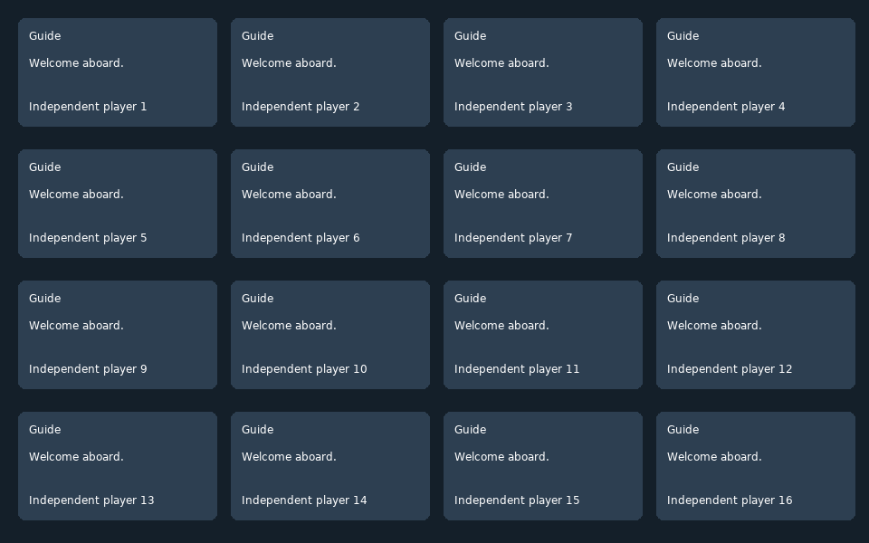

# Dialogue M0: compatibility and baseline

This directory records the pre-localization dialogue contract and provides a
small reproducible baseline. It is a contributor workload, not a new profiler or
an example of the final showcase UI.

- [Contract decisions and integration audit](CONTRACTS.md)
- `fixture/`: preserved version-one scripts, ordinary imported Tua type probes and
  a headless compatibility host. Negative probes live outside its source root.
- `ownership.lua`: mutable input/snapshot isolation and player lifecycle oracle.
- `runtime.lua`: warmed CPU batches and separate GC-stopped allocation estimates.
- `love.lua`: original synthetic 16-panel renderer and the same runtime oracle.
- `editor.js`: actual LSP requests using the repository's existing client/stats.
- `run.py`: builds an isolated fixture with the selected compiler, checks runtime
  identity, runs available hosts, and records provenance/results.

## Run

From the repository root, choose a new output directory:

```sh
python3 benchmarks/dialogue/run.py --tua target/release/tua --output /tmp/dialogue-baseline-new
cargo test -p tua-cli --test dialogue_contracts
```

The runner needs Lua, Node and LÖVE for all workloads. It reports unavailable
hosts instead of claiming they passed. `--love` selects another LÖVE executable.
It never uses the zombie game or its assets. Native windows are expected; the
runner takes one screenshot for each JIT mode and exits automatically.

The selected compiler must emit the current bundled dialogue runtime byte for
byte; otherwise the runner stops rather than recording a stale-runtime baseline.
The compiler revision/hash and source/fixture/harness revisions are recorded
separately because a test harness can change without a runtime change.

## Measurement rules

CPU batches use `os.clock`, with GC running and 200 warmup operations per workload.
Seven trials alternate workload order. Each update/snapshot trial has 2,000
operations; each complete-session trial has 500. Median/p95 describe **batch
averages per operation**, not individual frame latency. Outcome assertions are
part of the timed workload. No runtime profiler is enabled.

Allocation estimates are separate seven-by-200-operation runs with GC stopped.
They report Lua heap growth per operation and the retained batch delta after full
collection. These are allocation proxies; they exclude C/GPU allocations and can
include allocator/JIT noise. Never label net heap growth with GC running as total
allocated memory.

Native runs use 60 warmup frames and 180 measured callbacks at fixed 1/60 simulated
time, with 16 independent players and owned snapshots. Update and draw CPU times
are separate; they exclude GPU completion, presentation and full frame duration.
The rendering fixture displays full text and uses the default LÖVE font; it does
not benchmark portrait loading, shaping, the zombie renderer or future text effects.

Editor runs use five fresh server processes. Each records its first completion
after opening a script, then five completion warmups, 20 warm completion/hover/
definition rounds and ten unsaved character-import changes. Response content is
asserted after every edit. First-completion timings exclude process initialization
but include work triggered by document opening. These are client-clock protocol
round trips, not physical key-to-widget latency. No installed VS Code UI test is
claimed by this workload.

## Recorded baseline

See [results/baseline.json](results/baseline.json) for exact versions, hashes,
counts, raw editor samples, diagnostics, min/max and percentile summaries.
The reference compiler is clean `46a70a89` (0.11.0 development), release build for
Apple Silicon; M0 changes no runtime implementation. Standalone LuaJIT was not
available, so native LÖVE covers LuaJIT with compilation off and on.

Tables below are generated from that capture. They are a baseline for matching
future comparisons, not timing assertions or demonstrated optimizations.

| Host | Operation | Median CPU µs/op | p95 batch-average µs/op | Lua KiB/op (GC stopped) | Retained KiB/batch, median |
| --- | --- | ---: | ---: | ---: | ---: |
| lua | idle_update | 0.607 | 0.624 | 0.141 | 0.062 |
| lua | snapshot | 3.047 | 3.195 | 1.111 | 0.062 |
| lua | full_session | 11.884 | 12.692 | 4.204 | 0.062 |
| love-jit-off | idle_update | 0.308 | 0.338 | 0.164 | 0.000 |
| love-jit-off | snapshot | 1.093 | 1.112 | 1.148 | 0.000 |
| love-jit-off | full_session | 5.708 | 6.038 | 4.531 | 0.000 |
| love-jit-on | idle_update | 0.239 | 0.305 | 0.164 | 0.000 |
| love-jit-on | snapshot | 0.701 | 0.745 | 0.898 | 0.000 |
| love-jit-on | full_session | 3.020 | 3.350 | 4.094 | 0.000 |

| Rendered host | Callback (16 players/panels) | Median CPU ms | p95 CPU ms |
| --- | --- | ---: | ---: |
| love-jit-off | rendered_16_players_update | 0.027 | 0.094 |
| love-jit-off | rendered_16_panels_draw | 0.090 | 0.112 |
| love-jit-on | rendered_16_players_update | 0.020 | 0.094 |
| love-jit-on | rendered_16_panels_draw | 0.088 | 0.118 |

| Editor request | Samples | Median ms | p95 ms |
| --- | ---: | ---: | ---: |
| first_completion_after_open | 5 | 78.361 | 89.313 |
| warm_completion | 100 | 0.201 | 0.246 |
| warm_hover | 100 | 0.179 | 0.219 |
| warm_definition | 100 | 0.066 | 0.108 |
| completion_after_unsaved_import_edit | 50 | 11.160 | 12.918 |

| Imported-type probe | Observed behavior |
| --- | --- |
| direct-event-payload | Rejected with TL1003, as intended |
| known-field-type | Rejected with TL1003, as intended |
| nested-event-payload | Accepted: validation gap to account for |
| readonly-write | Rejected with TL1003, as intended |
| unknown-context-field | Accepted: validation gap to account for |

The directly exported signal bus rejects the wrong payload; nesting that bus in
the re-exported record loses this validation in the probe. Keep both cases when
evaluating M4. No production workaround or compiler fix is introduced by M0.



## Validation scope

The native compatibility/ownership oracles run in both JIT modes before rendering.
Screenshots in `results/` show the reference renderer that was inspected.
The CLI regression exercises positive/negative typing, actual emitted Lua, helper
omission and runtime replacement. The separate probe report records permissive
cases for later M2/M4 work rather than making their continued permissiveness a
regression-test requirement.

Run the owning dialogue/parser/editor tests when extending the feature. Full
`make verify` remains required for later cross-cutting compiler/runtime changes;
this M0 fixture/decision work does not change production semantics.

### M0 verification result

- Six CLI integration regressions pass: five existing dialogue asset tests and
  the new M0 fixture test, run serially for isolated temporary project ownership.
- Eighteen focused core dialogue tests, all seven emitted-dialogue tests and four
  focused LSP dialogue tests pass.
- Workspace Clippy (`--all-targets -- -D warnings`), Rust formatting, explicit
  Tua/Lua fixture formatting, Node/Python syntax checks and JSON checks pass.
- A clean strict documentation build passes. A prior incremental site build
  reported stale missing-page links; cleaning its cache removed those warnings.
- Lua 5.4.8 and native LÖVE 11.5.0 / LuaJIT 2.1.1700008891 pass the compatibility
  and ownership checks; both native JIT modes complete 240 rendered frames.
- Captured fixture/harness/runtime hashes match the committed inputs.
  [Artifact checksums](results/artifacts.json) identify the captured JSON and images.

The whole `make verify` suite and installed VS Code UI checks were not rerun for
this test/decision-only milestone; no production compiler/runtime behavior changed.
This is not a claim of a full release qualification or a performance improvement.

## M1 follow-up

[M1 delivery and measurements](M1.md) retain these frozen M0 inputs and compare
the implemented localization runtime, including its measured allocation cleanup.
The original results above remain the historical baseline.
