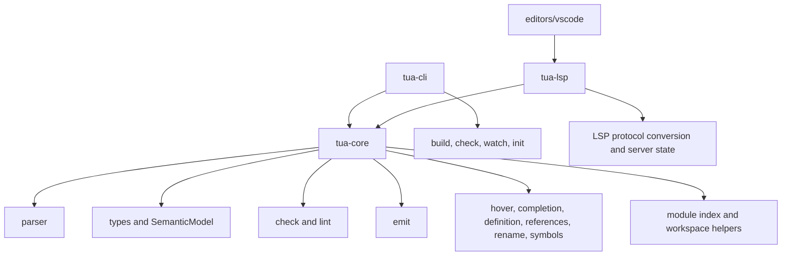

# Architecture

This page maps rust-analyzer's crate architecture to Tua's current structure and
the Phase 12 roadmap. The goal is not to copy rust-analyzer directly. The goal
is to borrow boundaries that make a language tool faster, easier to reason
about, and less likely to grow one-off feature paths.

Reference point: the current rust-analyzer `crates/` tree includes architecture
families such as `base-db`, `ide-db`, `vfs`, `vfs-notify`, `project-model`,
`parser`, `syntax`, `hir`, `hir-def`, `hir-expand`, `hir-ty`, `ide`,
`ide-assists`, `ide-completion`, `ide-diagnostics`, `test-fixture`,
`test-utils`, and `profile`.

## Current Tua Shape

The current implementation already has a broad feature surface: diagnostics,
hover, completion, signature help, go to definition, references, rename,
document symbols, workspace symbols, document links, code actions, call
hierarchy, inlay hints, semantic tokens, LuaDoc support, LOVE helpers, and
watched-file updates.

The main architectural gap is not missing editor surface. It is that too much
semantic knowledge still lives in helper APIs and feature-specific paths instead
of a single dependency-tracked analysis model.

## Gap Matrix

| rust-analyzer area | Purpose in rust-analyzer | Tua equivalent today | Status | Roadmap |
| --- | --- | --- | --- | --- |
| `base-db` | Stores stable inputs, file IDs, crate graph, and query base data. | Partial LSP analysis snapshot plus config/source helpers. | Partial | 53, 56 |
| `vfs`, `vfs-notify` | Tracks files, changes, paths, and file watching. | LSP open-document state, watched-file handling, CLI source discovery. | Partial | 54 |
| `project-model` | Models Cargo workspaces, packages, targets, cfg, and sysroot. | `tua.toml`, workspace folders, source/out roots, require lookup helpers. | Partial | 55 |
| `parser` | Parses token streams into syntax. | `tua-core::parser`, full_moon-based Lua parsing, Tua syntax extraction. | Existing | 57 |
| `syntax` | Typed syntax tree and syntax utilities. | Parser model plus source spans; no dedicated syntax crate/model boundary. | Partial | 57 |
| `hir`, `hir-def`, `hir-expand` | Lowers syntax into semantic definitions and handles expansion. | Parsed source model, module index, type environment, symbol helpers. | Partial | 58, 59 |
| `hir-ty` | Type inference and type checking over HIR. | `types`, `check`, `SemanticModel`, Lua/LOVE builtin catalogs. | Partial | 61, 62 |
| `ide-db` | Shared IDE database and symbol indexes. | Workspace symbol scans and LSP analysis helpers. | Partial | 64, 65 |
| `ide` | User-facing IDE queries. | Core modules for hover, completion, definition, references, rename, symbols, etc. | Existing | 65 |
| `ide-completion` | Completion-specific query and rendering logic. | `completion` module and LSP completion conversion. | Existing | 64, 65 |
| `ide-diagnostics` | Diagnostic query layer. | Parser/check/lint/project diagnostics called by CLI and LSP. | Partial | 63 |
| `ide-assists` | Code actions and refactor assists. | `code_action` module with conservative quick fixes. | Partial | 66 |
| `ide-ssr` | Structural search and replace. | No equivalent planned for v1. | Out of scope | None |
| `test-fixture`, `test-utils` | Fixture DSLs and shared test support. | Many focused tests with ad hoc fixtures and temp projects. | Partial | 52 |
| `profile` | Performance tracing and benchmark support. | No dedicated profiling layer. | Missing | 69 |
| `proc-macro-*`, `mbe`, `tt` | Rust macro expansion infrastructure. | No equivalent; Tua plugins must not become arbitrary macro expansion. | Out of scope | None |
| `load-cargo`, `toolchain` | Rust toolchain and Cargo loading. | No equivalent; Tua project model stays Lua/LOVE-focused. | Out of scope | None |

## Planned Architecture Path

Phase 12 should land in this order:

1. Add fixture DSL support so architecture changes can be tested clearly.
2. Introduce `AnalysisHost` and immutable `AnalysisSnapshot`.
3. Add VFS/open-file overlays and a project model.
4. Add dependency-tracked query caching.
5. Split parser output from the semantic source model.
6. Lower files into HIR-like modules with stable IDs.
7. Build require graphs, scope maps, project-aware type data, and symbol indexes.
8. Route diagnostics and IDE features through the snapshot.
9. Move code actions and call hierarchy onto the shared model.
10. Add selection/folding ranges, profiling, and final architecture docs.

## Non-Goals

- Do not create a Rust clone. Tua targets Lua 5.1/LuaJIT/LOVE projects.
- Do not add a macro system equivalent to Rust macros.
- Do not run project code to discover symbols or assets.
- Do not make plugin support a back door for arbitrary expression rewriting.
- Do not replace readable Lua output with optimized or minified compiler output.
- Do not move everything into separate crates until the boundary has earned its
  cost.

## Commit Mapping

| Roadmap item | Architecture gap |
| --- | --- |
| 51 | This matrix and architecture gap documentation. |
| 52 | Test fixture and project fixture foundation. |
| 53 | Analysis host/snapshot boundary. |
| 54 | VFS and open-document overlays. |
| 55 | Project model for roots, targets, config, and require paths. |
| 56 | Dependency-tracked query cache. |
| 57 | Syntax tree versus semantic source model split. |
| 58 | HIR-like semantic module lowering. |
| 59 | Require graph and export index. |
| 60 | Lexical scope maps. |
| 61 | Project-aware type database. |
| 62 | Flow-sensitive narrowing. |
| 63 | Incremental diagnostics pipeline. |
| 64 | Shared symbol index. |
| 65 | LSP feature routing through `AnalysisSnapshot`. |
| 66 | Code action framework over snapshot data. |
| 67 | Selection and folding ranges. |
| 68 | Call hierarchy over require graph and symbols. |
| 69 | Analysis tracing and benchmarks. |
| 70 | Final contributor architecture guide after implementation. |
