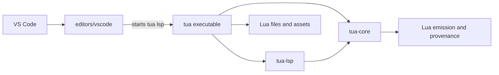
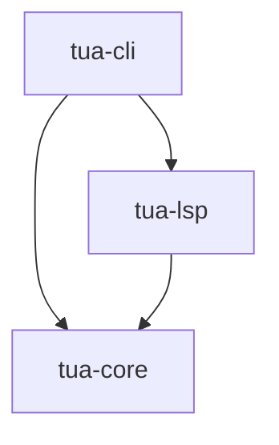
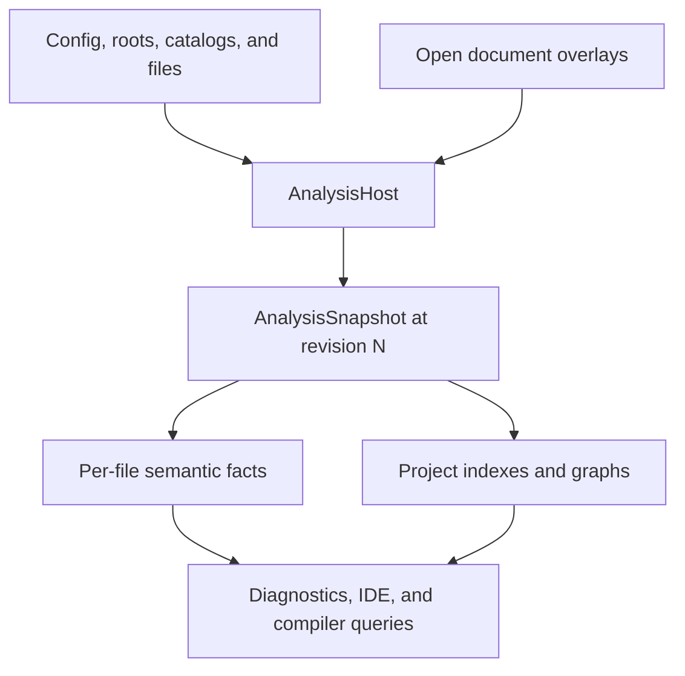
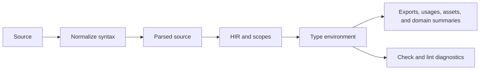
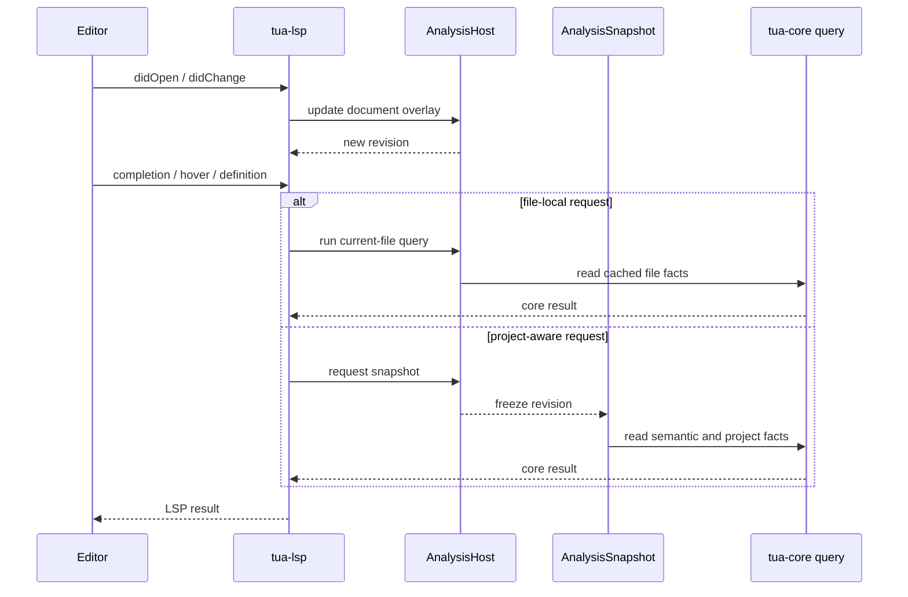
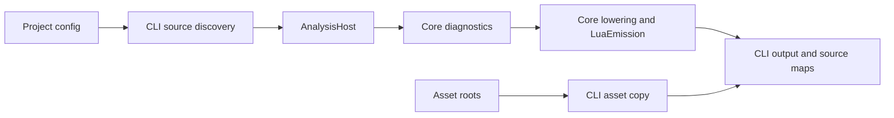

# Architecture

Tua is organized around one reusable language engine. The CLI and language
server provide different transports and lifecycles, but both read the same
project model, semantic data, diagnostics, and generated Lua from `tua-core`.

This page documents the current implementation boundaries for contributors.
For language behavior, see [Language](language.md) and
[Typing In Tua](typing.md).

!!! warning "Keep semantics in shared analysis"
    A CLI command, LSP handler, or VS Code feature must not recreate parser,
    type, module, or domain knowledge. Add the fact or query to `tua-core`, then
    adapt its result at the edge.

## At A Glance



The implementation follows four rules:

1. **One semantic authority.** Parsing, types, module resolution, diagnostics,
   and editor facts live in `tua-core`.
2. **Revisioned queries.** Mutable project inputs belong to `AnalysisHost`;
   requests read immutable `AnalysisSnapshot` values.
3. **Side effects stay at the edges.** The CLI owns disk output and watch
   events. The LSP owns JSON-RPC and protocol conversion. The extension owns
   VS Code integration.
4. **Dynamic Lua stays conservative.** Static analysis reports what source and
   configured catalogs establish. It does not execute project code or invent
   identities for dynamic values.

Shader compilation follows the same boundary: `tua-core` owns the request
protocol and diagnostics, the CLI supplies a bounded LÖVE process adapter, and
the LSP owns idle scheduling and stale-result rejection. The executable injects
the adapter through `run_stdio_with_shader_validator`; core analysis never
starts a process. Editor shader overlays reuse the shared asset inventory.
Uniform metadata lives in the asset index as immutable shared models, reused
by the checker and editor queries. Disk refreshes compare shader content and
reuse unchanged models; synchronized overlays replace only the current
snapshot's model. Completion, hover, and definition do not read shader files.
Models retain GLSL types, array bounds, original declaration spans, entrypoints,
and read status. Shader-local resolution uses the shared lexical resolver.

## Repository Boundaries

| Path | Owns | Does not own |
| --- | --- | --- |
| `crates/tua-core` | Source models, parser, HIR, scopes, types, checking, linting, diagnostics, project model, VFS, module graph, IDE queries, domain analysis, lowering, and Lua emission | Filesystem watching, JSON-RPC, terminal presentation, or editor UI |
| `crates/tua-cli` | Arguments, command orchestration, project discovery, builds, output files, asset copying, watch mode, source maps, traceback mapping, and terminal diagnostics | Independent language or editor semantics |
| `crates/tua-lsp` | Stdio transport, scheduling, cancellation, document synchronization, settings, capability advertising, URI and position conversion, and LSP request routing | Parsing or inferring source in handlers |
| `editors/vscode` | Language registration, grammar, settings, tasks, extension activation, server discovery, custom views, packaging, and extension tests | Type inference or project analysis in TypeScript |

The Rust dependency direction is intentionally small:



`tua-core` must remain usable without an editor or command-line process. This
keeps semantic tests fast and lets future integrations reuse the same engine.

## Core Analysis Model



### Inputs And Identity

`ProjectModel` interprets workspace configuration: source and output roots,
declaration-only type-library roots and module-prefix mappings, asset roots,
ignored paths, file associations, and module paths. `Vfs` stores the
corresponding analysis files. An open document overlay takes precedence over
the disk copy until the document closes, so editor requests always analyze the
text the user can see.

Each path's effective visible source and source kind has a monotonic VFS
version. A VFS lineage shares its allocator across worker and ephemeral host
clones, while snapshots freeze the version they observed. Identical updates
retain the version; changing the visible overlay or disk value receives a new
one. Do not detach this allocator when resetting clone-local analysis caches.

Paths are normalized before they become analysis identities. Module, symbol,
asset, and reverse-reference indexes should use those normalized identities
instead of retaining ad hoc path strings.

`AnalysisHost` owns mutable inputs and the current revision. Updating a file,
document overlay, project option, or builtin catalog invalidates the affected
cached products and advances that revision.

`AnalysisSnapshot` is an immutable view of one revision. It combines cached
per-file facts with project-wide indexes and exposes stable query APIs to the
CLI and LSP.

Per-file analysis records are immutable and shared by reference between the
host cache and snapshot copies. Snapshot clones also share their immutable
project-wide indexes. Updating a file creates new records and indexes; in-flight
requests retain the previous revision without copying its AST and semantic data.
Identical builtin alias and local catalogs also share storage across files;
project-specific additions use copy-on-write storage.

Module-path completion follows the same boundary. Workspace indexing and file
events provide normalized module paths and workspace-scoped require roots to
`AnalysisHost`; each snapshot combines that inventory with live VFS overlays
in a `ModulePathIndex`. `require(...)` and `import(...)` completion query that
index without walking the live filesystem, so output roots, associated Lua
files, unsaved documents, and the rest of the query observe one consistent
revision. Normal `require(...)` and non-relative static imports consume the same
ordered workspace module map, while child-relative imports use paths near the
current file. Require-root order remains project-model order so source modules
keep precedence over duplicate generated modules. The index has its own
revision and is reused across source-content edits until its roots, separator,
or path inventory changes. Configured roots are indexed recursively; a
configless workspace indexes direct siblings at its root and around opened or
watched files instead of recursively walking an unbounded workspace folder.
Closing a document that has no file on disk removes its VFS entry and module
path, preventing unsaved modules from leaking into later snapshots.

Declaration libraries enter the VFS as Lua analysis inputs, but remain outside
source roots, require search roots, asset copying, and emission. During snapshot
construction, `---@meta` identities are mapped to configured runtime
`require(...)` names and added as declaration overlays in the shared module
graph. The type database and editor queries consume that same resolved module
instead of maintaining a separate external-library path.

| Use | API |
| --- | --- |
| Update configuration, roots, catalogs, disk files, or open documents | `AnalysisHost` |
| Serve a fast query against the current file during typing | Current-file `AnalysisHost` query |
| Resolve modules, symbols, references, assets, or project types | `AnalysisSnapshot` query |
| Keep several related reads internally consistent | One shared `AnalysisSnapshot` |

!!! tip "Snapshot once per logical operation"
    A handler or command that needs several project facts should take one
    snapshot and reuse it. Taking snapshots between related reads can mix
    revisions and duplicate project work.

### Per-File Products

The per-file pipeline produces reusable semantic data rather than a separate
parse for every feature:



A successfully parsed file has one semantic bundle containing its HIR, scope
map, and base type environment. Other per-file products include module exports
and require edges, symbols, member usages, asset references, and compact
summaries for Signals, ECS, and object pools.

Temporarily invalid text follows the shared recovery path. The lossy parse and
degraded environment are cached for that snapshot so hover, completion, and
other typing features can keep working without polluting the valid semantic
cache.

!!! warning "Do not add feature-specific fallback parsing"
    If an editor feature fails on incomplete source, improve the shared parser
    recovery or degraded semantic facts. A private fallback environment inside
    completion, hover, or an LSP handler will drift from the checker.

### Project Products

Snapshots aggregate per-file summaries into project-aware structures:

- `ModuleGraph` connects imports and exports.
- `ProjectTypeDatabase` resolves exported and cross-file types.
- Symbol and usage indexes support workspace symbols, references, rename,
  call hierarchy, and ranking.
- Asset indexes support validation, completion, hover metadata, and rename.
- Signal, ECS, and object-pool graphs support diagnostics and structured
  inspector views.

Project indexes retain compact facts rather than duplicating all project source
text. Reverse relationships are derived from indexed files and reused by
navigation queries.

### Query Surface

The public analysis API is the integration boundary. A minimal core consumer
looks like this:

```rust
use std::path::PathBuf;
use tua_core::{AnalysisHost, AnalysisSourceKind, SourcePosition};

let path = PathBuf::from("src/main.tua");
let mut host = AnalysisHost::new();
host.set_source_roots([PathBuf::from("src")]);
host.set_file_with_kind(
    path.clone(),
    "local score: number = 0\n",
    AnalysisSourceKind::Tua,
);

let snapshot = host.snapshot();
let hover = snapshot.hover(&path, SourcePosition { line: 1, column: 8 });
```

Snapshot queries cover diagnostics, completion, hover, signature help,
inlay hints, semantic tokens, symbols, links, code actions, navigation,
references, rename, call hierarchy, module graphs, assets, type explanations,
and domain inspectors. Prefer extending that surface over exposing internal
parser or cache types to another crate.

### Query Contexts And Semantic Domains

Recursive semantic work carries an explicit query context. Type inference,
checking, and completion should construct that context once and pass it through
the entire operation instead of repeatedly threading parsed source, type
environments, local bindings, configuration, and ranking inputs through long
procedural argument lists. Besides keeping entry points small, one context
ensures every nested walk observes the same semantic inputs.

Built-in language domains are registered through the internal
`BuiltinDomainRegistry`. The registry owns their stable ordering and shared
hooks for type names, aliases, constructors, typed members, inferred method
returns, and diagnostics. Completion-only presentation hooks live behind the
`CompletionDomainRegistry`, which converts domain results into protocol-neutral
completion items. Adding a built-in domain should extend these registries and
the domain's own module instead of adding another parallel chain to the type
environment, checker, and completion dispatcher.

These are closed compile-time integration points, not a runtime plugin API.
Third-party Lua libraries continue to enter through declaration-only type
libraries and normal module resolution; semantic queries never load executable
plugins or fetch code from the network.

## Editor Request Flow



The server separates transport and scheduling from language work. Interactive
requests use the responsive worker path, while indexing and diagnostics can be
debounced or warmed in the background. Current-file diagnostics can appear
quickly during typing; project-aware diagnostics follow when the relevant
snapshot is ready.

Results are associated with document versions and analysis revisions. The
server discards stale work instead of publishing it over newer text. Cancellation
is cooperative at the scheduling boundary: a core query that already started
may finish, but its stale result must not be applied.

LSP handlers should have a narrow shape:

1. Convert URI, position, and settings into core inputs.
2. Select a current-file query or take one snapshot.
3. Call a typed `tua-core` query.
4. Convert the core result into an LSP response.

The server classifies request and notification method strings once through its
typed protocol registry before dispatch. Handlers match those request kinds;
they do not maintain independent string-based routing or domain semantics.

If a handler starts parsing text, resolving a module, or constructing a type,
the behavior belongs lower in the stack.

## Build And Watch Flow



The build path is split by responsibility:

1. The CLI loads configuration, discovers project files, and updates one
   `AnalysisHost`.
2. Core analysis checks the same sources and dependencies used by editor
   features.
3. Core lowering returns `LuaEmission`: generated Lua plus source provenance.
4. The CLI writes Lua, helper runtimes that are actually required, assets, Tua
   provenance maps, and standard debugger-compatible source maps.
5. Runtime traceback mapping consumes compiler provenance instead of guessing
   line offsets from generated text.

The VS Code LOVE debug command consumes those build artifacts rather than
adding debugger semantics to the compiler or language server. It launches an
external Lua debug adapter against generated Lua and lets the adapter resolve
Tua breakpoints and stack frames through the standard maps.

Watch mode keeps a long-lived host while project configuration remains stable.
File events update the VFS, invalidate affected importers, and rebuild from the
new snapshot. Filesystem watching and output suppression stay in `tua-cli`;
semantic invalidation stays in `tua-core`.

## Semantic Ownership

Use this map when deciding where a change belongs:

| Concern | Primary modules |
| --- | --- |
| Surface syntax, normalization, comments, and spans | `parser`, parser source models |
| Declarations, expressions, scopes, and semantic identity | `hir`, `scope`, `semantic_index` |
| Type representation, inference, assignability, and project exports | `types`, `type_database` |
| User-facing errors, warnings, and inline ignores | `check`, `diagnostic`, `inline_ignore` |
| Canonical source layout | `formatter` |
| Code-quality and standard lint rules | `linter` |
| Roots, files, module paths, imports, and project identity | `project_model`, `vfs`, `module_graph`, `module_index`, `module_link` |
| Revisioned inputs, cached products, recovery, and public queries | `analysis` |
| Completion, hover, navigation, symbols, refactors, and editor data | Corresponding `tua-core` feature module, exposed through `analysis` |
| Lowering, helper selection, generated Lua, and provenance | `emit` |
| LOVE, assets, sprites, Signals, stores, input, ECS, pools, and vectors | Shared domain modules and analysis queries |

Domain support follows the same architecture as language support. LOVE and Lua
catalogs contribute typed facts; asset and gameplay helpers contribute indexed
summaries; editor features consume those facts through shared queries. Custom
VS Code views render structured results but do not derive them.

## Architecture Invariants

These are review requirements, not future goals:

- Core IDE queries do not read files directly from disk.
- LSP handlers and extension code do not duplicate semantic analysis.
- Diagnostics use the shared diagnostic model and stable Tua codes.
- A snapshot never observes half of a newer revision.
- Invalid-source support uses shared recovery rather than one-off parsers.
- Cross-file features use normalized project identities and indexes.
- Dynamic project code is never executed to answer an editor query.
- Generated output remains portable Lua 5.1-compatible code with source
  provenance.
- Optional helper runtimes are emitted only when lowering requires them.

The explicitly started `tua api --stdio` session exposes these snapshot queries
as read-only newline-delimited JSON-RPC. `tua mcp --stdio` maps twelve tools
onto the same session. Neither starts from LSP, opens a socket, calls a model,
or applies edits. See [External API And MCP](external-api-bridge.md).

Model completion follows the same ownership boundary. Core constructs bounded,
fingerprinted FIM context and validates candidates in an ephemeral cloned
analysis host. Core also classifies local versus function-body completion and
owns the corresponding candidate limits. LSP only converts protocol positions
and versions. The VS Code extension owns loopback Ollama transport and
ghost-text lifecycle, so ordinary compiler completion remains deterministic and
model-independent.

Deterministic inline completion uses a separate host-level query. Core owns
eligibility, source-only statement snippets, current-file recall, ranking, and
parse-only validation. The Phase 1 query reads the current VFS document and may
peek at an exactly matching cached file, but it never constructs a snapshot or
runs project analysis. The LSP supplies configuration, a fixed deadline, and a
cancellation flag, converts protocol ranges, and schedules requests as
non-interactive newest-wins work on a single speculative worker. That lane
keeps at most one queued request per document and replaces it in place, so
cancelled keystroke bursts cannot grow an unbounded queue or occupy the menu
completion workers. The coordinator prepares an owned source query without
parsing, then gives the worker a bounded priority window for returning it. An
already-completed workspace warm-up may wait for that window, but edits,
cancellation, menu completion, and ordinary completed requests do not. VS Code
owns the single debounced inline provider and tries deterministic results before
the optional Ollama path. After its 65 ms debounce, the provider bounds the
local request to 250 ms with a linked cancellation token; timeout is a transient
abstention rather than an Ollama fallback trigger.
Disabled or malformed local requests never enter the speculative queue, and a
panic in candidate generation is contained to that request so the worker can
serve the next keystroke.
The hidden Phase 2 project-wide exact-retrieval experiment uses an immutable,
host-owned corpus that is not part of `AnalysisSnapshot`. Background workers
receive owned source/version inputs and a caller-supplied loaded project model,
then return immutable per-file tables. The coordinator adopts each table only
while its effective VFS version and eligibility generation still match. A
merged base plus a small overlay of replacements and tombstones lets edits
become stale immediately without mutating shared state; request-time queries
read only that corpus, the active VFS source, and effective VFS versions.
Module targets are resolved and declared LÖVE callbacks are collected during
background construction, never by loading a model or reading disk on the
request path. Callback generation remains deferred pending evaluation; the
collected declarations are foundation for later cross-file duplicate
suppression.

The LSP keeps this source disabled unless its internal experimental source flag
is explicitly enabled; the extension does not contribute that setting.
`didChange` only advances the VFS version and moves a per-file deadline; after
300 ms of idle time, the background lane builds at most 16 files per batch.
Base remerges use the same prepare/build/adopt boundary: construction stays on
the worker, while the coordinator accepts the result only if the corpus
identity, VFS lineage, generation, and every input version are still current.
Corpus queue, adoption, memory, cancellation, and remerge counters are
available through `tua/cacheStats` and `tua/health`.
The bounded request path uses the currently tuned policy only after semantic
and current-file sources abstain: comma, operator, and other contexts, at least
six non-whitespace prefix characters, and at least two supporting matches from
a directly required module. Unrelated project, same-directory, and
bundled-corpus evidence are not used. This integration has not passed held-out,
external, or aggregate phase gates and is not a public completion capability.

The Phase 3 statistical experiment reuses the same immutable corpus and
background build/adopt lifecycle rather than creating another index or worker.
It adds bounded token-count tables for Tua files when the statistical source is
explicitly enabled. When project exact retrieval is disabled, statistical-only
builds omit its original-line tables entirely; the corpus then retains token
counts and provenance only. Query-side identifier slots use bounded scope facts
captured by normal analysis warm-up. The scope cache may retain the last
analyzed source for small active Tua files so normalized parser positions can
be mapped back to original coordinates; cold or changed suffixes fall back to
conservative slots instead of preventing forward typing. Each generated token
needs evidence from at least two distinct files at the context order that chose
it, and decoding is bounded by file, byte, candidate, beam, token, deadline,
and cancellation limits before entering the same suffix and parse-delta
validator as exact sources. The extension exposes this source as an explicit
default-off experiment because tuning evidence is too sparse for quality
approval.

The custom and standard inline-completion protocols are adapters over this one
core path. `tua/localInlineCompletion` carries Tua source metadata for the VS
Code extension's local counters; `textDocument/inlineCompletion` returns the
portable LSP shape. Both are routed through the same speculative newest-wins
queue. During initialization, the Tua VS Code extension declares its combined
provider and the server omits `inlineCompletionProvider` for that client;
standalone clients still receive the standard capability.

Developer menu-state replay follows the same boundary. When two explicit
environment variables configure a local capture and deterministic inline
completion is enabled, the extension records normalized edited-document hashes,
dataset-relative paths, UTF-16 positions, document versions, edit delays, menu
state, and the selected completion text/range when present. The relative path
exposes part of the dataset layout, and selected text can retain source-derived
identifiers or literals, so the JSONL is potentially sensitive local evaluation
data even though it omits the document body and absolute URI. The extension
normalizes CRLF to LF before hashing, matching the evaluator's canonical
scenario text. Core generates the evaluator's
known-truth scenario documents and applies a record only when its hash and
position match one exactly. This allows real unsaved edits without storing the
document body while preventing menu state from being applied to a different
document. No production request path
reads a capture file, and no capture is uploaded.

## Change Workflows

### Add Or Change Language Behavior

1. Update parser normalization and source models where syntax changes.
2. Represent declarations and expressions in shared HIR and scope data.
3. Implement type behavior in the shared environment and type database.
4. Add checker diagnostics and lowering from the same semantics.
5. Expose reusable facts through analysis queries for editor features.
6. Add focused parser, checker, emitter, and analysis tests, then update the
   language documentation and examples.

### Add An IDE Or LSP Feature

1. Define a protocol-neutral result type and query in `tua-core`.
2. Reuse semantic files, project indexes, and shared resolvers.
3. Add focused core tests for valid, incomplete, and cross-file source.
4. Add a thin `tua-lsp` conversion and handler with protocol tests.
5. Change `editors/vscode` only when VS Code needs custom UI or configuration.

### Add A Domain Inspector

1. Extract a compact summary while analyzing each file.
2. Aggregate summaries in a revisioned snapshot graph.
3. Expose structured graph data through a core query.
4. Route a custom LSP request only if standard LSP cannot represent it.
5. Keep rendering and interaction in the extension.

### Change Build Or Watch Behavior

Put language lowering and provenance in `tua-core`. Put source discovery,
filesystem events, generated-file writes, asset copying, and terminal reporting
in `tua-cli`. Test invalidation with an existing host rather than rebuilding a
new analysis world for every event.

## Verification

Test at the layer that owns the behavior, then run the integration boundary it
affects:

| Change | Focused verification |
| --- | --- |
| Parser, types, diagnostics, IDE facts, or emission | `cargo test -p tua-core` |
| LSP routing, freshness, protocol conversion, or scheduling | `cargo test -p tua-lsp` |
| CLI commands, builds, source maps, or watch mode | `cargo test -p tua-cli` |
| Real editor and closed-file behavior | `make editor-regression-smoke` |
| Documentation structure and examples | `make docs-build` |
| Main repository checks | `make verify` |

Use the smallest focused test while iterating. Before merging a cross-layer
change, include the relevant integration test and run `make diff-check`.

## Non-Goals

- Tua does not run user code to improve static analysis.
- Tua does not make the VS Code extension a second language engine.
- Tua does not require an LSP process to compile a project.
- Tua does not optimize architecture around giant-workspace machinery before
  measurements justify the complexity.
- Tua does not hide generated output behind an opaque runtime; emitted Lua is a
  readable, debuggable build artifact.

## Related Guides

- [Language](language.md)
- [Typing In Tua](typing.md)
- [Configuration](configuration.md)
- [Lua Interoperability](lua-interop.md)
- [Diagnostics](luahelper-code-matrix.md)
- [External API Bridge](external-api-bridge.md)
