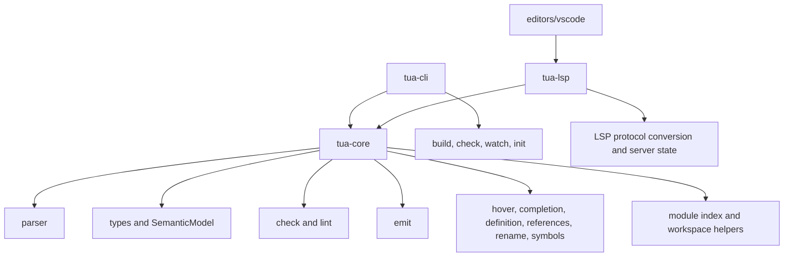

# Architecture

This page maps rust-analyzer's crate architecture to Tua's current structure and
the Phase 12 roadmap. The goal is not to copy rust-analyzer directly. The goal
is to borrow boundaries that make a language tool faster, easier to reason
about, and less likely to grow one-off feature paths.

Reference point: the current rust-analyzer `crates/` tree includes architecture
families such as `base-db`, `ide-db`, `vfs`, `vfs-notify`, `project-model`,
`parser`, `syntax`, `hir`, `hir-def`, `hir-expand`, `hir-ty`, `ide`,
`ide-assists`, `ide-completion`, `ide-diagnostics`, `test-fixture`,
`test-utils`, and `profile`.

## Current Tua Shape



The current implementation already has a broad feature surface: diagnostics,
hover, completion, signature help, go to definition, references, rename,
document symbols, workspace symbols, document links, code actions, call
hierarchy, inlay hints, semantic tokens, LuaDoc support, LOVE helpers, and
watched-file updates.

The main architectural gap is not missing editor surface. It is that too much
semantic knowledge still lives in helper APIs and feature-specific paths instead
of a single dependency-tracked analysis model.

## VFS Overlay Example

The core analysis layer now keeps file identity in a small virtual file system.
Disk files and open editor documents share the same normalized path, so an
unsaved editor buffer can temporarily replace disk content without changing the
file's identity.

```rust
use tua_core::{AnalysisHost, AnalysisSourceKind, SourcePosition};

let path = "game/src/player.tua";
let mut host = AnalysisHost::new();

host.set_source_roots([std::path::PathBuf::from("game/src")]);
host.set_output_roots([std::path::PathBuf::from("game/build")]);
host.set_file_with_kind(
    path,
    "type Player = { hp: number }\nlocal player: Player = { hp = 10 }\n",
    AnalysisSourceKind::Tua,
);

host.open_document_with_kind(
    "game\\src\\player.tua",
    "type Enemy = { hp: number }\nlocal enemy: Enemy = { hp = 5 }\n",
    AnalysisSourceKind::Tua,
);

let snapshot = host.snapshot();

assert!(snapshot.is_open_document("./game/src/player.tua"));
assert!(snapshot
    .hover("game/src/player.tua", SourcePosition { line: 2, column: 14 })
    .unwrap()
    .contents
    .contains("Enemy"));

host.close_document("game/src/player.tua");

let snapshot = host.snapshot();

assert!(!snapshot.is_open_document("game/src/player.tua"));
assert!(snapshot
    .hover("game/src/player.tua", SourcePosition { line: 2, column: 15 })
    .unwrap()
    .contents
    .contains("Player"));
```

The same VFS helpers normalize `file://` URIs with spaces, backslash-separated
paths from Windows-style clients, source roots, build output roots, ignored
paths, and module-relative paths such as `entities.player` or
`entities/player`.

### Project Model Example

Project modeling now sits between raw config parsing and request handlers. A
handler or CLI command should ask the model for roots, targets, and require
paths instead of rebuilding those rules locally.

```rust
use tua_core::{ProjectModel, ProjectModelOptions};

let model = ProjectModel::load_with_options(ProjectModelOptions {
    // Each workspace folder keeps its own tua.toml and roots.
    workspace_folders: vec!["examples/project-model".into()],

    // Editor settings can add associations without changing tua.toml.
    file_associations: vec![],

    ..ProjectModelOptions::default()
})?;

let workspace = model.primary_workspace().unwrap();

// The CLI emits only the primary source root by default, but the model can
// represent multiple roots for future indexing and generated-source workflows.
assert_eq!(workspace.primary_source_root().ends_with("src"), true);

// Require resolution is rooted in the project model, not the current file's
// parent directory.
let main = workspace.primary_source_root().join("main.tua");
assert_eq!(
    model.resolve_required_module(&main, "entities.player").unwrap(),
    workspace.primary_source_root().join("entities/player.tua")
);
```

### Query Cache Example

The analysis cache is intentionally file-granular for now. It is not yet a full
incremental query database, but it gives the LSP and future IDE queries a stable
place to reuse expensive per-file work.

```rust
use tua_core::AnalysisHost;

let mut host = AnalysisHost::new();

host.set_file("src/main.tua", r#"local value: number = 1"#);
host.set_file("src/player.tua", "return { hp = 100 }");

// First snapshot parses files and builds derived per-file query products:
// type environments, diagnostics, module exports, require edges, and symbols.
let first = host.snapshot();
assert!(first.parse("src/main.tua").is_some());

// The second snapshot reuses unchanged files instead of reparsing them.
let _second = host.snapshot();
assert!(host.cache_stats().parse_hits > 0);

// Editing a file invalidates that file. When require edges resolve to
// project-backed files, editing an exported module also invalidates known
// importers through the cached dependency graph. Unrelated files stay reusable.
host.set_file("src/player.tua", "return { hp = 200 }");
let _third = host.snapshot();
assert!(host.cache_stats().invalidations > 0);
```

### Parser Layer Example

Parser output is split into explicit layers while `ParsedSource` remains the
compatibility aggregate used by older emit/type/check code.

```rust
use tua_core::{extract_tua_source_model, normalize_tua_source, parse_raw_tua_source};

let normalized = normalize_tua_source("type Slot = { name?: string }\n");
assert_eq!(normalized.parser_source, "type Slot = { name: string? }\n");

let raw = parse_raw_tua_source("src/slot.tua", normalized.original)?;

// Raw syntax is Lua/Luau-compatible parser output with source spans.
assert!(raw.span.is_some());

// Typed extraction is a separate semantic-source pass over the raw tree.
let typed = extract_tua_source_model(&raw)?;
assert_eq!(typed.type_aliases[0].name, "Slot");
```

### HIR Module Example

The HIR-like layer lowers a parsed file into stable same-file symbols. IDE
features should prefer this model for declarations and same-file symbol identity
before falling back to syntax walks or dynamic Lua behavior.

```rust
use tua_core::{lower_parsed_source, parse_tua_source, HirExportValue, HirSymbolKind};

let parsed = parse_tua_source(
    "src/player.tua",
    r#"
type Player = { hp: number }
local M = {}
return { player = M, dynamic = make_player() }
"#,
)?;

let module = lower_parsed_source(&parsed);

// Symbols have stable ids and origin spans for hover, navigation, edits, and
// semantic highlighting.
let player = module.definition_for_type_alias("Player").unwrap();
assert_eq!(player.kind, HirSymbolKind::TypeAlias);

// Simple exports point at known symbols. Dynamic exports stay unknown instead
// of being guessed.
assert!(matches!(module.exports[0].value, HirExportValue::Symbol(_)));
assert_eq!(module.exports[1].value, HirExportValue::Unknown);
```

### Require Graph Example

The module graph is built from the snapshot's indexed files, HIR modules, and
project roots. It resolves `require(...)` edges, keeps partial results for
missing modules and cycles, and indexes public exports without rereading files
during hover or go-to-definition requests.

```rust
use tua_core::{
    AnalysisHost, AnalysisSourceKind, DiagnosticCode, SourcePosition,
};

let mut host = AnalysisHost::new();

host.set_source_roots(["src".into()]);
host.set_file_with_kind(
    "src/main.tua",
    r#"local Player = require("player")
local player = Player.new()
"#,
    AnalysisSourceKind::Tua,
);
host.set_file_with_kind(
    "src/player.tua",
    r#"local function new()
  return { hp = 100 }
end

return { new = new }
"#,
    AnalysisSourceKind::Tua,
);

let snapshot = host.snapshot();
let graph = snapshot.module_graph();

assert!(graph.export("src/player.tua", "new").is_some());
assert_eq!(graph.diagnostics("src/main.tua"), []);

let definition = snapshot
    .definition("src/main.tua", SourcePosition { line: 2, column: 22 })
    .unwrap();

assert_eq!(definition.path.ends_with("src/player.tua"), true);

host.set_file_with_kind(
    "src/broken.tua",
    r#"local Missing = require("missing")
"#,
    AnalysisSourceKind::Tua,
);

let snapshot = host.snapshot();
assert!(snapshot
    .module_graph()
    .diagnostics("src/broken.tua")
    .iter()
    .any(|diagnostic| diagnostic.code == Some(DiagnosticCode::LINT_MISSING_REQUIRE)));
```

### Scope Map Example

Scope maps are the reusable lexical layer above HIR. They track locals,
parameters, module aliases, globals, table-shape fields, declaration spans, use
spans, shadowing, and unresolved names through one lookup path.

```rust
use tua_core::{
    parse_tua_source, scope_map_parsed_source_with_globals, ScopeDeclarationKind,
    ScopeGlobalKind,
};

let parsed = parse_tua_source(
    "src/main.tua",
    r#"
local Player = require("player")
local value = 1

do
  local value = 2
  print(Player.make(), value, configured)
end
"#,
)?;
let scopes = scope_map_parsed_source_with_globals(&parsed, ["configured"]);

let values = scopes
    .declarations()
    .iter()
    .filter(|declaration| declaration.name == "value")
    .collect::<Vec<_>>();

// Same-name locals are separate symbols, and the inner one records that it
// shadows the outer one.
assert_eq!(values.len(), 2);
assert_eq!(values[1].shadows, Some(values[0].id));

let player = scopes
    .declarations()
    .iter()
    .find(|declaration| declaration.name == "Player")
    .unwrap();

assert_eq!(
    player.kind,
    ScopeDeclarationKind::ModuleAlias {
        module: "player".to_owned()
    }
);
assert_eq!(
    scopes.globals().get("configured").map(|global| global.kind),
    Some(ScopeGlobalKind::Configured)
);
```

### Project Type Database Example

The project type database is built from snapshot-indexed files, cached
per-file type environments, lexical module aliases, and the module graph. It
resolves type aliases, LuaDoc-provided types, exported function signatures, and
module field chains across indexed files without reading from disk during a
request.

```rust
use tua_core::{AnalysisHost, AnalysisSourceKind, TableField, Type};

let mut host = AnalysisHost::new();

host.set_source_roots(["src".into()]);
host.set_file_with_kind(
    "src/main.tua",
    r#"local Types = require("types")
local player: Types.Player = nil
"#,
    AnalysisSourceKind::Tua,
);
host.set_file_with_kind(
    "src/types.tua",
    r#"type Player = { hp: number }

return {}
"#,
    AnalysisSourceKind::Tua,
);

let snapshot = host.snapshot();
let binding = snapshot
    .type_database()
    .resolve_type_name(snapshot.module_graph(), "src/main.tua", "Types.Player")
    .unwrap();

assert_eq!(
    binding.ty,
    Type::table([("hp", TableField::required(Type::number()))])
);
assert!(snapshot.diagnostics("src/main.tua").is_empty());
```

## Gap Matrix

| rust-analyzer area | Purpose in rust-analyzer | Tua equivalent today | Status | Roadmap |
| --- | --- | --- | --- | --- |
| `base-db` | Stores stable inputs, file IDs, crate graph, and query base data. | `AnalysisHost`/`AnalysisSnapshot`, VFS, project model inputs, and a file-granular query cache. | Partial | 53, 56 |
| `vfs`, `vfs-notify` | Tracks files, changes, paths, and file watching. | Core VFS plus LSP watched-file handling and CLI source discovery. | Partial | 54 |
| `project-model` | Models Cargo workspaces, packages, targets, cfg, and sysroot. | Core `ProjectModel` for workspace folders, source/out roots, require roots, file associations, Lua target, and LOVE target. | Existing | 55 |
| `parser` | Parses token streams into syntax. | Raw Lua/Tua parser APIs over full_moon plus normalization for Tua-only syntax. | Existing | 57 |
| `syntax` | Typed syntax tree and syntax utilities. | Raw parsed source, normalized source, and typed source extraction models in `tua-core::parser`. | Partial | 57 |
| `hir`, `hir-def`, `hir-expand` | Lowers syntax into semantic definitions and handles expansion. | `HirModule` with stable same-file symbols, declarations, require bindings, and simple module exports. | Partial | 58 |
| `hir-ty` | Type inference and type checking over HIR. | `types`, `check`, `SemanticModel`, project type database, and Lua/LOVE builtin catalogs. | Partial | 61, 62 |
| `ide-db` | Shared IDE database and symbol indexes. | `AnalysisSnapshot`, file-granular cache, module graph, export index, lexical scope maps, project type database, workspace symbol scans, and LSP analysis helpers. | Partial | 59, 60, 61, 64, 65 |
| `ide` | User-facing IDE queries. | Core modules for hover, completion, definition, references, rename, symbols, etc. | Existing | 65 |
| `ide-completion` | Completion-specific query and rendering logic. | `completion` module and LSP completion conversion. | Existing | 64, 65 |
| `ide-diagnostics` | Diagnostic query layer. | Parser/check/lint/project diagnostics called by CLI and LSP. | Partial | 63 |
| `ide-assists` | Code actions and refactor assists. | `code_action` module with conservative quick fixes. | Partial | 66 |
| `ide-ssr` | Structural search and replace. | No equivalent planned for v1. | Out of scope | None |
| `test-fixture`, `test-utils` | Fixture DSLs and shared test support. | Many focused tests with ad hoc fixtures and temp projects. | Partial | 52 |
| `profile` | Performance tracing and benchmark support. | No dedicated profiling layer. | Missing | 69 |
| `proc-macro-*`, `mbe`, `tt` | Rust macro expansion infrastructure. | No equivalent; Tua plugins must not become arbitrary macro expansion. | Out of scope | None |
| `load-cargo`, `toolchain` | Rust toolchain and Cargo loading. | No equivalent; Tua project model stays Lua/LOVE-focused. | Out of scope | None |

## Planned Architecture Path

Phase 12 should land in this order:

1. Add fixture DSL support so architecture changes can be tested clearly.
2. Introduce `AnalysisHost` and immutable `AnalysisSnapshot`.
3. Add VFS/open-file overlays and a project model.
4. Add dependency-tracked query caching.
5. Split parser output from the semantic source model.
6. Lower files into HIR-like modules with stable IDs.
7. Build require graphs, scope maps, project-aware type data, and symbol indexes.
8. Route diagnostics and IDE features through the snapshot.
9. Move code actions and call hierarchy onto the shared model.
10. Add selection/folding ranges, profiling, and final architecture docs.

## Non-Goals

- Do not create a Rust clone. Tua targets Lua 5.1/LuaJIT/LOVE projects.
- Do not add a macro system equivalent to Rust macros.
- Do not run project code to discover symbols or assets.
- Do not make plugin support a back door for arbitrary expression rewriting.
- Do not replace readable Lua output with optimized or minified compiler output.
- Do not move everything into separate crates until the boundary has earned its
  cost.

## Commit Mapping

| Roadmap item | Architecture gap |
| --- | --- |
| 51 | This matrix and architecture gap documentation. |
| 52 | Test fixture and project fixture foundation. |
| 53 | Analysis host/snapshot boundary. |
| 54 | VFS and open-document overlays. |
| 55 | Project model for roots, targets, config, and require paths. |
| 56 | Dependency-tracked query cache. |
| 57 | Syntax tree versus semantic source model split. |
| 58 | HIR-like semantic module lowering. |
| 59 | Require graph and export index. |
| 60 | Lexical scope maps. |
| 61 | Project-aware type database. |
| 62 | Flow-sensitive narrowing. |
| 63 | Incremental diagnostics pipeline. |
| 64 | Shared symbol index. |
| 65 | LSP feature routing through `AnalysisSnapshot`. |
| 66 | Code action framework over snapshot data. |
| 67 | Selection and folding ranges. |
| 68 | Call hierarchy over require graph and symbols. |
| 69 | Analysis tracing and benchmarks. |
| 70 | Final contributor architecture guide after implementation. |
