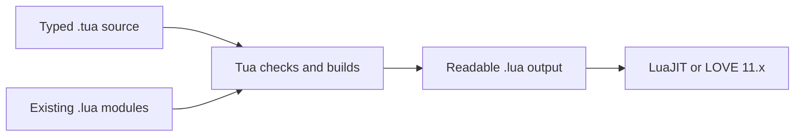

# Tua

**Typed Lua source-to-source tooling for LuaJIT and LOVE projects.**

Tua is a gradually typed Lua language and toolchain. You write familiar Lua
with erased type annotations and a small amount of LuaJIT-safe syntax, get
compiler-backed editor feedback, and build readable Lua 5.1-compatible source
for LuaJIT or LOVE 11.x.

Tua works alongside ordinary `.lua` modules, so an existing project can adopt
`.tua` files gradually instead of changing runtime, framework, or module
system.



!!! tip "Fastest way to try Tua"
    Install the [Tua VS Code extension](installation.md), open a folder, and
    run **Tua: Initialize Tua Project**. Published extension packages include
    the matching language server, so this workflow does not require Rust,
    Cargo, or a separate Tua installation. Continue with the
    [Quickstart](quickstart.md) to build and run the project.

## Start Here

| Your goal | Read this |
| --- | --- |
| Install Tua and choose an editor or CLI setup | [Installation](installation.md) |
| Create and run a first project in VS Code | [Quickstart](quickstart.md) |
| Debug generated LOVE code from `.tua` source | [Debugging](debugging.md) |
| Learn the language by building a small LOVE project | [Learn Tua](learn.md) |
| Add Tua to an existing Lua codebase | [Lua Interoperability](lua-interop.md) and [Configuration](configuration.md) |
| Model data and share type-safe module APIs | [Typing In Tua](typing.md) |
| Generate typed modules from source assets | [Asset Pipelines](asset-pipelines.md) |
| Look up syntax or a specific feature | [Language Guide](language.md) |
| Animate sprites from a sprite sheet | [Sprites And Animation](sprites.md) |
| Move things with vectors, interpolation, and colors | [Vectors And Game Math](vectors.md) |
| Decouple game systems with typed events | [Signals](signals.md) |
| Define typed keyboard, mouse, or gamepad controls | [Input](input.md) |
| Build a managed LÖVE audio graph | [Audio Systems](audio.md) |
| Look up commands, build output, and diagnostics | [CLI](cli.md) and [Diagnostic Codes](luahelper-code-matrix.md) |

## From Tua To Lua

Types improve checking and editor tooling, then disappear from generated code.
Tua conveniences such as compound assignment lower to portable Lua:

<div class="tua-code-compare" markdown="1">
<div class="tua-code-compare__pane" markdown="1">
<p class="tua-code-compare__label">Tua</p>

```tua
type Player = {
  x: number,
  speed: number,
}

local player: Player = {
  x = 80,
  speed = 120,
}

function love.update(dt: number)
  player.x += player.speed * dt
end
```

</div>
<div class="tua-code-compare__pane" markdown="1">
<p class="tua-code-compare__label">Generated Lua</p>

```lua
local player = {
  x = 80,
  speed = 120,
}

function love.update(dt)
  player.x = player.x + player.speed * dt
end
```

</div>
</div>

!!! info "Runtime model"
    Ordinary typed code has no Tua runtime dependency. Opt-in helpers such as
    vectors, sprite sheets, stores, state machines, ECS, and object pools can emit
    their required vendored Lua modules into the build output when used.

## What Tua Gives You

- **Gradual types for Lua.** Add annotations to locals, functions, tables,
  arrays, modules, and classes where static feedback is valuable; leave
  dynamic code as normal Lua or use `any` explicitly.
- **Compiler-backed editing.** The VS Code extension provides diagnostics,
  completion, hover, signature help, navigation, rename, semantic highlighting,
  inlay hints, formatting, generated-Lua inspection, and project explorers.
- **A practical build toolchain.** `tua check`, `tua build`, and `tua watch`
  check `.tua`, emit `.lua`, copy ordinary Lua and assets, and preserve source
  information for traceback mapping and Lua debugger integration.
- **LOVE-aware development.** Built-in LOVE APIs, callbacks, object methods,
  enums, asset paths, sprites, vectors, Signals, state stores, state machines,
  ECS, and object pools receive dedicated checking and editor support.
- **Normal Lua interoperability.** Use `require(...)`, keep `.lua` and `.tua`
  files in one project, and describe Lua module APIs with supported LuaDoc
  annotations.

Tua does not introduce a VM, bytecode format, package manager, or replacement
runtime. Generated files are ordinary Lua and can be inspected, debugged, and
distributed with the rest of the project.

## Find The Right Guide

### Write Tua

- [Learn Tua](learn.md) is the guided tutorial for types, tables, functions,
  modules, classes, and LOVE callbacks.
- [Language](language.md) is the navigable feature guide for exact syntax,
  emitted Lua, and game-focused features.
- [Typing In Tua](typing.md) explains inference, type forms, narrowing,
  exported types, and declaration-only `.d.tua` modules.
- [Lua Interoperability](lua-interop.md) covers mixed `.lua` and `.tua`
  projects, module exports, and LuaDoc annotations.
- [Asset Pipelines](asset-pipelines.md) covers cached external importers,
  generated modules, and structured asset diagnostics.
- [Examples](examples.md) explains the bundled feature tour and LOVE projects.
- [Sprites And Animation](sprites.md), [Vectors And Game Math](vectors.md),
  [Signals](signals.md), [State Stores](stores.md),
  [State Machines](state-machines.md), [Entity Component Systems](ecs.md),
  [Object Pooling](object-pooling.md), and [Audio Systems](audio.md) document
  Tua's opt-in game helpers.

### Configure And Use The Toolchain

- [Configuration](configuration.md) documents every `tua.toml` option.
- [CLI](cli.md) covers project initialization, checking, formatting, linting,
  building, watching, traceback mapping, and the language server command.
- [Language Server](lsp.md) describes editor features, settings, and custom
  project views.
- [Debugging](debugging.md) covers source-mapped LOVE sessions, generated Lua,
  and debugger integration.
- [Diagnostic Codes](luahelper-code-matrix.md) defines every Tua error,
  warning, and hint code.
- [Releases](releases.md) covers downloads, checksums, compatibility, and
  migration policy.

### Contribute Or Investigate

- [Architecture](architecture.md) explains crate ownership, shared analysis,
  request and build flows, and where changes belong.
- [Completion Benchmarks](completion-benchmarks.md) explains how to run and
  interpret completion performance checks.
- [LLM Language Evaluation](llm-language-evaluation.md) provides a 40-task,
  compiler-backed corpus for measuring how reliably models learn Tua.
- [External API And MCP](external-api-bridge.md) documents the shipped,
  read-only stdio JSON-RPC API and MCP adapter for trusted local tools.
- [Contributing](https://github.com/Kyonru/tua-lang/blob/main/CONTRIBUTING.md),
  [Security](https://github.com/Kyonru/tua-lang/blob/main/SECURITY.md), and
  [Support](https://github.com/Kyonru/tua-lang/blob/main/SUPPORT.md) document
  project participation, private vulnerability reporting, and help channels.

Source, issues, and releases are available in the
[Tua GitHub repository](https://github.com/Kyonru/tua-lang).
