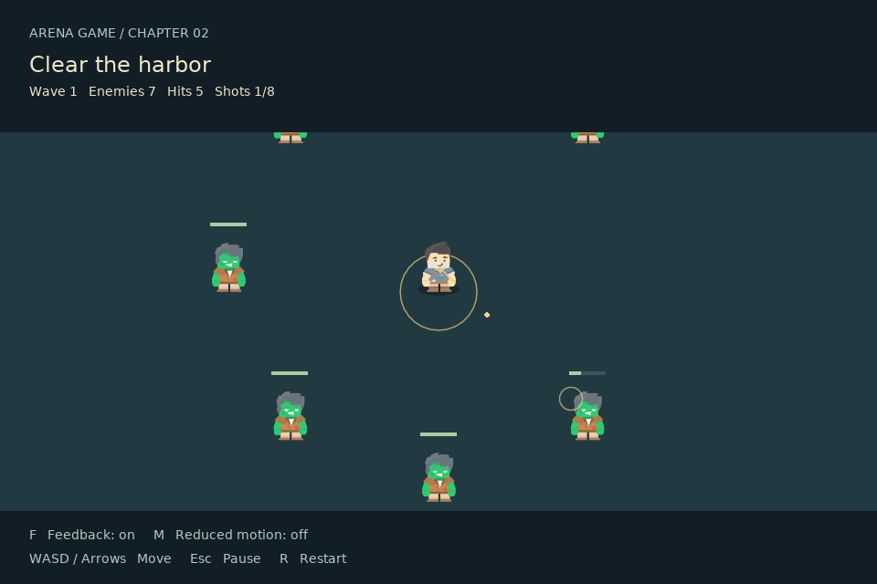

# 2. Combat and waves

Turn chapter 1's movable character into a small shooting game. Aim, fire, damage
enemies, clear a wave and start another. The new systems share the existing pause
and restart boundary; this is the next version of the same project.



## Play the checkpoint

```sh
cd examples/tutorials/arena-game/checkpoints/02-combat-waves
tua check --deny-warnings
tua build
love build
```

Start with **Enter**. Move with **WASD/arrows**, aim with the **mouse**, and hold
**left click or Space** to fire. Enemies take three hits. Press **N** after all
enemies and projectiles are gone to start the next wave. **Escape**, **R** and
**Backspace** retain their pause, restart and title roles from chapter 1.

**F** toggles feedback; **M** removes recoil/shake while keeping hit indicators.
These preferences survive restart. Close the window to quit. The eight enemies
are stationary targets in this chapter; movement and attacks come next.

## Start from chapter 1

Copy your first checkpoint or open the [completed chapter 2 source](https://github.com/Kyonru/tua-lang/tree/main/examples/tutorials/arena-game/checkpoints/02-combat-waves).
The existing `movement.tua` stays unchanged. Add these files and changes:

| File | New responsibility |
| --- | --- |
| `components.tua` | Declare shared position and health component identities |
| `collision.tua` | Compute first contact between a segment and a circle |
| `combat.tua` | Own ECS enemies, pooled bullets, simulation ticks and wave boundaries |
| `feedback.tua` | Own presentation tweens and accessibility preferences |
| `session.tua` | Gate the entire simulation, and reset combat with the player |
| `main.tua` | Convert pointer coordinates, render combat and observe hit/shot counters |

Add the bundled Kenney zombie atlas to `src/assets`. No separate asset download,
framework or import from another checkpoint is needed. The excerpts below explain
edits in those files; the complete checkpoint is authoritative.

## 1. Put enemies in the ECS world

Declare position and health once, then import the same handles everywhere:

```tua
local Position = ECS.component("Position", { x = "number", y = "number" })
local Health = ECS.component("Health", { current = "number", maximum = "number" })
return { Position = Position, Health = Health }
```

Combat owns one world and a query requiring both components. `nextWave()` creates
eight enemies around the harbor center with three health each. It refuses until
both the enemy query and the active-bullet array are empty. Waiting for bullets
prevents leftover shots from damaging a newly spawned wave.

The query is the enemy registry. No copied enemy array owns health. Destroying an
enemy removes all its components. The query counts only entities with every required
component. If you introduce partially constructed enemies, revisit whether its count
still means the whole wave is empty. Spawn complete enemies outside selection callbacks;
do not depend on a newly matching entity being visited in the same iteration. Readers resolve the current position/health or
nil, including after replacement, removal or a world clear. Rendering reads the
same health used by collision, so its bars cannot diverge from damage state.

## 2. Give movement and firing one clock

Chapter 1 applied movement once per update. Here the session delegates to combat,
which advances both player movement and projectiles in **1/120-second ticks**.
Each update contributes elapsed time to an accumulator; whole ticks are processed
and the fractional remainder is retained.

```tua
accumulator += math.min(dt, 0.25)
while accumulator + 0.000000001 >= STEP do
  accumulator = math.max(0, accumulator - STEP)
  tick(x, y, held, aimX, aimY)
end
```

The tiny tolerance avoids missing a boundary through floating-point rounding.
Inside a tick: move the player, decrement the cooldown, attempt a shot if held and
ready, then advance bullets and resolve hits. An attempted shot starts a 15-tick
cooldown: eight shots per simulated second when capacity permits. The initial
attempt is on the first ordinary playing tick, never the start/resume transition.

Input is sampled once per outer update and used by all its ticks. Equal held input
and equal elapsed simulation time produce equal cadence across update rates; this
does not promise identical paths for differently sampled moving pointers. A stall
longer than 250 ms discards the excess wall time and runs at most 30 ticks. That
explicit host policy avoids an unbounded catch-up burst.

## 3. Bound reuse without changing active shots

The pool owns reusable bullet records; combat's array owns active membership.
A bullet stores numeric position, velocity and age plus a hit flag. It keeps no
enemy ID or component reference. A typed factory preserves the payload shape:

```tua
export type Bullet = {
  x: number,
  y: number,
  vx: number,
  vy: number,
  age: number,
  hit: boolean,
}
```

Before acquisition, reject an attempt if eight bullets are active. Count that
skipped slot, start the normal cooldown and leave existing shots alone. On a hit
or 1.2-second expiry, remove the bullet from the active array and release it once.
The pool's reset callback clears **every field**, including velocity and hit state.

This is an explicit capacity policy layered over `objectPool`; the pool itself
is not told a maximum. The same ownership rule applies to cosmetic pools: copy hit
coordinates into an effect, reject excess effects at a chosen bound, and release all
active effects on reset or disable. A dropped cosmetic effect must never undo damage.
The retained [small enemy-wave example](https://github.com/Kyonru/tua-lang/tree/main/examples/tutorials/enemy-wave)
contains a separate, bounded defeat-ring pool if you want to explore that variation. Pooling demonstrates ownership and bounded reuse, not a
measured performance improvement. An aim point at the exact muzzle does not define
a direction, so that attempt produces no projectile and still starts the normal firing cooldown.

## 4. Find the first hit, not just an overlapping endpoint

A fast bullet may cross an enemy between two updates. `collision.contact` solves
segment/circle intersection and returns the first contact fraction from 0 to 1,
or nil. It handles starting inside, zero-length segments and reverse travel.
The circle radius is 25: a 22-pixel enemy body plus the 3-pixel projectile radius.

For each bullet, query live enemies and choose the smallest contact fraction.
Equal fractions choose the smaller entity ID. After iteration finishes, resolve
that entity's live position and health again, subtract one health, and destroy it
at zero. Then release the bullet. One projectile can damage only one enemy.

Structural changes are phase-owned: spawning happens outside collision iteration;
destruction happens after that bullet's query. There are no user callbacks mutating
the world mid-selection. The next bullet performs a fresh query, so a dead enemy
cannot absorb a second hit or award another defeat. If adding external mutations
later, re-evaluate this phase contract rather than retaining old payloads as proof
of liveness.

## 5. Observe results to animate feedback

The host converts the screen pointer through the unshaken camera:

```tua
local mx, my = love.mouse.getPosition()
session.trigger.x, session.trigger.y = camera:toWorld(mx, my)
session.trigger.held = controls:down("fire")
```

Combat never reads feedback settings. After the session advances, the renderer
compares shot and hit counters with their previous values. A shot kicks the barrel
back, a hit shows a short ring, and a restrained two-pixel drawing offset gives
camera feedback. A private `Tween.group()` eases those values back to zero.

The offset is applied only inside drawing, not to the camera's stored position,
input conversion or projectiles. Thus it cannot change a trajectory. Multiple hits
within one outer update are summarized by the most recent impact indicator; damage
is still counted individually. Reduced motion disables recoil and drawing offset;
turning feedback off clears all indicators. No sound is added yet.

## 6. Preserve pause, reset and cleanup

The existing session remains the gate. If it reports no simulation advance, do not
update projectiles, sprites, camera or feedback tweens. Focus return still requires
an explicit resume. Held firing, like held movement, resumes on the next ordinary
playing update. Input polling continues while inactive so transitions consume edges.

Reset clears active bullets, clears the ECS world, creates wave one, resets counters
and resets the camera/animation/tween group. Old entity IDs no longer resolve.
Disposal clears the world and pool and makes later combat updates inert; the host
also releases both sprite images and fonts. Next-wave creation is separate from
restart and never happens automatically.

## Try it

- Aim between enemies and hold fire: missed shots fill the eight slots, then expire.
  Watch the active count fall after releasing fire. No old shot is stolen.
- Toggle F or M while firing at the same target: health loss is unchanged.
- Pause with a bullet in flight, then restart: it cannot survive into the new wave.
- Increase projectile speed: the swept test still catches a crossed target. Do not
  replace it with endpoint distance just because the default speed appears safe.

The camera follows the player, so move to reveal enemies outside the view or behind
the HUD. Smaller windows show less of the world; HUD strips keep labels legible.
There is no collision with scenery or automatic difficulty scaling.

See [ECS](../../ecs.md), [pooling](../../object-pooling.md),
[tweening](../../tweening.md) and [camera](../../camera.md) for full contracts.
Continue with [enemy decisions](enemy-decisions.md) to add movement, attacks and
game over to this same game.
