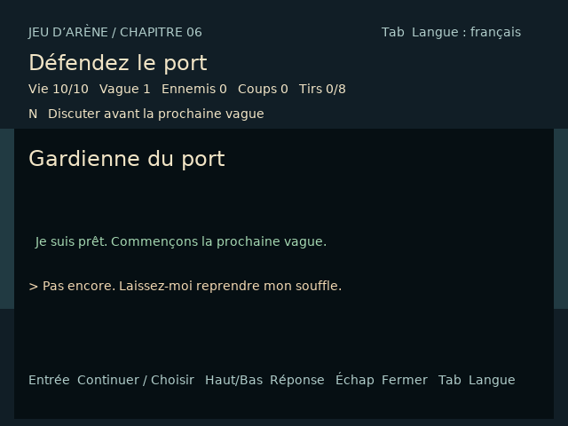

# 6. Conversation and language

After a wave, talk to the harbor keeper before starting the next one. Switch the UI
and conversation between English and French while keeping the same dialogue visit,
reply selection and gameplay state. This chapter adds both systems to the game you
already built, rather than replacing its renderer with a dialogue framework.



## Play the checkpoint

```sh
cd examples/tutorials/arena-game/checkpoints/06-conversation-and-language
tua check --deny-warnings
tua build
love build
```

**Tab** switches language. Clear the wave and let remaining shots expire, then press
**N** to talk. **Enter** advances or chooses; **Up/Down** selects a reply. Readiness
starts the next wave only after its final line completes. Rest or **Escape** closes
without spawning. **R/Backspace** cancel and restart/return to title. Existing audio
and visual settings still work. Movement and firing are blocked during conversation.

## Extend chapter 5

Use the [complete checkpoint](https://github.com/Kyonru/tua-lang/tree/main/examples/tutorials/arena-game/checkpoints/06-conversation-and-language)
or add these files to your chapter 5 project:

| File | Responsibility |
| --- | --- |
| `locales/en.lua`, `locales/fr.lua` | UI, speaker and dialogue translations |
| `cast.tua` | Shared character identity and localized display name |
| `interlude.tdialogue` | Lines, stable reply IDs and branching flow |
| `conversation.tua` | Dialogue player, selection and one-shot host request |
| `main.tua` | Modal input ownership, locale switch and custom drawing |
| `tua.toml` | Enable catalogs with English as the default/fallback locale |

The combat world and enemy behavior do not need dialogue code. The host checks that
the wave and projectile array are empty before opening the interlude.

## 1. Enable catalogs and replace UI literals

Add the opt-in configuration:

```toml
[i18n]
enabled = true
default_locale = "en"
fallback_locale = "en"

[[i18n.catalogs]]
locale = "en"
path = "locales/en.lua"

[[i18n.catalogs]]
locale = "fr"
path = "locales/fr.lua"
```

Paths are relative to `src`. Catalog files return a table rooted at their locale;
keep stable keys separate from displayed prose. The header, for example, uses a
literal catalog key and named interpolation arguments:

```tua
I18n.t("ui.stats", {
  health = combat.state.health,
  wave = combat.state.wave,
  enemies = combat.enemies:count(),
  hits = combat.state.hits,
  shots = #combat.bullets,
})
```

Translate the whole sentence so translators can reorder it. Keep numeric game state
numeric; formatted labels never become simulation input. Tua checks literal keys
against the configured catalogs. The shipped catalogs are complete, so checking with
`--deny-warnings` stays useful.

## 2. Author a shared character and a separate conversation

`cast.tua` provides the character's fallback name and translation key:

```tua
return { Keeper = { name = "Harbor keeper", nameKey = "ui.speaker" } }
```

The dialogue file imports that cast and gives lines/replies stable IDs:

```text
@dialogue 1
@document arena.interlude
@characters Cast "cast"
[start]
// @id ui.hello
Cast.Keeper: You held the harbor. Shall we prepare another wave?
// @id ui.go
-> I am ready. Start the next wave. [target:ready]
// @id ui.rest
-> Not yet. Let me catch my breath. [target:rest]
[ready]
// @id ui.readyLine
Cast.Keeper: Then keep your eyes on the water. (end)
[rest]
// @id ui.restLine
Cast.Keeper: Take your time. The harbor can wait. (end)
```

The IDs map to catalog entries. Choosing a reply passes its authored ID to
`player:choose`; translated text is never used as an identifier. The UI remains
custom LÖVE drawing with wrapped text, a speaker label and a visible selected-row
marker. A portrait is optional, not required by the dialogue player.

## 3. Keep the gameplay effect at one explicit boundary

Create the player with the configured resolver:

```tua
local player = Dialogue.new(document, {
  locale = I18n.getLocale(),
  resolve = I18n.dialogue,
})
```

The controller receives a `startWave` callback. Selecting `ui.go` records intent;
it does not immediately spawn. After the final line completes, the controller closes
and calls that callback once. Subsequent updates see an inactive conversation.
Closing, restarting or returning to title clears the pending request instead.

This is a small host-owned effect, not a durable transaction or persistent dialogue
action. If the callback refuses because the world is not ready, the conversation
still closes; the host does not retry secretly. The existing `combat.nextWave()` gate
remains authoritative.

## 4. Give the modal conversation priority

Poll input and service shader/audio controls as before. When conversation is active,
route Enter and Up/Down to it and return before the session's simulation update.
Do not let the same Enter also start gameplay or the same arrow move the character.
Only choice states change selection; pressing Down during a line cannot create an
invalid initial selection.

The modal path sends an effective paused mode to the audio policy, stopping short
effects and pausing music without replacing the game session. The close/completion
update is consumed too, so held fire cannot immediately leak into a newly spawned
wave. On the next ordinary playing update, held controls resume normally.

Focus loss uses the existing session pause state. When focus returns, an Enter first
resumes that state without advancing the dialogue. A later Enter advances it. Restart
and title commands close the dialogue before the normal session transition runs.

## 5. Refresh presentation without replaying flow

Tab updates the host preference and then the dialogue player's locale:

```tua
I18n.setLocale(I18n.getLocale() == "en" and "fr" or "en")
conversation.locale()
```

The controller calls `player:setLocale(I18n.getLocale())`, not `start()`. The current
visit and generation remain unchanged, as does the selected reply. The renderer reads
a fresh snapshot, so both the speaker name and text update together. The next-wave
intent is neither repeated nor cleared merely by translating the final line.

The locale stays selected across in-game restarts. Persisting that preference across
launches belongs to the next chapter, not this controller.

## 6. Handle missing translations and longer text

Resolution uses the selected locale, its parent and the configured English fallback.
For example `fr-CA` can use `fr`. A missing catalog key for a dialogue line can fall
back to its authored source text. The regression temporarily removes one French
entry before loading catalogs to prove English fallback; production catalogs remain
complete. Invalid literal keys in Tua still report diagnostics rather than becoming
an excuse to ship incomplete catalogs.

The host uses `printf` for conversation text/options and HUD interpolation. The
640×480 native scenario checks French text and longer control hints. The default
font supports the tested Latin text; unsupported arrow glyphs were replaced with
translated words. This does not establish Arabic shaping, CJK coverage, bidirectional
layout or unlimited text fitting. Font selection and layout remain host responsibilities.

## Try it

- Switch locale while a reply is selected: it remains selected and no wave starts.
- Choose readiness, then switch locale on the final line: completion still starts one wave.
- Close that final line instead: the pending request is discarded.
- Extend a French reply and inspect the smallest supported window; adjust layout rather
  than assuming catalog lookup measures or wraps text for you.

See [Dialogue](../../dialogue.md) and [Localization](../../localization.md) for full
contracts. Next: save progress at a between-wave boundary and restore preferences.
