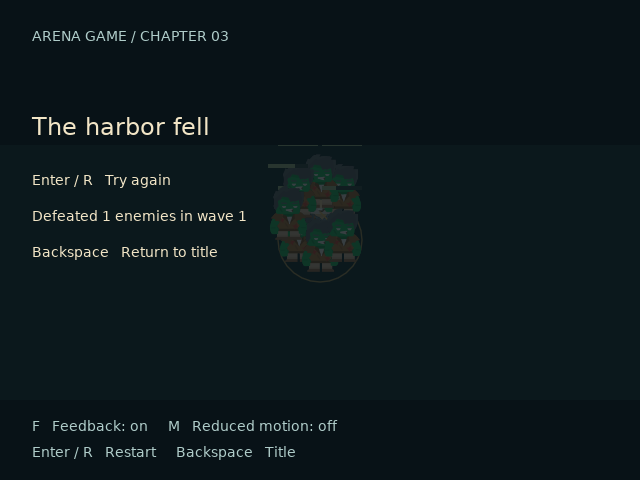

# 3. Enemies that make decisions

The enemies from chapter 2 now notice you, chase and attack. Run away and they return
to patrol; fight back and a lethal hit cancels their attack. Player health connects
the combat simulation to a game-over screen and the existing restart flow.



## Play the checkpoint

```sh
cd examples/tutorials/arena-game/checkpoints/03-enemy-decisions
tua check --deny-warnings
tua build
love build
```

The previous controls remain: **Enter** starts, **WASD/arrows** move, **mouse** aims,
and **left click or Space** fires. **Escape** pauses, **R** restarts, **Backspace**
returns to title, **N** requests another cleared wave, and **F/M** control feedback.
At game over, use **Enter or R** to restart. Escape cannot resume a dead player.

Stand still to see enemies approach and attack. Run away to leave their detection
range. You are faster than they are; there is no pathfinding, enemy separation or
collision with scenery. The simple scene keeps these decisions visible.

## Start from chapter 2

Use [the complete checkpoint](https://github.com/Kyonru/tua-lang/tree/main/examples/tutorials/arena-game/checkpoints/03-enemy-decisions)
or extend your chapter 2 files:

| File | Change |
| --- | --- |
| `brain.tua` — new | Typed context, shared tree, per-enemy runner factory and Brain component |
| `components.tua` | Position remembers its previous coordinates for moving-target collision |
| `combat.tua` | Brain updates, movement, surviving attack intents, health and cancellation |
| `session.tua` | Playing → gameover, plus restart/title from gameover |
| `main.tua` | Enemy walking/idle presentation, player health, game-over controls |

Movement, projectile pooling, feedback ownership and the 120 Hz simulation clock
remain recognizable. Add decision-making to the existing game rather than creating
a second enemy registry.

## 1. Separate decisions from damage

One context holds the values a leaf callback needs: distance/direction to the player,
patrol direction, cooldown, intended velocity, an attack flag and a display mode.
It does not hold a world, entity ID, player health reference or position payload.

Combat fills in the current observations and clears the old intents before each
runner update. A tree leaf chooses what to do; combat applies its velocity and,
later, its attack. This separation prevents callbacks from destroying entities or
changing health while another system is selecting hits.

`brain.tua` exports `Context` and defines a small typed `Runner` record for ECS
storage. The component schema names those local aliases:

```tua
local Brain = ECS.component("Brain", {
  context = "Context",
  runner = "Runner",
  homeX = "number",
})
```

Create the tree once at module scope. `create(x)` makes a fresh context and calls
`tree:instance(context)` for each spawned enemy. The tree definition is shared;
runner progress and cooldown data are not. There is no `any` adapter in this example.

## 2. Use a reactive priority order

The root is a `reactiveSelector` with three branches:

1. At distance ≤32, stop moving and attack when the cooldown reaches zero.
2. Otherwise, at distance ≤300, chase the player at 60 world pixels/second.
3. Otherwise, patrol horizontally at 25 pixels/second, reversing at spawn X ±40.

The first two branches use `reactiveSequence`: a condition followed by an action
returning `"running"`. The condition is revisited every tick. A conventional sequence
can resume a running action without rechecking its earlier condition; that would
let an attack or chase continue after the player left range.

For example, the attack branch inside the shared tree is:

```tua
BehaviorTree.reactiveSequence({
  BehaviorTree.condition(function(actor: Context) return actor.distance <= 32 end),
  BehaviorTree.action(function(actor: Context)
    actor.mode = "attack"
    if actor.cooldown == 0 then
      actor.attack = true
      actor.cooldown = 120
    end
    return "running"
  end),
})
```

Conditions return booleans. An action returns `"success"` when completed,
`"failure"` when it cannot do the job, or `"running"` while it remains active.
Our continuous behaviors return running; the reactive parents decide when to
interrupt them. Entering attack range does not reset the cooldown, so repeatedly
crossing the boundary cannot grant extra attacks.

## 3. Keep decisions inside the fixed tick

Each combat tick performs these phases:

1. Move the player using the existing normalized input.
2. Query live Position + Health + Brain components. Clear intents, compute distance,
   decrement cooldown by one tick, update each runner, and apply intended movement.
3. Attempt the player's shot and resolve all projectile contacts.
4. Query surviving brains and apply their attack intents, clamping player health at zero.
5. If health reached zero, cancel brains and stop remaining catch-up ticks.

The first ready attack is immediate; the next is 120 ticks later. With 120 Hz
simulation that is one simulated second, including the prior chapter's bounded
stall policy. Pause freezes the cooldown with everything else. Enemy damage is one
point, player health starts at ten, and there are no invulnerability frames. Several
enemies can damage you in a tick, but health never becomes negative.

Attack application happens after projectile damage. If an enemy prepares an attack
and then dies to a shot in that tick, it is absent from the surviving-brain query.
It cannot land a final hit after death. This is a deliberate game rule; reversing
those phases would produce different gameplay.

## 4. Sweep relative to moving enemies

An enemy can now cross a projectile between ticks. Store the enemy's old coordinates
before movement and reuse chapter 2's segment/circle helper in relative space:

```tua
local t = Collision.contact(
  bullet.x - position.previousX,
  bullet.y - position.previousY,
  nx - position.x,
  ny - position.y,
  0,
  0,
  25
)
```

The enemy becomes a stationary circle at the origin while the segment represents
relative movement. This handles both objects moving, including a stationary bullet
crossed by an enemy. Select the earliest fraction, retaining the existing entity-ID
tie-break. The cosmetic hit coordinate is still interpolated on the bullet's actual
world-space segment.

This models linear motion inside each fixed tick and circular bodies. It is not a
solver for arbitrary curved movement or rotating shapes. Structural mutations remain
owned by the combat phases, not arbitrary callbacks during a query.

## 5. Cancel before removing or clearing

Use `destroyEnemy(id)` for gameplay removal: read its current brain, cancel the
runner, clear its attack intent, then destroy the ECS entity. The kill path calls
this function rather than `world:destroy` directly.

Reset and disposal first cancel all matching brains, then release bullets and clear
the world. Reset creates fresh brains for wave one; disposal does not spawn a wave.
Old contexts do not receive future updates. Cancellation stops a runner's current
work; it does not make the runner permanently unusable. ECS membership and the host's
phase ownership are what prevent a removed actor from being scheduled again.

If adding new ways to remove enemies, route them through the same cleanup boundary.
Do not replace a live Brain payload or remove required components without cancelling
its old runner first. Position and Health payloads are read live during each phase;
brains retain observations, not obsolete component tables.

## 6. Let the session own game over

Add `defeat` from playing to gameover, and allow restart/leave from gameover. After
combat advances, the session checks health and fires `flow:defeat()` at zero. Future
ordinary updates do nothing in gameover. Enter or R resets the run and consumes its
transition frame, restoring health, player/camera position, enemies and presentation.

Health carries into later waves; only a full restart restores it. Focus return does
not resume paused or defeated play. Walk and idle sprites reflect the brain's mode;
identical enemies share a walking animation clock to keep this chapter small.
Enemy overlap is intentional here—avoidance would be a separate behavior problem.

## Try it

- Reduce detection range from 300 to 150: the initial wave patrols until you approach.
- Increase cooldown from 120 to 240: each enemy attacks half as often while in range.
- Move out of range during attack: the reactive tree switches back to chase or patrol.
- Stand still until game over, then restart: health is ten and no old attack survives.

See [behavior trees](../../behavior-trees.md), [ECS](../../ecs.md) and
[state machines](../../state-machines.md) for full contracts. Continue with [sound](sound.md) to add cues, music and volume controls to this same game.
