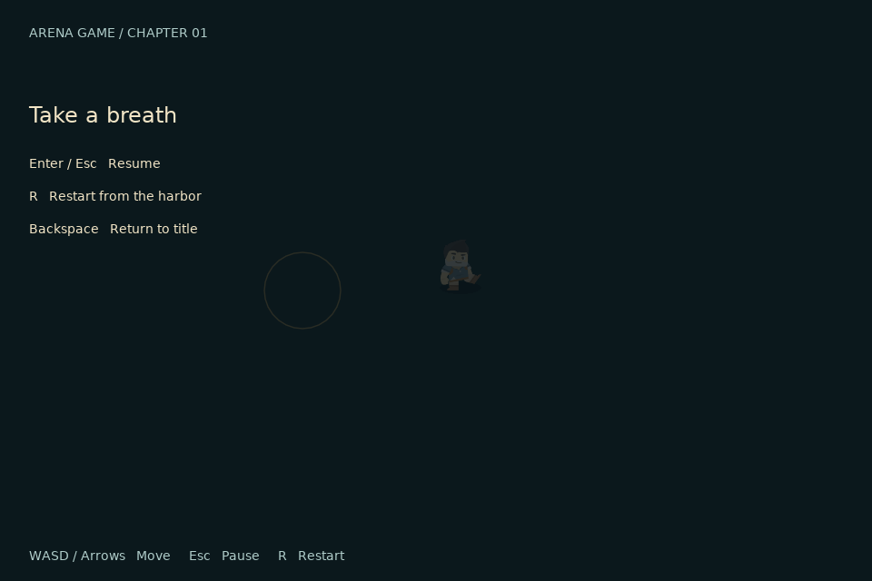

# 1. The playable loop

Start a run, move an animated character and pause without the world advancing behind
the menu. Restart returns the character and camera together. This is the foundation
of the arena game; there is no weapon or enemy yet.



## Play the checkpoint

From a repository checkout:

```sh
cd examples/tutorials/arena-game/checkpoints/01-playable-loop
tua check --deny-warnings
tua build
love build
```

Press **Enter** to start, then **WASD** or **arrows** to move. **Escape** pauses;
**Enter** or **Escape** resumes. **R** restarts, and **Backspace** returns to title.
Close the window to quit. These menus use keyboard shortcuts; the text is not a
set of clickable buttons. Returning to the window after focus loss requires an
explicit resume.

The [complete checkpoint](https://github.com/Kyonru/tua-lang/tree/main/examples/tutorials/arena-game/checkpoints/01-playable-loop)
is the source of truth. The following excerpts explain its construction; they are
not extra entry files. Create a fresh project with the included `tua.toml` and copy
its `src/assets` folder if following along from scratch.

## 1. Separate the run from its presentation

Create three files under `src/`:

| File | Owns |
| --- | --- |
| `movement.tua` | Bounded position updates, given a normalized direction and elapsed time |
| `session.tua` | Player position, title/playing/paused state, focus and restart policy |
| `main.tua` | Input polling, sprite/image, camera, fonts and LÖVE callbacks |

The session never draws or polls keys. This lets later chapters put combat behind
the same pause boundary, and lets tests exercise restart without a window. The host
creates the session once, rather than rebuilding it on every menu transition.

Movement is a small function, not an ECS world yet:

```tua
export type Position = { x: number, y: number }
local function move(player: Position, x: number, y: number, speed: number, dt: number)
  player.x = math.max(32, math.min(1568, player.x + x * speed * dt))
  player.y = math.max(48, math.min(1168, player.y + y * speed * dt))
end
return { move = move }
```

These bounds and the session's 180-pixel-per-second speed are game policy. The input
pair normalizes diagonals before movement, so holding two directions is not faster.
The side-facing Kenney sprite moves freely; there is no gravity or collision solver.

## 2. Give transitions one owner

In `session.tua`, create a state machine with these events:

```tua
local flow = stateMachine({
  initial = "title",
  events = {
    { name = "start", from = "title", to = "playing" },
    { name = "pause", from = "playing", to = "paused" },
    { name = "resume", from = "paused", to = "playing" },
    { name = "restart", from = { "playing", "paused" }, to = "playing" },
    { name = "leave", from = { "playing", "paused" }, to = "title" },
  },
})
```

The session accepts one typed command per update and returns whether simulation
advanced. Title, paused and unfocused updates return `false`. Every transition also
returns `false`, even when its destination is playing. The next ordinary update
moves the character. This stops a start or resume press from also advancing gameplay.

Restart resets position and time and increments `generation`. That number tells the
host to reset its animation, facing and camera too. It is a local restart signal,
not an entity ID or something to save. Leaving to title retains the background;
starting the next run resets it.

## 3. Poll input, then decide whether the world can advance

Create one `input` object in `main.tua`. Its `move` pair combines left/right/up/down;
menu commands use Enter, Escape, R and Backspace. Poll it on **every update**, even
when the session is paused or unfocused, so press edges stay current.

The host picks at most one command, with priority leave → restart → pause → confirm.
It reads movement and calls the session. This is the crucial composition boundary:

```tua
local x, y = controls:get("move")
local advanced = session.update(dt, x, y, command)
if generation ~= session.state.generation then
  generation = session.state.generation
  resetPresentation()
end
if not advanced then return end
```

The code below that guard updates animation and camera. The session already updated
position. A held movement key starts moving on the first ordinary playing update;
the player need not release it after resuming. Focus loss calls `session.focus(false)`
and pauses an active run. Focus return alone does not change paused to playing.

## 4. Animate and follow the same position

Declare the included sprite sheet once: cells are 80×110, idle uses column 0/row 0,
and walking uses columns 0 and 6 of row 1 at 8 FPS. Tua's `spriteSheet` loads the
image and creates animation players; `hero:play` selects idle or walk. Repeatedly
selecting the same animation preserves its frame progress.

The camera follows the updated player, with smoothing 6:

```tua
hero:play((x ~= 0 or y ~= 0) and "walk" or "idle")
hero:update(dt)
camera:follow(player.x, player.y)
camera:update(dt)
```

All four operations belong after the session guard. Pausing freezes the current
animation frame and camera position, not just the character coordinates. Restart
snaps the camera to the reset character before the next draw, so it does not glide
back from the previous run.

## 5. Draw the world, then the menu

Draw the character and world landmarks inside `camera:draw(drawWorld)`. Draw the HUD
and menus afterward, in screen coordinates. Title and pause add a translucent dark
layer over the world and a short, left-aligned action list. No extra scene or UI
framework is needed. The character, ring and gates give camera movement landmarks;
there is no grid background.

The layout adapts the visible-world/compact-action-list arrangement in DICE's
[Battlefront II pause reference](https://interfaceingame.com/screenshots/star-wars-battlefront-ii-pause-menu/),
inspected through Artstyle. It uses original drawing and Kenney assets, not that
screenshot or the game's artwork. The screenshot establishes layout, not animation
or interaction timing. The reference's ownership remains with its rights holders.

Create the image and fonts once; release them in `love.quit`. Nothing owns a listener
or resource per restart, so repeated restarts do not accumulate subscriptions or images.

## Try it

- Hold Right while starting: the character stays still on the transition update,
  then moves. Pause while holding it: character, animation and camera all freeze.
- Change camera smoothing from 6 to 0: following snaps rather than lagging. Restart
  still resets both positions together.
- Change speed in `session.tua`: movement changes without altering the sprite frame
  rate or menu behavior. Keep all world updates behind the same session boundary.

See [input](../../input.md), [sprites](../../sprites.md), [camera](../../camera.md)
and [state machines](../../state-machines.md) for complete APIs. Continue with [combat and waves](combat-waves.md), extending this checkpoint
with weapons and enemies rather than starting an unrelated example.
