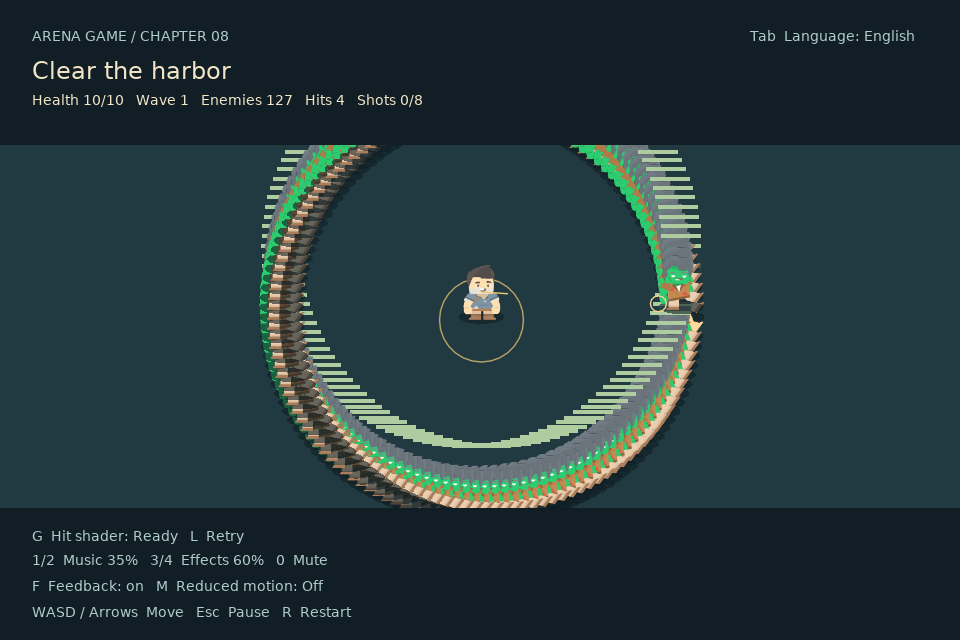

# 8. Profile the game

The arena now combines movement, combat, enemy decisions, audio, shaders, dialogue
and saving. Use that same game to learn where its time goes. This chapter adds a
repeatable workload, reads Tua's existing inspector and profiler, and evaluates one
small change without assuming that less code or fewer queries means higher FPS.



## Play a larger wave

```sh
cd examples/tutorials/arena-game/checkpoints/08-profile-the-game
tua check --deny-warnings
tua build
love build
```

On the title screen, **F6** selects **8, 32 or 128 enemies** for the next wave.
Press Enter to start, or F9 to resume a saved empty boundary and talk before the next
wave. Eight is still the default. This diagnostic count is not saved; the checkpoint
continues to save cleared wave number, health and player preferences.

Return to the title to change the count. Changing it never resizes a live wave.
The large ring is intentionally crowded and much harder to survive. It is a bounded
workload, not a redesigned difficulty curve. The eight-bullet cap remains unchanged.

## 1. Inspect state before interpreting timing

In VS Code, enable **Tua → Runtime Inspector**, then start a new Tua run. Inspect:

- The ECS world: are enemies still alive, with the components you expect?
- The state machine: is the game playing, paused or already over?
- The bullet pool: how many bullets are active, available and retained at peak?

A fast update after death may mean that simulation stopped, not that the code became
faster. Confirm the intended state before comparing captures. This chapter's native
inspector check received a playing session, its 32-enemy world and bullet pool.

Inspector snapshots are bounded. The entity limit is 100, with additional object,
depth and shared-value limits; even a smaller world can produce truncated component
content. Check the truncation marker. Sampled entity counts are not authoritative
whole-world counts. A snapshot also cannot prove that no brief event occurred between
samples. The game's own state and deterministic test assertions remain authoritative.

## 2. Capture a representative slow interval

Run **Tua: Profile LOVE Game** from the Command Palette or use the pulse button in
**Tua LOVE Game**. Choose a capture length, start the larger wave, move and fire.
Use CPU stacks to identify repeated work and optional behavior-tree tracing when you
need call counts. Tracing adds overhead; use it deliberately.

Read the columns separately:

| Measurement | What it tells you |
| --- | --- |
| Update duration | Time inside the update callback |
| Draw duration | Time inside the draw callback; not necessarily completed GPU work |
| Complete frame time | The loop, including sleep and pacing |
| CPU samples | Statistical locations where the VM was observed |
| GC samples | Observed GC activity, not exact GC duration |
| Heap size | Current heap, not cumulative allocated bytes |

The sampled CPU profile for this chapter points mainly to behavior-tree evaluation.
Collision math accounts for few leaf samples in this workload. That does not establish
which system dominates every wave or every machine.

The profiler runs through Tua's temporary launcher. Ordinary builds and packaged games
contain no profiler branch. Use [Debugging](../../debugging.md#capture-love-performance)
for capture navigation, source links, optional flame charts and exports.

## 3. Reproduce the workload without instrumentation

The [checkpoint's measurement runner](https://github.com/Kyonru/tua-lang/tree/main/examples/tutorials/arena-game/checkpoints/08-profile-the-game/tests)
compiles a frozen reference and the current typed source, then runs them in independent
LÖVE processes. It alternates their order instead of timing every baseline first.

The recipe is fixed: seed 71, 8/32/128 enemies, 120 warm-up updates, 600 measured updates,
1/60-second simulation steps and five trials per variant. The player follows the same
short movement/firing pattern in repeated one-second episodes. Reset happens outside
the timed update block. Each measured call must advance two simulation ticks with a
living player; otherwise the harness fails.

This guard matters. An initial two-second fixture let the player die at 128 enemies.
Its idle updates produced misleading near-zero medians. Those trials were discarded,
the episode corrected, and both implementations measured again.

Keep profiling separate from timing. The timing runs leave GC enabled. A separate
60-update probe stops GC to measure allocated bytes, then collects to measure retained
heap change. Reset and warm-up are outside that allocation block. Do not call ordinary
heap growth with GC running an allocation measurement.

The runnable README gives exact commands. These are simulation measurements; rendering,
input polling, audio updates, saves, frame pacing and GPU work are outside the timed
block. GC caused by episode resets can still affect later updates. This workload does
not establish an enemy-count limit for the complete game.

## 4. Evaluate one change without changing attack rules

Before this chapter, each simulation tick queried every enemy once to make decisions
and again after bullet damage to apply attack flags. Most approaching enemies have no
attack to apply. The candidate collects IDs only when a brain actually requests one:

```tua
brain.runner:update(STEP)
if actor.attack then attackers[#attackers + 1] = id end
```

After projectile damage, it reads the live Brain and Health components for those IDs,
applies surviving attacks, clears the flags and empties the array. The array is reused
and reset/disposal clears it. It owns no component payloads and is not a second enemy
registry. The old pass remains in a typed test fixture for comparison.

Keep the phase rules intact:

1. Move and evaluate brains.
2. Resolve projectile hits and destroy defeated enemies.
3. Apply surviving attack intents, then handle player death.

An enemy killed by a bullet cannot attack afterward. Many simultaneous attackers
cannot reduce health below zero. External spawning/replacement belongs between updates;
this sample exposes no callback for arbitrary structural mutation halfway through a
collision/attack phase. Existing live reads still handle normal destruction within it.

A differential regression compares 3,600 mixed updates field by field against the
reference: player state, combat counters, enemies, brain flags/cooldowns and bullets.
It includes dense attacks, deaths, component replacement and repeated resets. Matching
outcomes are required even when a timing result looks favorable.

## 5. Keep an unfavorable result useful

The candidate removes a full query and its callback allocation per simulation tick.
On the tested host, separate allocation probes consistently saved **4.69 KiB across
120 simulation ticks**. Retained-heap deltas were nearly unchanged in those approaching-enemy
probes (one 128-enemy baseline differed by 0.5 KiB). An attacking workload can grow the reused ID array to its bounded peak.

Timing was less decisive. Two valid batches showed small median changes at 128 enemies,
while smaller-wave results varied and sometimes became worse. There was **no reliable
CPU or p95 improvement across batches**. Behavior-tree work still dominated the profile.
The full trial ranges, runtime identities and unfavorable measurements are retained in
[qualification](https://github.com/Kyonru/tua-lang/blob/main/benchmarks/tutorials/arena-game-08.md).

The small change is retained for its measured allocation reduction and simpler work
selection; it is not presented as a frame-rate improvement or a solution to the main
sampled cost. A broader behavior-tree or storage rewrite needs its own evidence and
correctness checks.

## Try it

- Compare 8 and 128 enemies in the inspector, noting snapshot limits.
- Capture a live wave and a paused interval; explain why their update times differ.
- Run the benchmark twice and retain both sets, even if one contradicts your expectation.
- Change the input path or episode length, but keep the active-update assertion.
- Measure the full rendered game separately before deciding whether draw, simulation
  or another system should be the next target.

You have reached the end of the playable series. Return to the [chapter index](index.md)
to revisit a system, or extend the game while keeping its lifecycle and outcome checks.
