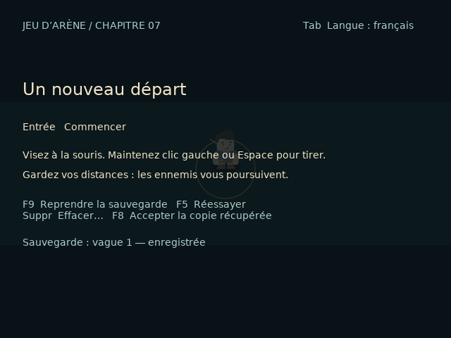
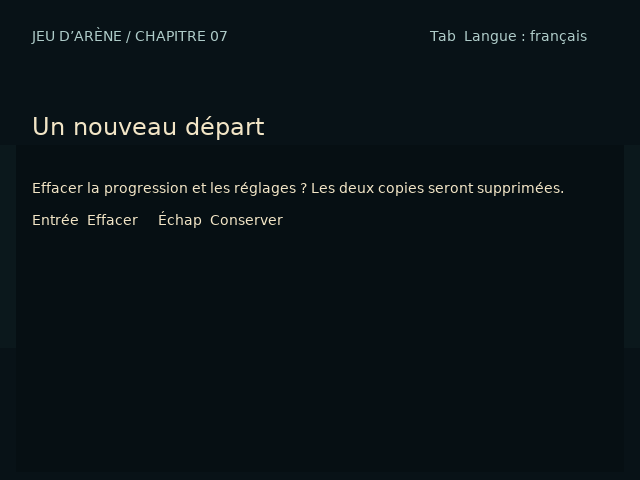

# 7. Save progress and preferences

Clear a wave, close the game, and return to the harbor with that progress intact.
This chapter adds a save boundary to the same game, plus remembered language, audio
and visual preferences. It uses Tua's typed Save contract and store binding; the game
still decides what progress means and when recovery is acceptable.



## Play the checkpoint

```sh
cd examples/tutorials/arena-game/checkpoints/07-save-progress
tua check --deny-warnings
tua build
love build
```

Clear a wave and let the last bullet disappear. Close and reopen the game, then press
**F9** on the title screen to resume the saved boundary. The harbor is empty and your
remaining health is restored. Press **N** to talk before starting the next wave.

**Enter** starts a fresh run; **R** restarts one. Neither deletes saved progress.
Clearing a wave in that new run replaces the old boundary, even if its number is lower.
**F5** retries a pending save. Language, volume, mute, reduced motion, feedback and shader
preferences are remembered independently of your current combat state.

## 1. Choose a boundary before choosing a format

A complete combat snapshot would need enemy identities, behavior runners, projectile
history, timers and presentation resources. This game instead saves a quiet boundary:

- The session is playing and the player is alive.
- No enemies remain.
- No bullets remain, including missed shots still in flight.

Only the cleared wave number and remaining health describe that checkpoint. Resuming
creates fresh runtime objects, resets the player to the center, and waits for the
next-wave conversation. It does not restore hit totals, positions, dialogue visits,
shots, audio transport or shader instances.

This is a checkpoint policy, not a record of your highest wave. Keeping permanent
unlocks or a best score would require distinct fields and their own update rules.

## 2. Declare owned, typed data

The [complete checkpoint](https://github.com/Kyonru/tua-lang/tree/main/examples/tutorials/arena-game/checkpoints/07-save-progress)
adds these responsibilities:

| File | Responsibility |
| --- | --- |
| `profile.tua` | Versioned schema and historical migration |
| `progress.tua` | Load validation, store binding, writes and recovery decisions |
| `conf.tua` | Stable LÖVE save identity |
| `main.tua` | Empty-world boundary, settings capture and title controls |
| `session.tua`, `combat.tua` | Recreate the saved empty boundary |

`conf.tua` sets `t.identity = "tua-arena-tutorial"` before loading the profile.
Keep that identity stable across releases. Saves live in LÖVE's save directory,
not beside your source. Changing identity selects another directory; it is not a migration. The slot is `arena`; neither loading
this example nor its tests accesses another game's saves.

The current contract is version 2. Its literal schema infers the snapshot type:

```tua
schema = Save.record({
  clearedWave = Save.number(0),
  health = Save.number(10),
  locale = Save.enum({ "en", "fr" }, "en"),
  music = Save.number(0.35),
  effects = Save.number(0.6),
  muted = Save.boolean(false),
  feedback = Save.boolean(true),
  reducedMotion = Save.boolean(false),
  shader = Save.boolean(true),
}),
```

This is the schema portion of `Save.contract`, not a complete standalone file.
Tua includes the Save runtime because the typed source references it. There is no
manual runtime-copy step and no generated Lua to edit.

Schema validation checks the data shape and finite numbers. `progress.tua` separately
rejects negative/fractional wave numbers, health outside integer 1–10 and gains outside
0–1. Invalid loaded values block writes and resume; defaults are not silently written
over them. A missing slot, by contrast, is an ordinary new game.

## 3. Separate durable data from transient UI

For a game that needs only explicit checkpoints, `profile:save(snapshot)` writes a
validated plain record directly and returns success plus an optional issue. Check the
result: changing progress in memory does not prove it reached storage. Autosave is
optional; this chapter adds a store binding because it also persists preferences.

The progress controller owns a store containing only the profile. Status messages,
reset confirmation and live combat state stay outside it. The binding observes
store revisions:

```tua
profile:bind(game, {
  select = function(state) return state end,
  debounce = 1,
  max_interval = 10,
})
```

The host compares settings before updating that store. Unchanged settings and UI
notices cause no writes. Changed preferences save after one quiet second, or after
ten seconds of continued changes. These updates keep the last completed boundary;
changing volume during wave 4 does not turn wave 4 into saved progress.

When a new boundary is reached, the host updates the wave/health fields and flushes
immediately. A generation-and-wave marker prevents repeated checkpoint writes while
standing in the empty harbor. If a write fails, the binding retains the dirty data
and uses retry backoff. **F5** requests an explicit retry; quit flushes pending data
before disposing the binding. Quitting while reset confirmation is open leaves the
files alone. `dispose()` itself does not flush. F5 retries pending data; it does not
force a clean profile to be written. If your UI promises an explicit save even when
nothing changed, call `markDirty()` before `flush()` for that separate policy.
An untouched new profile does not create a file merely by being opened.

## 4. Restore through the normal lifecycle

On the title screen, F9 checks that the loaded profile is usable and contains a cleared
wave. `session.resumeCheckpoint` resets the session, clears the initial enemy wave,
restores wave/health and starts playing with an empty world. Camera, animation and
feedback reset through the same presentation path used for a new run. The dialogue
stays closed until N is pressed.

Preferences are applied after native presentation systems are created: audio gains
are sent to the backend, locale refreshes dialogue presentation, and visual options
are restored. The saved shader flag is only a preference; shader loading can still
fail and use chapter 5's fallback. No Source, Shader, ECS handle or dialogue player
is stored in the save.

## 5. Validate an older version before migrating it

Version 1 is a deliberately small historical fixture with only `clearedWave` and
`health`. Its schema validates the old payload before this direct migration runs:

```tua
migration_schemas = {
  [1] = Save.record({ clearedWave = Save.number(0), health = Save.number(10) }),
},
```

The migration carries those two values forward and supplies defaults for preferences.
The current schema then validates its result, followed by the game's range checks.
A malformed old payload never reaches the callback. Migrations go directly from each
supported old version to the current schema; they do not form an automatic chain.
Do not increment a schema version without deciding which old formats remain supported. A future version blocks writes.

Loading alone leaves files unchanged. A successful migration marks the binding for
an upgrade: a later scheduled write or quit flush commits the new representation.
This sample does not invent a migration for unknown future data.

## 6. Let the player choose recovery or reset

If one save copy is damaged, the other may be older. The title explains that saving
is blocked; **F8** accepts that available recovered copy explicitly. This clears the
recovery block, applies its preferences and schedules a write. Other load errors
cannot be accepted through F8. Keep the files for backup or use a compatible version.

**Delete** opens a confirmation before removing both save copies. Enter confirms;
Escape cancels. Confirmation consumes its input, so Enter cannot also start a run.
A failed or partial deletion remains blocked, with visible retry/cancel feedback.
Cancelling after a partial failure cannot restore a copy that was already deleted.
A successful reset returns preferences to defaults and removes the resume boundary.



The dual-copy protocol detects accidental corruption. It does not provide cloud
conflict resolution, multi-process coordination or guaranteed power-loss durability.
See [Typed Save Contracts](../../save-contracts.md) for the full contract and limits.

## Try it

- Clear a wave, change language and mute, quit, then resume with F9.
- Fire a missed shot after defeating the last enemy: saving waits for it to expire.
- Start a fresh run, leave before clearing it, and resume the previous boundary.
- Request a reset and cancel. Confirm that the same checkpoint is still available.

Next: [profile and measure this same game](profile-the-game.md).
