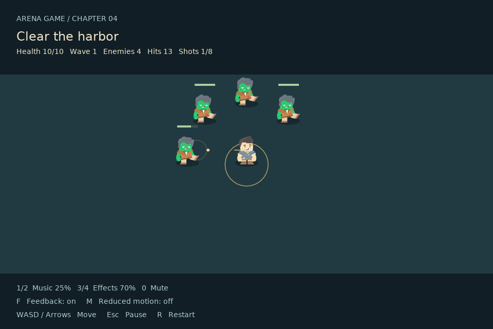

# 4. Give the game sound

Add feedback you can hear to the game from chapter 3: firing, hits, player damage
and defeat. Give title and combat their own music, then let the player control
music/effects volume independently. These sounds observe gameplay; they do not
control damage, cooldowns or enemy behavior.



## Play the checkpoint

```sh
cd examples/tutorials/arena-game/checkpoints/04-sound
tua check --deny-warnings
tua build
love build
```

The previous controls remain. **1/2** lower/raise music, **3/4** lower/raise effects,
and **0** toggles mute. **F/M** still control visual feedback and reduced motion.
Volume and mute survive an in-game restart; saving them across launches comes later.

Short original WAV tones and two small loops are bundled. They are deliberately
simple teaching assets, generated offline with a standard-library Python script.
You can replace them with licensed recordings without changing the simulation.
The example's asset README contains their CC0 notice and provenance.

## Start from chapter 3

Use [the complete checkpoint](https://github.com/Kyonru/tua-lang/tree/main/examples/tutorials/arena-game/checkpoints/04-sound)
or add these pieces to your previous version:

| File | Owns |
| --- | --- |
| `audio-backend.tua` | Source templates, typed cue/bus/scene declaration and native cleanup |
| `soundscape.tua` | Host audio policy: changes in state/counters, volumes and mute |
| `main.tua` | Calls the soundscape after the session update, even when gameplay is paused |
| `src/assets/audio/` | Four short effect WAVs, two music loops and provenance |

Combat, brains and the session model do not need audio calls. The soundscape receives
state/counter values instead of subscribing to long-lived gameplay objects. It can
be tested with a fake backend while the native adapter uses ordinary LÖVE Sources.

## 1. Declare cues and buses once

Load short cues with `sound(...)` and music with `music(...)` in the backend factory,
not in the update loop. Then pass those Sources to `audioSystem`:

```tua
local audio = audioSystem({
  buses = {
    master = { volume = 1 },
    music = { parent = "master", maxVoices = 2 },
    sfx = { parent = "master", maxVoices = 6 },
  },
  cues = {
    shot = { source = shot, bus = "sfx", maxVoices = 2, overflow = "reject", priority = 10 },
    hit = { source = hit, bus = "sfx", maxVoices = 2, overflow = "reject", priority = 20 },
  },
})
```

This excerpt shows two of the complete declaration's four cues. Static names give
Tua cue/bus completion and checking. `audio:play("shot")` starts a cloned playback
voice; the supplied Source is its template. Cue, voice and bus gains multiply.
The host caps effects at six voices, with narrower cue limits. Low-priority shots
may be rejected while more important hurt/defeat cues can replace lower-priority
voices under the configured overflow rules. Rejected audio never rejects a shot.

No waveform, source file or tree is created per simulation tick. The runtime can
clone a Source when starting a voice; this chapter does not claim allocation-free
playback or a measured speedup.

## 2. Observe changes, not repeated state

`main.tua` updates the session, then calls the soundscape with mode, focus, restart
generation and the cumulative shot/hit/attack counters. The soundscape compares them
with its previous observation. An increase starts one corresponding cue; unchanged
counters do nothing. Several events in one outer update produce one sound per
category, avoiding a catch-up burst after a slow frame.

A restart establishes a new baseline instead of interpreting reset counters as
events. A transition to game over emits defeat once. Start/resume transition frames
do not fire gameplay cues, matching the existing input-ownership contract.
The public `Backend` type names the small operations this policy needs; no dynamic
module-wide `any` is required.

## 3. Switch scenes at boundaries

The backend declares `harbor` and `combat` music scenes, each with a looping base
layer. The soundscape selects harbor for title/game over and combat for playing or
paused. It changes the scene only when that selection or the restart generation
changes—not every frame.

```tua
audio:stopBus("music")
audio:setMusicState("combat", { fade = 0.2 })
```

Stop first, then fade the new scene in. This is intentionally not a crossfade:
rapid restart/menu changes cannot stack outgoing loops. There is only one live
music voice after each transition. No beat quantization or analysis catalog is
needed. See the audio reference if the game later needs musical transitions.

## 4. Separate pause, volume and mute

Pause stops short effects and calls `pauseBus("music")`. Resume continues the same
music transport with `resumeBus("music")`; it does not seek to the beginning.
Losing focus pauses music too. Returning focus leaves the session paused until the
player resumes. Title and game-over music may play while the simulation is inactive.

The soundscape still calls `audio:update(dt)` once per outer update, outside the
simulation guard. That services finished voices and audio controls even while the
world is frozen. Music transport itself comes from the native Source's clock,
not the game's fixed-step accumulator.

Volume controls call `setBusVolume` independently for music and effects. Mute calls
`setBusMuted("master", value)` without changing either slider value or pausing the
transport. Thus unmute restores the chosen gains without restarting the loop.
There is no save integration in this chapter.

## 5. Stop playback before releasing templates

The soundscape's `dispose()` is idempotent and prevents subsequent policy updates.
Its backend stops the master bus before releasing the six Source templates created
at startup. Runtime voice handles become stale when stopped; the audio runtime
stops/drops its cloned Sources and their native resources are subsequently reclaimed
by LÖVE/Lua garbage collection. There is no public `audio:dispose()` in the API used
here, and the example does not invent one.

No event subscription is created per restart. The same soundscape and templates
survive in-game restarts; only scene playback and effect voices change. Shutdown
stops all owned playback before the window closes.

## Try it

- Mute while shooting: health and projectile results are unchanged. Unmute restores
  the selected music/effects gains.
- Pause halfway through the loop, then resume: music continues rather than starts over.
- Restart repeatedly: one music voice remains; previous gunshots do not carry over.
- Replace `hit.wav` with a licensed short sample: keep the cue name and gameplay code.

The native regression checks actual LÖVE playback and the Source clock. Its video
is silent because the replay runner does not record audio; the fake-backend test
alone is not evidence of native playback or audio quality.

See [Audio Systems](../../audio.md) for the complete API. Continue with [scoped shader feedback](visual-feedback.md) while preserving these
gameplay and presentation boundaries.
