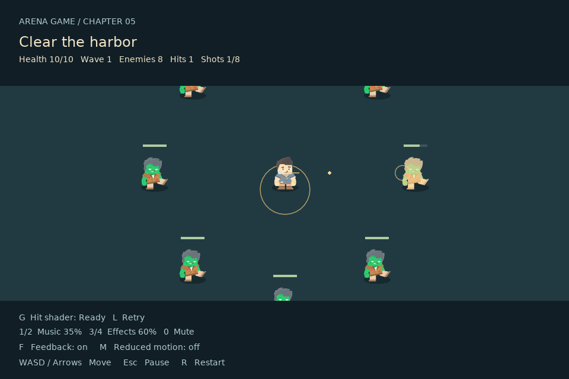

# 5. Scoped shader feedback

Make a surviving enemy briefly flash when hit. Keep its shadow, health bar and the
rest of the game unchanged. This chapter extends the existing feedback system with
shader loading, initialization, failure recovery and explicit draw ownership.



## Run the checkpoint

```sh
cd examples/tutorials/arena-game/checkpoints/05-visual-feedback
tua check --deny-warnings
tua build
love build
```

Use the previous controls to play. **G** toggles the shader; **L** retries loading.
The status line reports loading progress, ready/off, or normal-sprite fallback.
**F** disables all visual hit feedback. Reduced motion (**M**) removes recoil and
shake but retains the brief flash/ring. Neither setting changes damage.

Use [the complete checkpoint](https://github.com/Kyonru/tua-lang/tree/main/examples/tutorials/arena-game/checkpoints/05-visual-feedback)
or add `hit-shader.tua` and `shaders/` to chapter 4. Combat now records the most
recent hit entity ID; `main.tua` applies the existing impact decay only when drawing
that live enemy. A dead enemy is gone from the query, so it receives no flash.
Reset clears the ID with the existing hit counters. No second health registry is added.

## 1. Split the shader into an effect and a shared function

`src/shaders/hit.glsl` contains the LÖVE entry point:

```glsl
#include "shaders/lib/flash.glsl"
vec4 effect(vec4 color, Image texture, vec2 uv, vec2 pixel) {
    vec4 texel = Texel(texture, uv) * color;
    return vec4(hitColor(texel.rgb), texel.a);
}
```

`src/shaders/lib/flash.glsl` declares the uniform and color transformation:

```glsl
extern number flash;
vec3 hitColor(vec3 original) {
    return mix(original, vec3(1.0, 0.85, 0.60), clamp(flash, 0.0, 1.0));
}
```

Alpha is preserved, so transparent sprite pixels stay transparent. Paths are relative
to the running game root: `shaders/...`, not `src/shaders/...`. LÖVE alone does not
expand these includes; `ShaderScan` does so before compilation.

## 2. Initialize the candidate before activation

Create the scanner once and set its callback before loading:

```tua
scanner.on_compiled = function(name: string, path: string, candidate: Shader, previous: Shader | nil)
  candidate:send("flash", 0)
  state.error = ""
end
```

The candidate is not active yet. If setup throws, the scanner releases it and keeps
its previous shader. Successful replacement releases the old shader. Lookup the
current `scanner.s.hit` when drawing; do not cache a Shader across reloads. The
lookup may be nil until the first successful compile.

The required uniform uses `send`, rather than silently ignoring a missing uniform.
The callback initializes it to zero, and the draw path supplies the current flash
amount before rendering the affected sprite.

## 3. Queue loading without blocking gameplay readiness

The example uses `HitShader.new(true)` to queue one named shader with `preload`.
Its progress callback copies `completed`, `failed` and the first error message into
HUD state. `scanner:update(dt)` processes the queue and continues monitoring edits;
it runs outside the paused simulation guard.

One entry produces 0/1 then 1/1; there is no intermediate progress percentage to
animate. A larger real list can draw between entries. Each update attempts at most
one entry, but an individual GPU compile can still block that update. This is not
background compilation, a frame-time budget or first-draw warming. The example does
not perform a hidden warming pass.

Change the constructor argument to `false` for protected synchronous `load_shader`.
That path catches the error with `pcall` and exposes the same fallback state. The
small controller keeps an empty completed job initially so cancellation has one
consistent interface in either mode.

Loading success is independent of gameplay readiness: the world can run with normal
sprites. **L** cancels any pending queue and starts a fresh attempt. A failed initial
load leaves no shader; a failed replacement keeps the last good one. Errors are
printed with source context, while the HUD reports the concise outcome. Final job
counts describe that attempt; automatic reload availability is read from the scanner,
not inferred from historical job counters.

## 4. Scope the shader to one draw

The enemy's shadow is drawn first without the flash. Its sprite uses:

```tua
hitShader.draw(flash, function()
  sprite:draw(position.x, position.y + 28, 0, 0.6, 0.6)
end)
```

The controller saves `love.graphics.getShader()`, binds the active flash shader if
enabled and needed, runs the callback, then restores the caller's shader. It restores
the binding even if the callback throws, then propagates that error. Restoring the
previous shader is more composable than assuming the previous state was nil.

Health bars, later enemies and the HUD therefore keep their own rendering. The
native regression draws a flashed rectangle beside an ordinary one into a Canvas
and checks their pixels, rather than merely asserting that `setShader` was called.

## 5. Keep lifecycle and fallback explicit

Pause freezes the existing impact decay and gameplay; the shader scanner remains
available for loading/recovery. Restart clears hit feedback through the existing
session-generation boundary. Disabling the shader draws normally while retaining
the compiled resource for later re-enable.

On shutdown, cancel the pending job, release the active shader, clear its public
lookup and stop calling scanner updates. Successful replacements are already owned
by the scanner and must not be released again by the host. The controller makes
its disposal idempotent and rejects later retry/update work.

## Try it

- Change the warm flash color in the include and rebuild: the sprite silhouette and
  alpha stay the same, and the health bar does not change color.
- In a disposable running build, introduce a shader/include error: gameplay continues
  with fallback or the last working shader. Fix it and press L to retry.
- Toggle G while firing: damage and enemy decisions remain unchanged.

See [Shaders](../../shaders.md) for scanner/editor contracts and optional uniforms.
Next: add a between-wave conversation and runtime language switching to this game.
