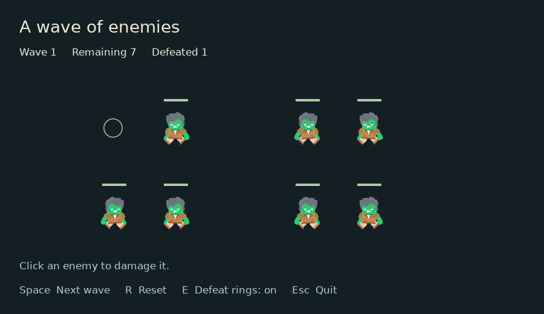

# A wave of enemies

Build a small wave you can damage, defeat and reset. You will use ECS for live
enemy data, then optionally reuse short-lived defeat effects with an object pool.
The scene uses Kenney characters on a plain background.



## Run it first

Install [Tua and LÖVE](../installation.md), then open
[`examples/tutorials/enemy-wave`](https://github.com/Kyonru/tua-lang/tree/main/examples/tutorials/enemy-wave):

```sh
cd examples/tutorials/enemy-wave
tua check --deny-warnings
tua build
love build
```

Click an enemy two or three times. Its health bar shrinks, then the enemy vanishes.
Clear all eight and press **Space** for the next wave. **R** resets the run;
**E** toggles defeat rings, initially off. **Escape** quits.

This guide assumes ordinary functions, records and LÖVE callbacks. Read the
[playable character tutorial](playable-character.md) first if those are new.
Use a compiler supporting `world:reader`; the [qualification record](https://github.com/Kyonru/tua-lang/blob/main/benchmarks/tutorials/enemy-wave.md)
identifies the exact development binary tested here.

## 1. Give each entity small pieces of data

An entity ID identifies one enemy. Components describe capabilities. In
`src/components.tua`, these declarations also give the checker and editor their
field types:

```tua
local Position = ECS.component("Position", { x = "number", y = "number" })
local Velocity = ECS.component("Velocity", { x = "number", y = "number" })
local Health = ECS.component("Health", { current = "number", maximum = "number" })
return { Position = Position, Velocity = Velocity, Health = Health }
```

`src/wave.tua` imports that module and owns one world. Creating an enemy means
creating an ID and attaching all three components:

```tua
local Components = require("components")
local world = ECS.world()
local id = world:create()
world:add(id, Components.Position, { x = 160, y = 240 })
world:add(id, Components.Velocity, { x = 28, y = 0 })
world:add(id, Components.Health, { current = 2, maximum = 2 })
```

There is no second array of enemy objects. The query is the live view of enemies
with position, health and velocity. Removing a required component makes that
entity stop matching the view; destroying the entity removes every component.

## 2. Update matching entities

A system selects the components its callback needs. The example also clamps and
reverses horizontal velocity at the scene edges; its core movement is:

```tua
local movement = ECS.system(world, { Components.Position, Components.Velocity }, function(_, position, velocity, dt)
  position.x += velocity.x * dt
  position.y += velocity.y * dt
end)
movement:update(dt)
```

The callback changes the actual component payload. Destroyed entities cannot
match this system, so they stop moving. Rendering uses a separate query including
health, which supplies the health-bar fraction. Identical sprites share one
animation clock in this example; independently timed animation would need its
own per-enemy state.

## 3. Select first, change membership second

A click searches the enemy query for centers within 30 pixels, choosing the
nearest; equal distances choose the smaller entity ID. Once iteration finishes,
`damage` resolves the current data and changes health:

```tua
local readHealth = world:reader(Components.Health)
local health = readHealth(id)
if health and health.current > 0 then
  health.current -= 1
  if health.current == 0 then world:destroy(id) end
end
```

The complete source also checks position and counts each defeat once. A reader
returns the **current payload or nil**. Adding Health again replaces its payload;
a previously retained table is then obsolete. Destroying an entity or clearing
the world makes its reader result nil. Never treat an old payload reference as
proof an enemy is alive.

The runtime supports payload changes and removal/destruction during queries;
clearing the world ends active iteration. This tutorial uses a simpler phase
rule: finish selection, then destroy. Create the next wave outside query
callbacks too. Do not depend on newly matching entities being visited in the same
iteration. See [ECS lifecycle rules](../ecs.md) for the full contract.

## 4. Make wave policy explicit

`spawnWave()` refuses while the enemy query is nonempty and creates exactly eight
enemies otherwise. Space requests it; a timer does not. The host always creates
complete enemies and destroys them on defeat. If you introduce partial entities,
reconsider whether this query's count still means “the wave is empty.”

Reset clears the world, resets counters and creates wave one. Existing queries
and readers continue to work, but old entity IDs and payload references are not
reused as authority. Disposal clears the world and makes later host commands
inert. The regression repeats reset 100 times to check those boundaries.

## 5. Add optional defeat rings

Only after the lifecycle works, enable **E**. `src/effects.tua` owns a separate
pool of `{ x, y, age }` records. On defeat, the host copies the hit coordinates
into a ring. No entity ID or component table enters the pool.

```tua
local pool = objectPool({
  create = function(): Ring return { x = 0, y = 0, age = 0 } end,
  reset = function(ring: Ring)
    ring.x = 0
    ring.y = 0
    ring.age = 0
  end,
})
```

Here `Ring` is the exported record type in `effects.tua`. Before acquiring, the
host rejects a seventeenth active ring. After 0.4 seconds it removes the ring
from the active array and releases it; release resets every field. Disabling
rings or resetting releases all active rings. Quitting also clears pool storage.
The pool stays empty until the first enabled defeat.

This is bounded cosmetic reuse, not an enemy registry or a demonstrated speedup.
Dropping a ring at capacity does not undo damage or change rewards. See
[object pooling](../object-pooling.md) for ownership and release rules.

## Change one thing

Try changing health, horizontal speed or the ring lifetime separately. Keep wave
size and spawn timing explicit. Projectile travel, collision broad phases,
performance scaling and automatic wave scheduling are outside this tutorial.
The next planned tutorial introduces a responsive weapon.
