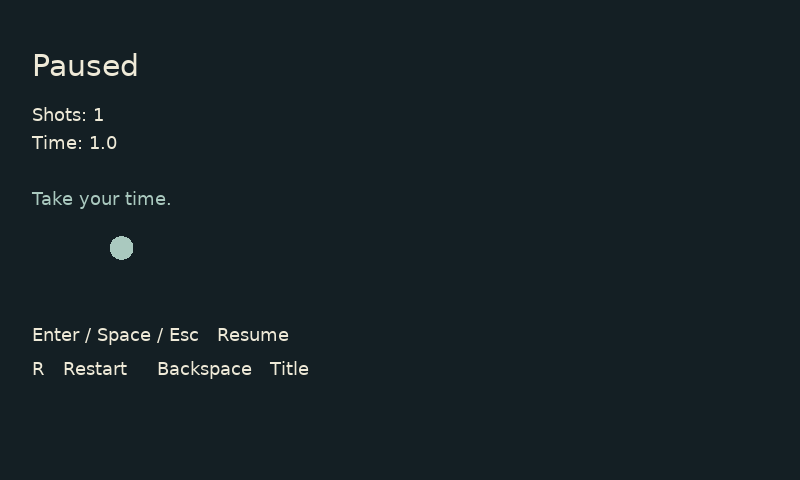
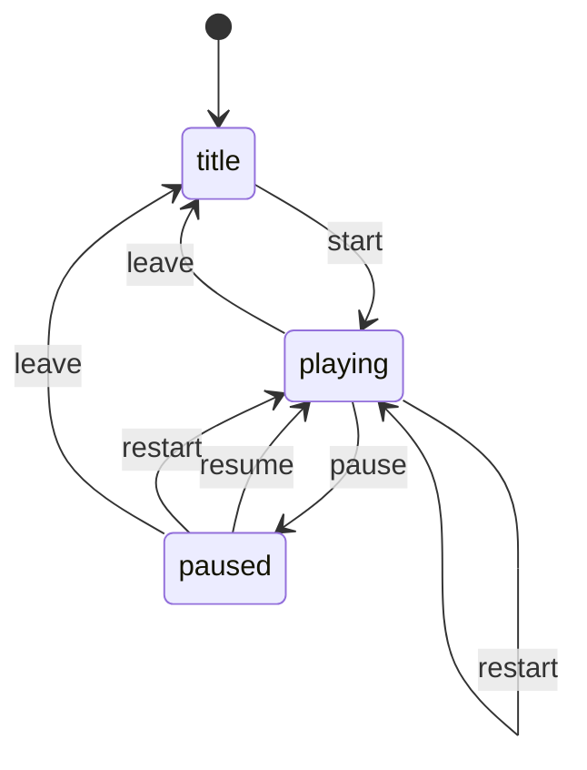

# A pause menu and game flow

Build a title screen, start a run, pause it, resume it and restart. The important
part is ownership: which state receives input, and which systems advance time?
This example uses a moving marker so the answer is visible. It needs no artwork.



For these systems in one evolving game, continue with [movement and game flow](arena-game/playable-loop.md).

## Run the example

From a Tua checkout, with a current compiler and LÖVE 11.5:

```sh
cd examples/pause-input
tua check
tua build
love build
```

Press **Enter** or **Space** to start. During play, **Space** fires once per press
and **Escape** pauses. From pause, **Enter**, **Space** or **Escape** resumes.
**R** restarts; **Backspace** returns to the title. **Escape** quits from the title.

The [complete source](https://github.com/kyonru/tua-lang/tree/main/examples/pause-input)
has a host model (`state.tua`) and drawing/callbacks (`main.tua`). The scenario files
are optional test drivers. The excerpts below explain the runnable example rather
than define additional entry files.

## 1. Give the screens one source of truth

Declare the allowed transitions in one typed state machine:

```tua
local flow = stateMachine({
  initial = "title",
  events = {
    { name = "start", from = "title", to = "playing" },
    { name = "pause", from = "playing", to = "paused" },
    { name = "resume", from = "paused", to = "playing" },
    { name = "restart", from = { "playing", "paused" }, to = "playing" },
    { name = "leave", from = { "playing", "paused" }, to = "title" },
  },
})
```



The initial title state is a choice made by this game. The renderer checks
`flow:is("paused")`; it does not keep a separate `paused` Boolean that could become
out of sync. The configuration gives Tua exact state/event names for checking and
completion. The [state-machine preview](../state-machines.md#preview-the-graph)
shows the authored routes without running your game.

State transitions alone do not reset a score or stop audio. The host's `pause`,
`leave` and `reset` functions own those side effects. They check the current state
before calling the corresponding event. Repeated `pause(true)` calls are harmless.

## 2. Poll all inputs, then choose one owner

Space means fire during play and confirm in menus. Use independent input players
for those contexts, but update all of them every frame:

```tua
globalInput:update()
playInput:update()
menuInput:update()
debugInput:update()
```

`debugInput` belongs to the existing optional practice-mode check; you do not need
it for a menu. The important rule is that a disabled context still gets polled.
Otherwise a key held during pause could appear newly pressed when gameplay resumes.

After polling, handle transitions before gameplay:

1. Returning to title consumes the frame.
2. Restarting consumes the frame.
3. On the title, confirm starts a fresh run and returns.
4. Escape toggles playing/paused and returns.
5. While paused, confirm resumes and returns.
6. Only the remaining playing path handles fire and advances gameplay.

For example, this is the paused branch in `state.tua`:

```tua
if flow:is("paused") then
  if menuInput:pressed("confirm") then
    state.confirms += 1
    pause(false)
  end
  return
end
```

The return matters. Without it, the same Space press could resume and fire in one
update. Holding Space through start or resume must not fire either: release it,
then press again. The confirmation counter is a regression aid, not a required API.

## 3. Keep UI time separate from gameplay time

Create separate tween groups once:

```tua
local gameplayTweens = Tween.group()
local uiTweens = Tween.group()
```

UI time advances after input polling, before the state checks. Gameplay time advances
only in the playing path:

```tua
-- Before routing: title and pause presentation can animate.
state.uiTime += dt
uiTweens:update(dt)

-- Only after routing has left us in gameplay:
state.gameplayTime += dt
gameplayTweens:update(dt)
```

These two excerpts belong at different points in the update, not next to each other.
The pause caption uses `uiTweens`, so it can fade in while the marker's gameplay
tween is frozen. The screen continues drawing the world during pause.

There is no accumulated gameplay dt. Resuming consumes that frame, then advances
gameplay by the next frame's ordinary dt. Do not feed the whole paused duration
into the simulation. If your game owns audio, particles or external clocks, decide
which state advances each of them as well; this example does not pause them globally.

## 4. Make restart and focus policy explicit

Reset stops the previous menu tween, replaces both tween groups, clears run counters,
returns the marker to its starting position, and starts one new movement tween.
It keeps the input players. Recreating them during reset would lose held-key history.
Returning to title freezes the old run; starting again creates a fresh run.

The LÖVE focus callback delegates to the host:

```tua
function love.focus(focused: boolean)
  model.focus(focused)
end
```

Focus loss pauses only a playing session. While unfocused, the host still polls
input and advances UI, then returns before accepting commands. Regaining focus
leaves the game paused until the player explicitly resumes. A title screen remains
a title screen. This is a different policy from the [character tutorial](playable-character.md),
which resumes held movement on refocus; choose deliberately for your game.

## Try a change

- Increase the caption fade to half a second. Confirm that it finishes while the
  marker stays still.
- Hold Space through start or resume, then release and press again. The shot count
  changes only on the new gameplay press.
- Add a game-over state and explicit return-to-title route. Decide which input and
  time domains it owns before adding renderer branches.

## What stays optional

You do not need a scene framework, ECS, audio or saved progress to manage these
three screens. The example's practice gate is independent of the menu flow.
Its state machine, input bindings and tween groups are included automatically when
referenced; no registration step is required.

For details use [state machines](../state-machines.md), [input](../input.md) and
[tweening](../tweening.md). If gameplay jumps after resume, check where dt accumulates.
If one press performs two actions, look for a missing return in transition handling.
If repeated restarts speed up animation, check whether old tweens are still updated.
