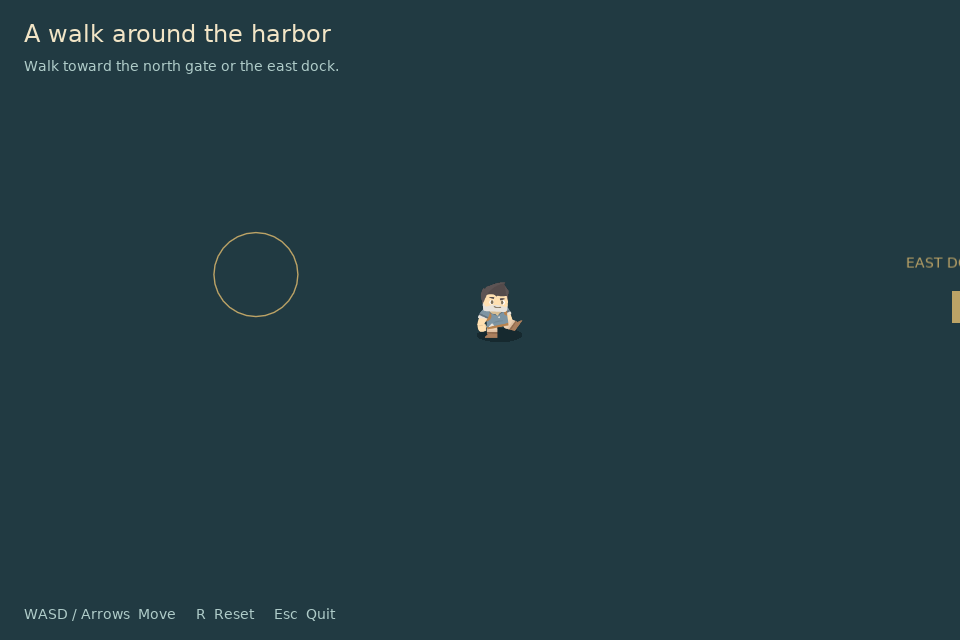

# Your first playable character

Move a character, switch its animation, and follow it with a camera. This tutorial
uses typed input, a Kenney sprite sheet, and a plain scene with a few landmarks.
The text at the top and bottom stays fixed while the world moves.



## Run it first

You need LÖVE 11.5 and a current Tua compiler. From a Tua repository checkout:

```sh
cd examples/tutorials/playable-character
tua check
tua build
love build
```

Use **WASD** or the **arrow keys** to move, **R** to reset, and **Escape** to quit.
The complete [runnable example](https://github.com/kyonru/tua-lang/tree/main/examples/tutorials/playable-character)
is self-contained. Its two source files are `src/main.tua` and `src/movement.tua`.
The following excerpts explain that working example; they are not separate entry files.

Character art comes from [Kenney Platformer Characters](https://kenney.nl/assets/platformer-characters)
under CC0. The unchanged image, license and provenance are bundled. You do not need
an asset tool or download to run it. This is free movement with a side-facing sprite;
it does not simulate gravity or provide four directional animation sets.

## 1. Turn controls into movement

Create one input player in `main.tua`. Names describe actions; bindings describe keys:

```tua
local controls = input({
  controls = {
    left = { "key:a", "key:left" },
    right = { "key:d", "key:right" },
    up = { "key:w", "key:up" },
    down = { "key:s", "key:down" },
  },
  pairs = { move = { "left", "right", "up", "down" } },
})
```

The four pair entries are ordered **left, right, up, down**. `controls:get("move")`
returns two numbers; the pair already normalizes diagonals, so holding two keys
does not make the character faster. Poll once before reading it each update:

```tua
controls:update()
local x, y = controls:get("move")
Movement.move(player, x, y, speed, dt)
```

`Movement` is an ordinary project module, not another Tua helper. Its complete
implementation in `movement.tua` keeps the character inside this example's world:

```tua
export type Position = { x: number, y: number }
local function move(player: Position, x: number, y: number, speed: number, dt: number)
  player.x = math.max(32, math.min(1568, player.x + x * speed * dt))
  player.y = math.max(48, math.min(1168, player.y + y * speed * dt))
end
return { move = move }
```

Multiplying by `dt` makes speed mean pixels per second. The example chooses 180;
that is a game setting, not a Tua default. Set it to 90, rebuild and restart to
halve travel speed. The world bounds are also host policy, not collision detection.

## 2. Let movement select an animation

The bundled atlas has 80×110 cells. Sprite configuration uses zero-based columns
and rows. Idle is one pose; walking alternates between two cells on its second row:

```tua
local Courier = spriteSheet({
  image = "assets/adventurer.png",
  frame = { width = 80, height = 110 },
  origin = { x = 40, y = 110 },
  animations = {
    idle = { column = 0, row = 0, fps = 1 },
    walk = { frames = { { column = 0, row = 1 }, { column = 6, row = 1 } }, fps = 8 },
  },
})
local hero = Courier:player("idle")
```

After moving, select the animation and advance its time:

```tua
hero:play((x ~= 0 or y ~= 0) and "walk" or "idle")
hero:update(dt)
```

Calling `play("walk")` again preserves the current animation's progress. Without
that behavior, selecting the same animation every update would freeze its first
frame. Idle here is intentionally static. Change walk `fps` from 8 to 4 and observe
that animation slows while movement speed stays the same.

The origin is at the feet. Drawing at 60% scale keeps that point on the character's
world position. A negative horizontal scale mirrors the sprite for leftward travel:

```tua
hero:draw(player.x, player.y, 0, facing * 0.6, 0.6)
```

`facing` is 1 or -1 and is retained while idle. This tutorial chooses animation from
input intent: pushing into a world boundary still plays walking. A collision-based
game may instead choose from actual displacement.

## 3. Follow the character, then draw the HUD

Create the camera once, initially centered on the player:

```tua
local camera = Camera.new({ x = player.x, y = player.y, smoothing = 6 })
```

The default camera style is `lockon`. Its default smoothing is 0 (snap); this
example explicitly chooses 6 for a gentle delay. After movement and animation:

```tua
camera:follow(player.x, player.y)
camera:update(dt)
```

Draw world objects inside `camera:draw`. Draw interface text after it returns:

```tua
camera:draw(drawWorld)
-- The camera has detached. These are screen coordinates.
love.graphics.print("A walk around the harbor", 24, 19)
```

The starting marker, north gate and east dock are world landmarks. Their movement
on screen helps you see the camera catch up. The heading never follows the player.
Try smoothing 0, then restore 6. Camera smoothing does not change simulation speed.

## 4. Decide what focus and reset mean

Losing window focus is handled explicitly in `main.tua`: set a `focused` flag to
false and select idle. Continue polling input, but skip movement, animation time
and camera updates until focus returns. No missed time is accumulated or replayed.

A still-held key resumes movement on focus return. A released key stays stopped.
This is the tutorial's policy; Tua does not choose your game's pause behavior.
[A pause menu and game flow](game-flow.md) uses explicit menu states when resuming
should require input.

Reset restores position, camera center, facing and idle animation. Shutdown releases
the sheet's image and the two fonts. Create resources during setup rather than
inside `love.update` or `love.draw`.

## Defaults and next steps

| Behavior | Owned by |
| --- | --- |
| Named input types, diagonal normalization | Typed input and its Baton runtime |
| Atlas frame selection and animation timing | `spriteSheet` and its player |
| Camera transform and following | `Camera` |
| Speed, bounds, animation selection, focus and reset | This example's host |
| Appearance, asset choice, draw order and HUD | This example's renderer |

These helpers are included when referenced; no runtime registration is needed.
There is no ECS, physics, audio, pooling or save system to configure here.

For details, use the [input](../input.md), [sprites](../sprites.md) and
[camera](../camera.md) reference pages. In the editor, try completing an animation
name or hovering the input player; names come from the declarations above.

If the sprite does not load, run from `love build` after rebuilding, not from
`src/`. If the animation stays idle, check the input bindings and window focus.
If HUD text moves with the camera, move its draw calls outside `camera:draw`.
