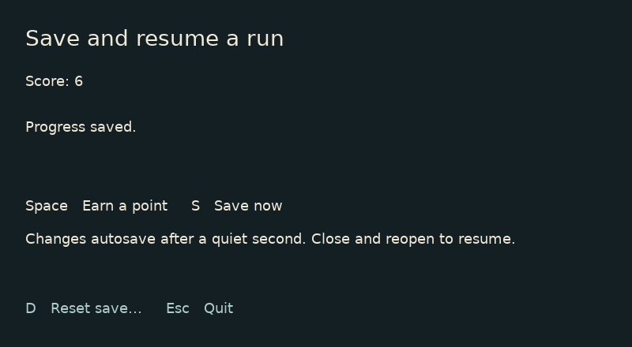
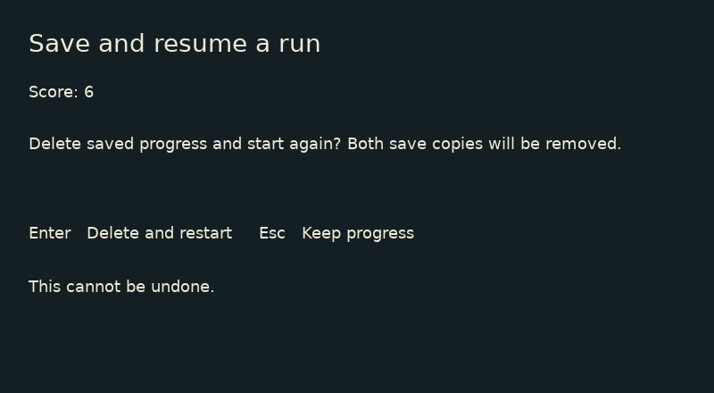

# Save and resume a run

Keep a small piece of progress between launches. Start with a typed record and an
explicit checkpoint, then add autosave and a migration. Finally, decide what the
player should see when loading cannot safely continue.



## Run it first

Use a current Tua compiler and LÖVE 11.5. From the repository root:

```sh
cd examples/love-save
tua check
tua build
love build
```

Press **Space** a few times, press **S**, quit with **Escape**, then reopen with
`love build`. Your score returns. The complete example also autosaves changes after
a quiet second; the steps below explain checkpointing before that optional layer.

The [source](https://github.com/kyonru/tua-lang/tree/main/examples/love-save) separates
its contract (`profile.tua`), session behavior (`session.tua`) and UI (`main.tua`).
Excerpts below are teaching steps or parts of those files, not additional entry modules.
No assets or accounts are needed.

## 1. Decide what belongs in the save

Store plain progress, not live objects. The example's current schema is:

```tua
schema = Save.record({
  score = Save.number(0),
  musicOn = Save.boolean(true),
})
```

The defaults describe a new run. `musicOn` preserves an existing preference in this
example's format; the example itself has no audio. Entity IDs, image handles, input
players and UI notice strings do not belong in this record.

Set a stable LÖVE identity in `conf.tua` before loading:

```tua
function love.conf(t)
  t.identity = "my-game"
end
```

Use your own identity. The bundled example uses `tua-save-example` so repeated
launches find the same files. Saves live in LÖVE's save directory, not beside source
files. Changing identity starts looking in a different directory; it is not a migration.

## 2. Load before constructing gameplay

The contract factory returns a fresh instance with its own recovery state:

```tua
local Profile = require("profile")
local profile = Profile.new()
local saved, issue = profile:load()
```

There are three starting cases:

| Result | What the host does |
| --- | --- |
| No snapshot, no issue | Start from `profile:defaults()` |
| Snapshot, no issue | Start from the validated snapshot |
| Any issue | Preserve the files and enter a recovery state |

The full example uses defaults internally to keep its data shape predictable when
loading fails, but freezes editing/writes and does not display those defaults as
successfully loaded progress. It only displays an older recovered snapshot with its
warning. Do not silently replace an error with a new save.

For a healthy session, an explicit checkpoint is simply:

```tua
local ok, saveIssue = profile:save(snapshot)
if not ok and saveIssue then
  print(saveIssue.message)
end
```

Here `snapshot` is your validated plain record, for example
`{ score = 4, musicOn = true }`. Saving is synchronous. Always inspect failure;
updating a score in memory is not proof it reached storage.

## 3. Add autosave without saving UI changes

Autosave is optional. Once explicit checkpoints work, bind a store containing only
persistent data. In `session.tua`, the load has already happened:

```tua
local game = store(saved or profile:defaults())
local persistence = profile:bind(game, {
  select = function(state) return state end,
  debounce = 1,
  max_interval = 10,
})
```

Use store updates to change progress:

```tua
game:update(function(state) state.score += 1 end)
```

Call `persistence:update(dt)` during healthy gameplay. This example chooses a
one-second quiet period and a ten-second maximum interval during continuous edits.
Those are explicit host settings. Check `lastIssue()` to display write failures.

The binding observes the store's revision, not just whether the selected values
look different. A UI message inside the same store could repeatedly dirty a save.
Keep notices and confirmation state in a separate ordinary table, as this example does.

`flush()` writes dirty data synchronously; `dispose()` only disconnects the binding.
Flush before disposal when pending progress should be saved. The example's S handler
calls `markDirty()` before `flush()` to force a requested checkpoint, even on a fresh
unchanged record. Quit flushes only pending data. Load errors keep both paths blocked.

If a write fails, retain the in-memory progress. The binding supports scheduled
retry/backoff, and the player can press S to retry immediately. Do not change the
notice to “saved” solely because the button was pressed.

## 4. Teach a new version to read an old save

Version 1 stored `points`; version 2 stores `score` and adds `musicOn`. This is the
complete contract factory in `profile.tua`:

```tua
local function new()
  return Save.contract({
    slot = "profile",
    version = 2,
    schema = Save.record({ score = Save.number(0), musicOn = Save.boolean(true) }),
    migration_schemas = { [1] = Save.record({ points = Save.number(0) }) },
    migrations = {
      [1] = function(old: { points: number })
        return { score = old.points, musicOn = true }
      end,
    },
  })
end
return { new = new }
```

The historical schema validates old input before calling the migration. A string
where `points` should be a number is an error, not a reason to quietly replace the
score with zero. Defaults do not repair malformed old records. The result is also
validated against the current schema.

Each migration goes directly from its declared old version to the current version;
there is no automatic version-by-version chain. Loading does not rewrite files.
A subsequent explicit save, or the binding's pending-upgrade write, persists the
validated current shape.

Keep schema changes intentional. Do not increment the version without providing
the supported historical schemas and direct migrations you intend to accept.

## 5. Make recovery a choice

The runtime keeps two generations with length/checksum verification. That helps
recognize incomplete or corrupt data, but it cannot know whether a damaged copy
contained newer progress.

| Situation | Example policy |
| --- | --- |
| One valid copy, one damaged copy | Show the recovered score, freeze edits/writes, and offer **R** to accept that it may be older |
| No usable copy or invalid historical data | Keep files unchanged and show the problem |
| A newer unsupported version | Keep writes blocked; suggest keeping files or opening a compatible game version |
| Reset requested | Open confirmation; **Enter** deletes both copies, **Escape** cancels |
| Reset failed | Keep the prompt and error visible for retry/cancel |



`acceptRecovery()` is only for the specific `damaged_slot_unverified` case. It does
not bypass every load error. `reset()` deletes both generations; it does not repair
them. The tutorial's **D** key opens a confirmation rather than calling it immediately.
The reset prompt owns input and pauses autosave until the player chooses.
A deletion failure may leave one copy already removed; cancelling cannot restore
that copy. Saving stays blocked after a failed reset until the problem is resolved.

The checksum detects accidental corruption, not cheating. This system does not
promise power-loss durability (`fsync`), simultaneous-writer coordination or cloud
conflict resolution. Its [reference](../save-contracts.md#recovery-and-errors)
explains the precise boundaries. Test against an isolated identity, never a real
player's save directory.

## Try a change

- Increase debounce to two seconds. Earn a point and watch the pending notice before autosave.
- Save, quit and reopen. Then try reset → cancel and confirm your progress remains.
- Read the isolated persistence tests to see a v1 save become v2 and an unsupported
  future save remain untouched. Do not manufacture those fixtures in your normal slot.

Use [save contracts](../save-contracts.md) for the full API. For rewards with external
side effects, follow the separate [durable action recipe](../dialogue.md#recover-consequential-host-actions);
a score checkpoint alone does not make those operations exactly-once.
