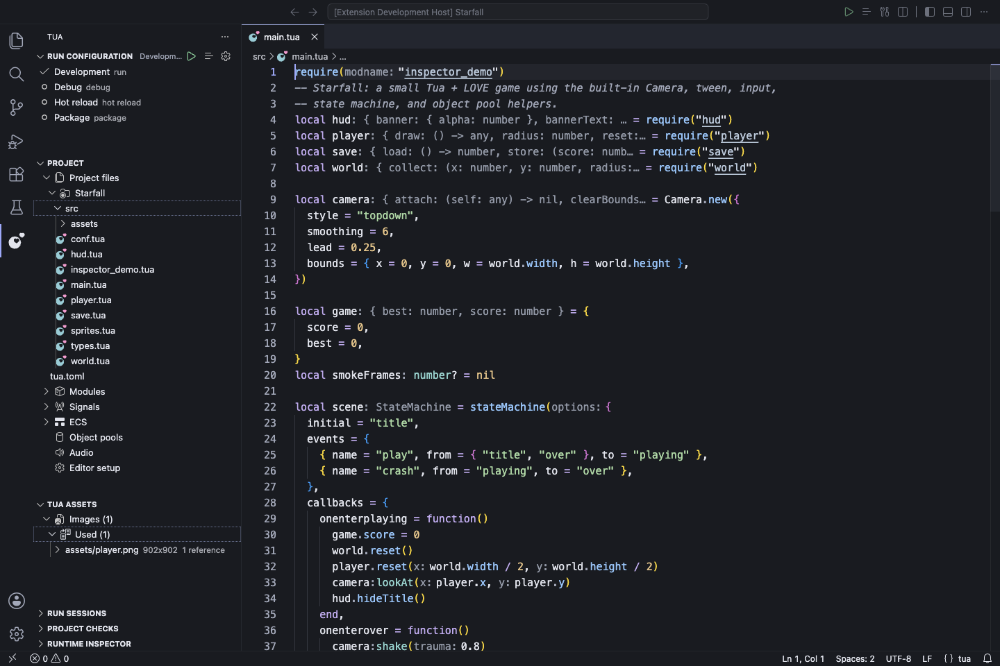
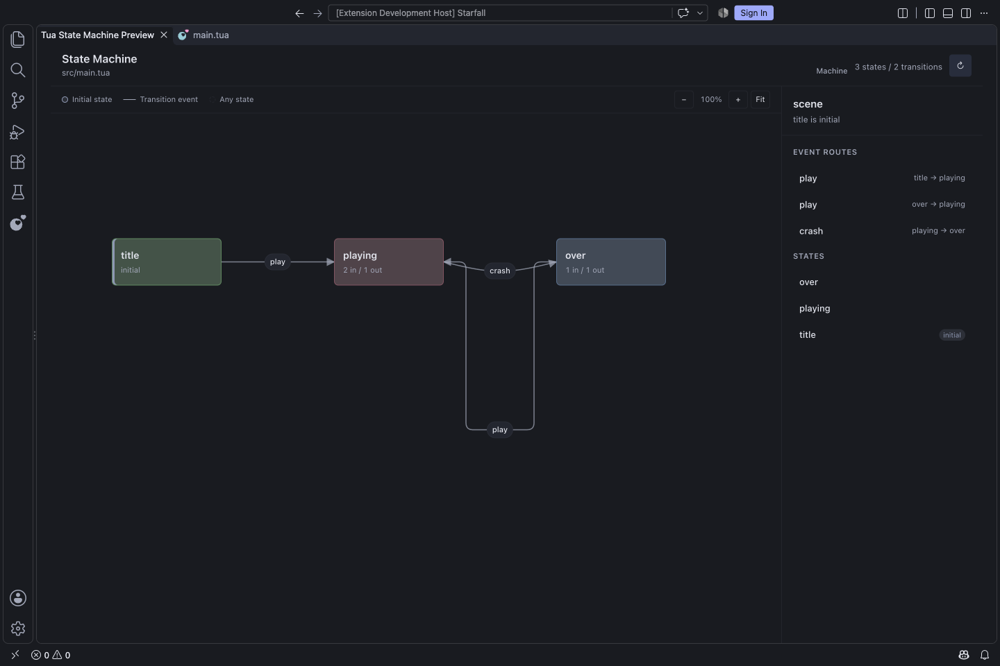
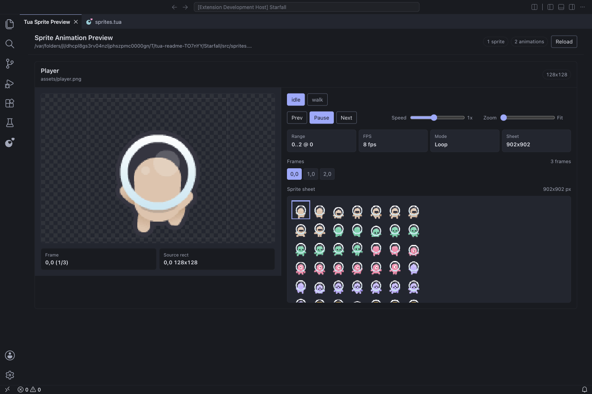
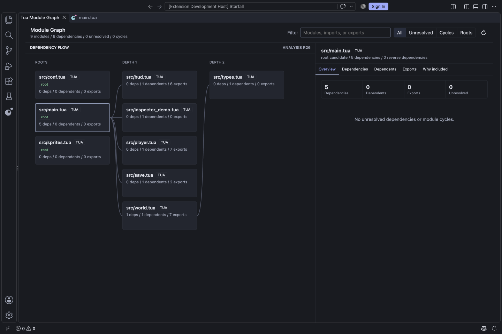
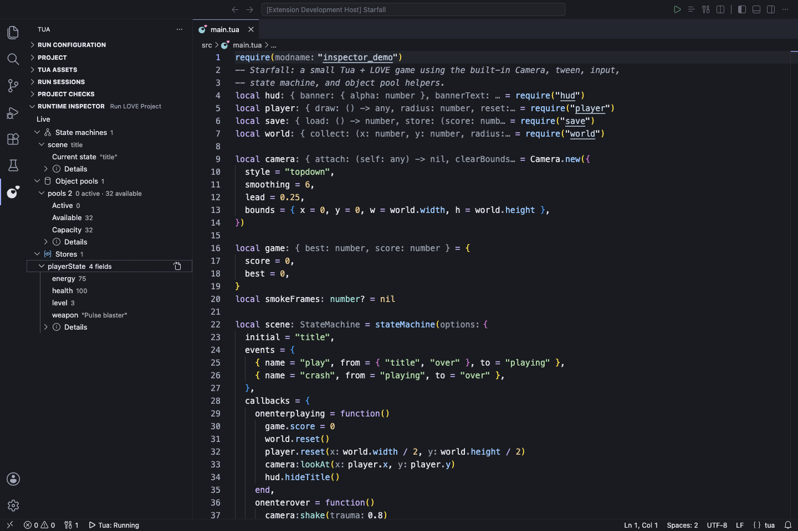

# Tua for VS Code

**Build LÖVE games in typed Lua, with the editor beside you from first line to running game.**

Tua checks your code as you write, helps you navigate a growing project, and emits readable Lua 5.1-compatible source for LuaJIT and LÖVE 11.x. The extension includes the matching language server, so you can open a Tua project and start editing without installing Rust or Node.js.

[Install from Visual Studio Marketplace](https://marketplace.visualstudio.com/items?itemName=SolenodonteLabs.tua) · [Install from Open VSX](https://open-vsx.org/extension/SolenodonteLabs/tua) · [Download a VSIX](https://github.com/Kyonru/tua-lang/releases) · [Read the quickstart](https://kyonru.github.io/tua-lang/quickstart/)

## Make the game, understand the code

| Write | Run | Explore |
| --- | --- | --- |
| Get completion, hover, signatures, diagnostics, and type explanations while editing Tua and project Lua. | Build and launch LÖVE, use hot reload, run Busted tests, or debug with source-mapped breakpoints. | Inspect assets, modules, signals, sprites, state machines, behavior trees, and live game state. |

Tua's native generics and protocols help keep APIs precise across files. You can still call ordinary Lua modules and LÖVE APIs; the generated Lua remains available beside your source whenever you want to see what will run.

## Start in four steps

1. Install the extension and open your game folder in VS Code.
2. Run **Tua: Initialize Tua Project** from the Command Palette, or open an existing folder with a `tua.toml`.
3. Edit `src/main.tua`. Completion, diagnostics, navigation, and hover work immediately.
4. With LÖVE 11.x installed, run **Tua: Run LOVE Project**.

A small Tua file looks familiar to Lua developers:

~~~tua
type Player = { x: number, y: number, speed: number }

local player: Player = { x = 160, y = 120, speed = 90 }

function love.update(dt: number)
  if love.keyboard.isDown("right") then
    player.x += player.speed * dt
  end
end

function love.draw()
  love.graphics.print("Hello from Tua", player.x, player.y)
end
~~~

The extension bundles its server for your platform. A separate CLI is useful for terminal builds, but it is not required for editor features. See [Installation](https://kyonru.github.io/tua-lang/installation/) if you prefer a manual VSIX or a custom server.

## See your project before you run it

The following views were captured from the extension running in VSCodium with its optional Indigo Carbon theme. The [Starfall example](https://github.com/Kyonru/tua-lang/tree/main/examples/starfall) supplies the game source. Static previews read source without executing the game; enable experimental previews with `tua.preview.enabled`. The seeded procedural-map preview runs only its own temporary sample project and never executes your game.

<strong>State machine</strong> · Follow states and event routes

Select a state or transition for details, then open its source. The graph shows the declared `title`, `playing`, and `over` states; it is separate from live runtime inspection.

<strong>Sprite animation</strong> · Check frames without launching LÖVE

Switch animations, pause playback, step through frames, and inspect the selected rectangle on the sprite sheet.

<strong>Module graph</strong> · Trace why a file is in the build

Follow imports from the entry module, inspect exports and dependents, and filter unresolved imports or cycles.

<strong>Runtime inspector</strong> · See the state of a running game

Opt into inspection for a development run to view stores, state machines, signals, entities, and object pools. This screenshot shows a live scene, pool counts, and store values.

Behavior trees also have a source-linked static tree preview. Asset, SignalBus, ECS, object-pool, and audio explorers help reveal relationships that are otherwise spread across game files.

## Editing Tua

When you call a method on an imported class, completion shows its members and
signature help shows the expected arguments. Hover shows the inferred type. If
a value unexpectedly resolves to `any`, run **Tua: Explain Type / Why Is This
Any?** to trace where that information was lost.

Diagnostics and quick fixes appear beside the code. You can organize imports,
apply safe fixes, or generate stubs for missing protocol methods. LÖVE
callbacks have snippets and signature checks; API calls have parameter
documentation. The [LÖVE 11.5 reference](https://kyonru.github.io/tua-lang/lsp/#love-authoring)
is also available offline from the Command Palette.

To inspect what will run, use **Tua: Open Generated Lua Beside Tua** and jump
between source and output. Tua also provides formatting and semantic
highlighting. [Format on save](https://kyonru.github.io/tua-lang/formatter/)
can be enabled in VS Code settings. Normal completion works by default; inline
suggestions and the local Ollama fallback are separate opt-in features.

## Run, test, and inspect

| Task | In VS Code |
| --- | --- |
| Play or rebuild | Choose a named Run configuration, then use Run, Stop, Restart, or Hot reload. |
| Debug | Use **Tua: Debug LOVE Project** with the optional [Second Local Lua Debugger](https://marketplace.visualstudio.com/items?itemName=ismoh-games.second-local-lua-debugger-vscode). Breakpoints and stopped locations map back to Tua source. |
| Test | Discover and run Tua/Busted specs in the Testing view, including file and case runs. Install Busted for the interpreter you use. |
| Inspect | Enable the development-only Runtime Inspector, then start a new run. Pause or refresh snapshots without pausing the game. |
| Package | Select the package icon in Tua’s Run view, choose a portable `.love`, Windows, or macOS target, then reveal the finished package. |

The **Tua** Activity Bar view groups project files, assets, signals, modules, ECS, pools, audio, run sessions, and project checks. Right-click a Tua file or declaration for relevant previews and source actions.

## Optional setup

**Tua: Set Up Tua** offers a theme, a layout preset, file-icon choices,
shader-tool checks, and inlay-hint settings. Opening it does not change your
settings. The language features work with your existing VS Code theme and layout.

Visual previews, runtime inspection, local inline suggestions, and Ollama each
have separate opt-in controls. The extension sends no telemetry or project
source uploads. It requires VS Code 1.94 or newer; running a game requires
LÖVE, and debugging or Busted tests require their respective tools.

## Learn more

- [Quickstart](https://kyonru.github.io/tua-lang/quickstart/) · [Language guide](https://kyonru.github.io/tua-lang/language/) · [Examples](https://kyonru.github.io/tua-lang/examples/)
- [LSP features and settings](https://kyonru.github.io/tua-lang/lsp/) · [Debugging](https://kyonru.github.io/tua-lang/debugging/) · [Testing](https://kyonru.github.io/tua-lang/testing/)
- [Editor reference](docs/editor-reference.md) for named runs, multiplayer, setup, controls, configuration, and detailed preview behavior.
- [Troubleshooting](https://kyonru.github.io/tua-lang/troubleshooting/) · [Report an issue](https://github.com/Kyonru/tua-lang/issues)

The screenshots show actual editor views. [Screenshot capture and verification notes](docs/screenshots/README.md) are available for contributors.
