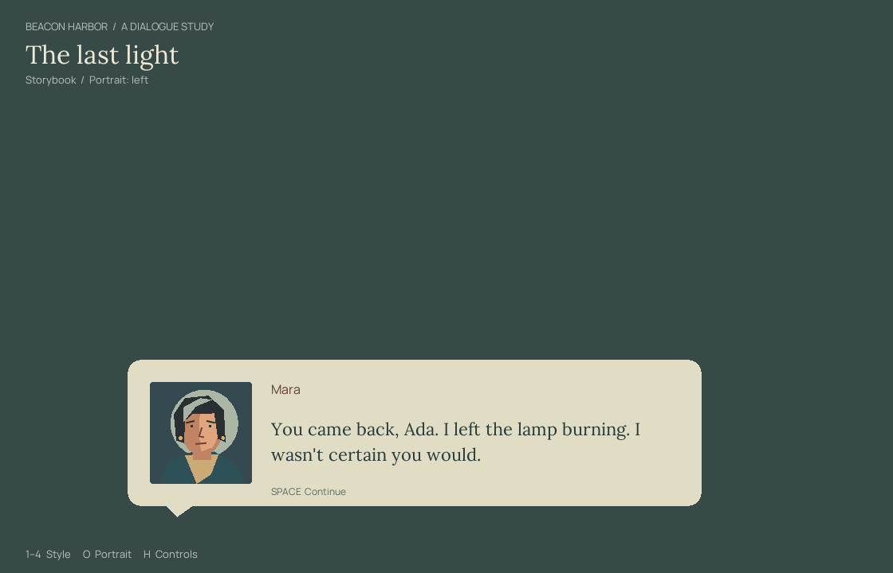

# Beacon Harbor — The last light

A dialogue-focused LÖVE showcase: a quiet stage, four interchangeable presentations,
three original character portraits, and a branching conversation about a ferry that
returns six years too late. Start with the story; press **H** when you want the controls.

```sh
tua fmt --check
tua check
tua build
love build
```

## Four presentations, one conversation

| Key | Presentation | What changes |
| --- | --- | --- |
| **1** | Cinematic | Wide framed panel, restrained brass rules, a portrait that breaks the frame on larger windows. |
| **2** | Storybook | Compact pale speech card, literary type, speech tail and warmer text. |
| **3** | Transmission | Right-aligned receiver panel, channel identity and a cooler palette. |
| **4** | Subtitles | Unframed dialogue and quiet speaker identification. |

**O** cycles portrait placement: left → right → above → hidden. Switch style or
portrait placement mid-sentence without restarting text, replaying audio or changing
story state. Narration and choice-only presentations do not invent a speaker portrait.
The layouts support 640×480 through 1120×720 and larger windows. Long text and choices
scroll; keyboard focus brings the newly selected reply into view.

| Cinematic | Storybook |
| --- | --- |
|  |  |
| Transmission | Subtitles |
|  |  |

## Read the story

The default `start` entry contains **33 utterances**, a returning information hub,
three outcomes, and an additional relationship-dependent ending variant. Replies
have stable text IDs and complete English/French templates.

- Ask about the passengers, lighthouse or chart, then return to the question hub.
- Believe Ivo to change his response later. The main plot can reconverge while the
  relationship still remembers what you said.
- Study the chart to reveal a new hub reply and unlock the skiff route. That route
  also requires a harbor permit; **G** toggles the permit to demonstrate live gating.
- Make a clearly signposted decision: light the beacon, take the skiff, or stay ashore.
- Save after learning something, restart, then restore. Knowledge and relationship
  locals return with the checkpoint; the current language preference stays selected.

**F2** switches to the compact `quick` entry: the original token/action/voice test
conversation. It remains useful for learning individual APIs without reading the story.
Reset clears dialogue locals, queues and transcript. Earned demonstration tokens remain
session-local. F2 changes the entry for subsequent resets and queued conversations;
restoring a checkpoint also restores which story entry it belongs to.

## Controls

| Key | Action |
| --- | --- |
| 1 / 2 / 3 / 4 | Cinematic / storybook / transmission / subtitles |
| O | Portrait left / right / above / hidden |
| Space / Enter | Finish revealing, continue, or confirm a reply |
| Up / Down | Focus a reply; disabled replies explain their requirement |
| Page Up / Page Down | Scroll dialogue or the open transcript |
| H / Tab | Controls and diagnostics / bounded recent conversation |
| F / M | Normal or 3× reveal speed / reduced motion and instant reveal |
| S / V | Subtitles / recorded voice mute |
| L / G | English or French / harbor permit |
| P / R | Pause both channels / restart |
| Q / N | Queue a conversation / non-blocking radio announcement |
| F5 / F9 | Save / restore an in-memory checkpoint |
| F2 | Long story / short feature demonstration |
| Escape | Close an overlay, otherwise quit and release resources |

## Find a feature

| Feature | Where to see it |
| --- | --- |
| Shared cast, portrait metadata and expression variants | Mara's worried/resolved/happy lines; Ivo and Beacon use the same renderer. See `characters.tua` and `portraits.tua`. |
| No portrait, narration and alternate placement | O; the light crossing the sea and the skiff ending contain narration. |
| Rich text, reveal pauses and motion | Opening hesitation, emphasized chart markers, wave motion on the crossing; warning/wave styles also appear in the quick entry. M removes motion. |
| Character chatter / word cadence | Mara and Ivo use different speech profiles. Beacon has a lower synthetic voice. |
| Recorded audio and locale fallback | The recovered transmission and quick radio check use `greeting`, with source-locale fallback. The WAV is a synthetic fixture, **not spoken voice acting**. Replace it with a licensed recording. |
| Localization and safe placeholders | L switches every story line, choice and disabled reason; `%{name}` is data, not executable markup. |
| Question hubs and conditional variants | Learn the chart, support Ivo, then compare the outcomes. |
| Visible/hidden and enabled/disabled replies | A learned route appears in the hub; the skiff requires knowledge plus a permit. |
| Typed host actions and dialogue locals | `remember` updates owned story memory; `collect` in the short demo grants one token. |
| Timed events | The opening emits shown/revealed signals; H exposes their counts. |
| Waits | The radio reply follows an explicit 0.8-second listening interval. |
| Independent non-blocking messages | N in styles 2–4. Style 1 suspends radio until the modal conversation releases priority. |
| Bounded queues | Q: two waiting conversations. N: four waiting messages. Overflow is counted in H. Active entries are additional. |
| Checkpoint boundaries and restore | F5 saves line/choice/wait boundaries and gives feedback elsewhere. F9 creates a fresh player without replaying settled effects. |
| Transcript | Tab shows the last eight entries within a 2 KiB string budget; Page Up/Down scrolls. Locale changes preserve the language originally recorded. |
| Pause and resource ownership | P freezes reveal and audio. R resets; Escape disposes both players and all fonts/Sources. |

This showcase focuses on presentation and conversation flow. The complete library also
has independent recipes for [durable effects](../durable/README.md),
[asynchronous actions](../actions/README.md), and [rich-text contracts](../rich/README.md).
The checkpoint here is in memory, not a crash-safe inventory transaction. There is no
screen-reader bridge, bidirectional text layout, or full script shaping in this renderer.

## Files to borrow

| File | Responsibility |
| --- | --- |
| `scene.tdialogue` | Story and short demonstration, stable identities and explicit transitions |
| `story.tua`, `actions.tua`, `events.tua` | Typed facts, locals, actions and notification payloads |
| `controller.tua` | Host channel priority, queues, checkpoints and story-local memory |
| `characters.tua`, `translations.tua` | Shared character metadata and French templates |
| `presenter.tua`, `theme.tua`, `portraits.tua` | Layout, palettes, fonts, expression art and reveal rendering |
| `audio.tua`, `backend.tua` | Cue policy and owned native Sources |
| `main.tua` | Minimal stage, keyboard routing, overlays and lifecycle callbacks |

The `remember` action settles into a response line; the host applies its accepted
memory before the next input/branch. Keep that boundary when adapting this example.
Core dialogue remains renderer-independent. Nothing here requires other games to use
these styles, queues or a particular game-pause policy.

## Verify and capture

```sh
python3 verify.py --tua ../../../target/release/tua
python3 verify.py --tua ../../../target/release/tua --love /path/to/love --output /tmp/dialogue-lifecycle
python3 verify.py --tua ../../../target/release/tua --love /path/to/love --scenario styles --output /tmp/dialogue-styles --video
```

Each output directory must be new. Headless checks run emitted Lua and cover all
endings, relationship variants, gated replies, localization coverage, checkpoint
memory, queues and the five showcase lifecycle regressions. Native lifecycle replay
covers actual input/render/audio callbacks. The style replay captures **32 combinations**:
four styles × four portrait placements × two window sizes, plus narrow choices,
French text with concurrent radio, help and transcript. Captures are functional visual
checks, not FPS benchmarks; MP4s are silent. `screenshots/provenance.json` identifies
the source replay and frame selected for each checked-in screenshot.

See [DESIGN.md](DESIGN.md) for visual decisions and reference interpretation.
Font licenses and provenance live in [src/assets/fonts/README.md](src/assets/fonts/README.md).
Portraits are original procedural drawings; no reference-game artwork is redistributed.
