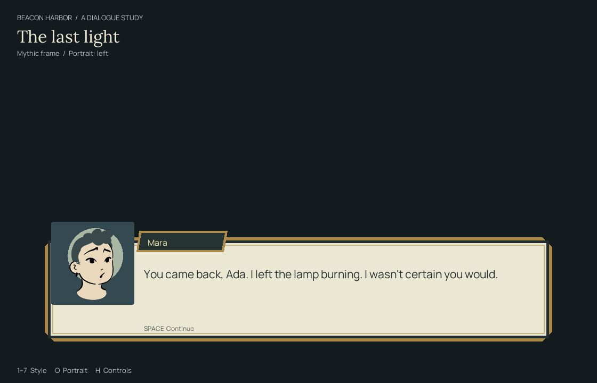
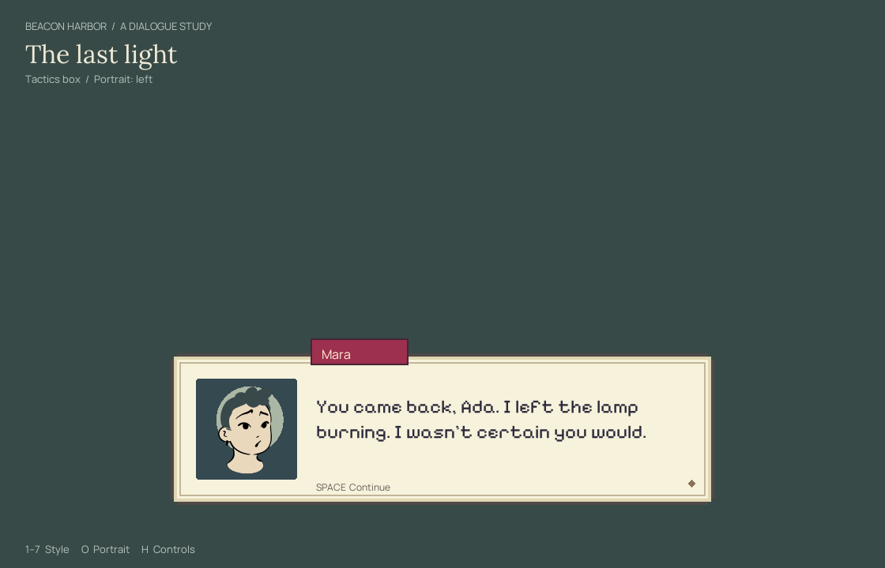
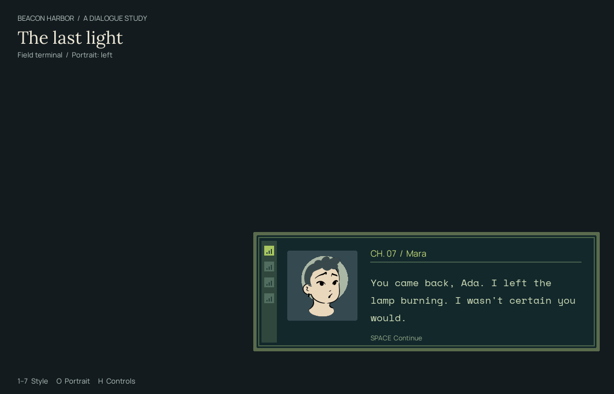
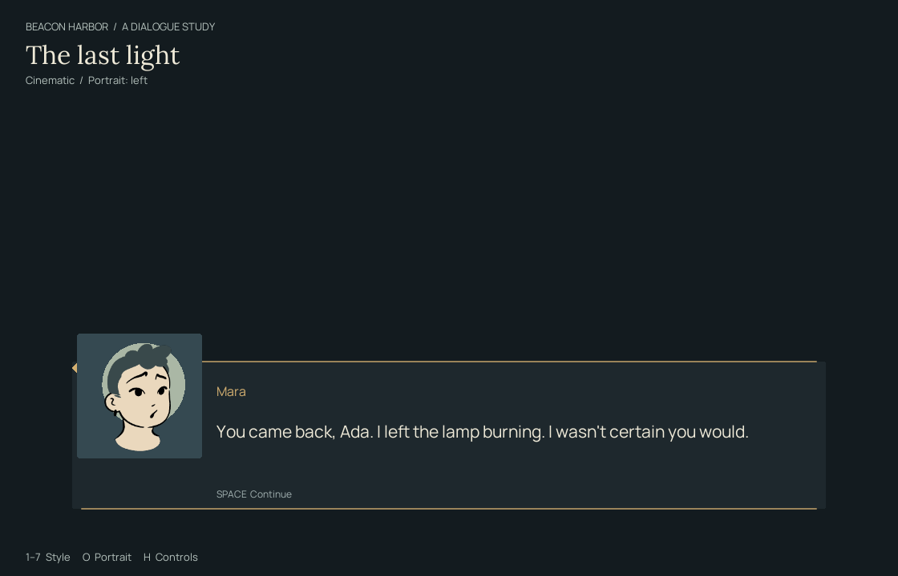
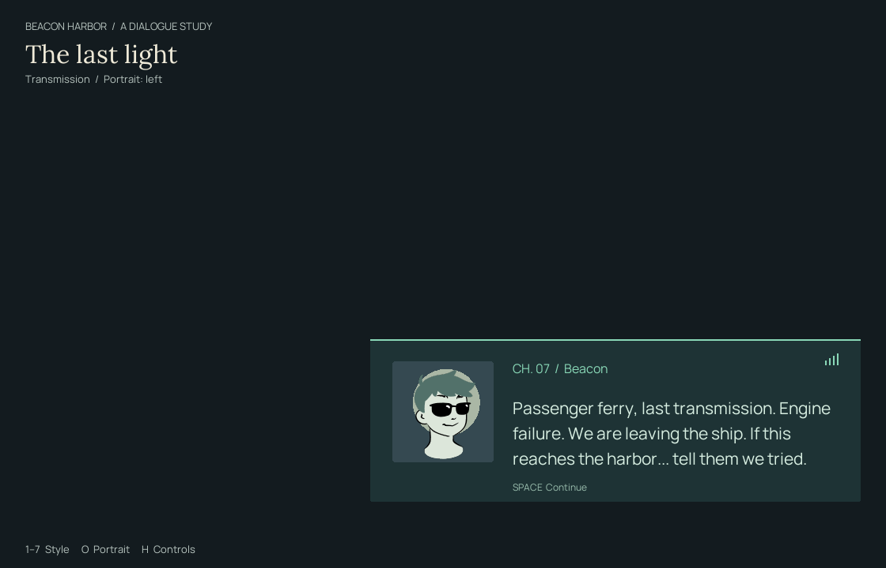
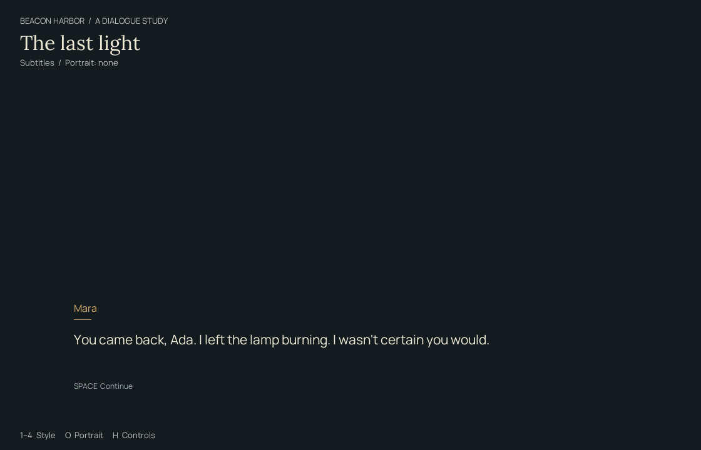
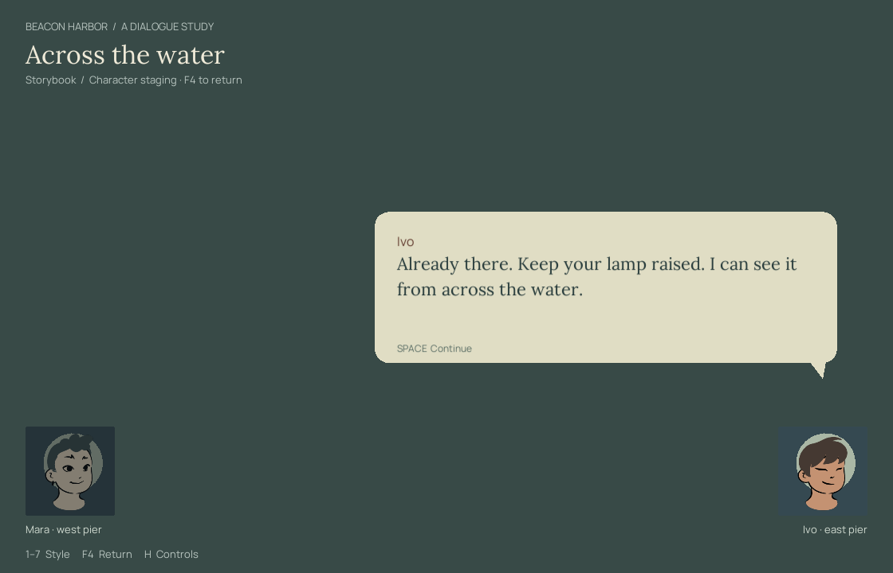
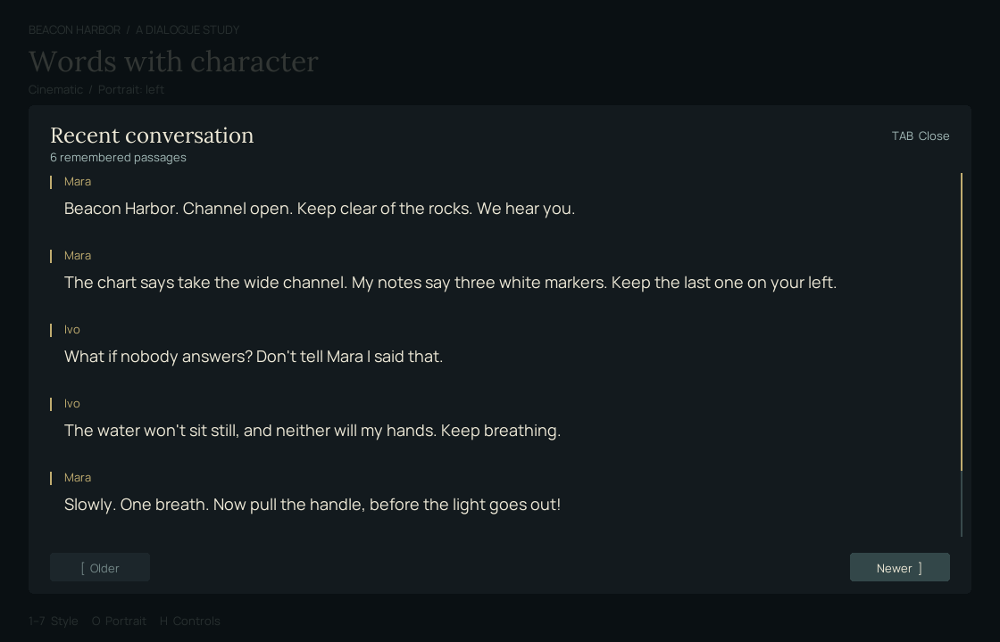
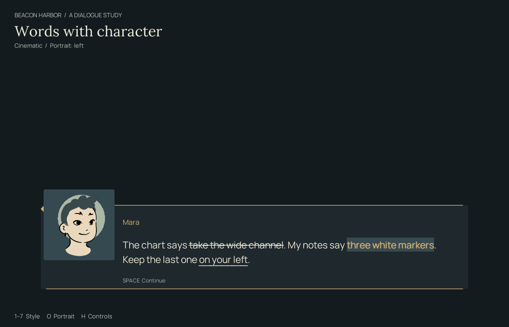

# Beacon Harbor — The last light

A dialogue-focused LÖVE showcase: a quiet stage, seven interchangeable presentations,
three Lorelei character portraits, and a branching conversation about a ferry that
returns six years too late. Start with the story; press **H** when you want the controls.

```sh
tua fmt --check
tua check
tua build
love build
```

New to the player? Start with the [two-file conversation](../first-conversation/README.md)
and [guided learning path](../../../docs/tutorials/first-dialogue.md). This showcase demonstrates
combinations; none of its adapters are required to start.

## Preview the scripts in the editor

Open a `.tdialogue` file and run **Tua: Preview Dialogue**. The reader shows authored
branches, common rich styles, and character expressions without starting LÖVE.
Its styling is independent of the seven in-game presentations below.

The game uses portrait IDs rather than file paths. To see the bundled portraits in
the reader, add this to the settings of the workspace you opened (including a parent
`examples` workspace). Paths are relative to this Tua project's `src`, not the
workspace folder:

```json
{
  "tua.dialogue.preview.portraits": {
    "mara": "assets/portraits/mara.png",
    "mara.happy": "assets/portraits/mara.happy.png",
    "mara.worried": "assets/portraits/mara.worried.png",
    "mara.resolved": "assets/portraits/mara.resolved.png",
    "ivo": "assets/portraits/ivo.png",
    "ivo.happy": "assets/portraits/ivo.happy.png",
    "ivo.worried": "assets/portraits/ivo.worried.png",
    "beacon": "assets/portraits/beacon.png"
  }
}
```

See [preview behavior and limits](../../../docs/dialogue.md#preview-the-authored-conversation).

## Seven presentations, one conversation

| Key | Presentation | What changes |
| --- | --- | --- |
| **1** | Cinematic | Wide framed panel, restrained brass rules, a portrait that breaks the frame on larger windows. |
| **2** | Storybook | Compact pale speech card, literary type, speech tail and warmer text. |
| **3** | Transmission | Right-aligned receiver panel, channel identity and a cooler palette. |
| **4** | Subtitles | Unframed dialogue and quiet speaker identification. |
| **5** | Mythic frame | Additional Hades-like pale panel, double gold border, cut corners and angled dark nameplate. |
| **6** | Tactics box | Additional Wargroove-like stepped box, burgundy speaker tab, pixel type and diamond cue. |
| **7** | Field terminal | Additional receiver-style frame, signal rail and monospace dialogue. |

Keys **1–4 retain the original layouts**. The reference-based styles are additions,
not replacements. All seven share the same dialogue player and portrait options.
The new frames reproduce layout treatments from the supplied references using host
primitives; they do not redistribute those games’ interface art.

| Mythic frame | Tactics box | Field terminal |
| --- | --- | --- |
|  |  |  |

**O** cycles portrait placement: left → right → above → hidden. Switch style or
portrait placement mid-sentence without restarting text, replaying audio or changing
story state. Narration and choice-only presentations do not invent a speaker portrait.
The layouts support 640×480 through 1120×720 and larger windows. Long text and choices
scroll; keyboard focus brings the newly selected reply into view.

| Cinematic | Storybook |
| --- | --- |
|  |  |
| Transmission | Subtitles |
|  |  |

## Character staging tour

Press **F4** for *Across the water*, a separate English/French conversation in
[`staging.tdialogue`](src/staging.tdialogue). F4 again returns to the main story.

- Mara stays on the left and Ivo on the right. The active speaker brightens;
  expression variants still select the corresponding Lorelei portrait.
- Each speaker has a bubble position. Beacon uses a screen-anchored bubble without
  a portrait or speech tail; the two visible portraits remain inactive.
- Choose **Bring the chart between us** to move Mara's bubble to the upper center
  for one line. Her portrait stays left, and her next bubble returns to its default.
- Narration and choices use neutral placement. **L** switches language; **1–7** still
  switch styles. This tour uses character slots instead of the global **O** setting.



The typed renderer configuration lives in [`staging_layout.tua`](src/staging_layout.tua).
It resolves **defaults → character → scene → line**, using `node.speakerKey` (the
character's `nameKey`) and `node.textId`, never translated names or portrait filenames.
For example, the line override changes the bubble while retaining Mara's portrait slot:

```lua
["staging.mara.center"] = { anchor = "screen", x = 0.5, y = 0 }
```

Coordinates are normalized over the bubble's available travel inside the safe area:
0 is the left/top edge, 1 the right/bottom edge. Geometry reserves room for portraits,
controls and headings. Long content scrolls with [ / ] (or Page Up/Down); choices scroll to focus.
An `actor` anchor points toward a portrait slot in this example. A world-space game
would project its actor position before passing geometry to the presenter.

This is host presentation data, not new dialogue syntax or a built-in engine layout.
The separate document shares the cast, context and translations with the story.
Checkpoints remember which document to restore and preserve the host's language.
While active, this tour suspends radio announcements in every style to protect its
staging area; the other tours retain their existing style-dependent priority.

```sh
python3 verify.py --tua ../../../target/release/tua \
  --love /Applications/love.app/Contents/MacOS/love \
  --scenario staging --output /tmp/beacon-staging --video
```

## Recent conversation

**Tab** opens the reading panel. Speaker labels, larger body text and a position
indicator make the bounded history easier to scan. **[** scrolls toward older text;
**]** scrolls toward newer text. The matching footer buttons are clickable and dim
at the beginning/end. Page Up/Down remain keyboard aliases. Tab or Escape closes it.



## Rich text tour

Press **F3** for *Words with character*, a six-line English/French tour. Switch among
all seven UI styles while reading. F3 again returns to the main story.



```text
[style=strike]take the wide channel[/style]
[style=highlight][em]three white markers[/em][/style]
[style=underline]on your left[/style]
[style=thought]What if nobody answers?[/style]
[style=whisper]Don't tell Mara.[/style]
[style=wave]The water won't sit still[/style]
[style=shake]neither will my hands[/style]
[speed=8]Slowly. One breath.[/speed][pause=0.6] [speed=65]Now pull![/speed]
```

`success`, `warning` and `radio` also provide palette-aware text colors. Emphasis
adds accented, heavier strokes; nested styles combine. Unknown style keys remain
ordinary text. `warning` retains its previous small shake. **M** disables wave/shake
and finishes reveal immediately; static decorations remain visible. **Space** can
finish timed text without playing a backlog of typing sounds.

These are host-defined `[style=…]` keys in `rich_styles.tua`, using Tua's existing
rich-text contract. No new language tags, inline scripts, or engine dependencies
were added. Decorations apply to line text; the current choice/reason renderer
keeps its plain wrapped layout. Pronunciation hints remain metadata for an audio
adapter, rather than a text-to-speech feature in this example.

The main story uses the same treatments for clues, uncertainty and important
callbacks. History stays plain, and interpolated names cannot inject markup.

## Read the story

The default `start` entry contains **33 utterances**, a returning information hub,
three outcomes, and an additional relationship-dependent ending variant. Replies
have stable text IDs and complete English/French templates.

- Ask about the passengers, lighthouse or chart, then return to the question hub.
- Believe Ivo to change his response later. The main plot can reconverge while the
  relationship still remembers what you said.
- Study the chart to reveal a new hub reply and unlock the skiff route. That route
  also requires a harbor permit; **G** toggles the permit to demonstrate live gating.
- Make a clearly signposted decision: light the beacon, take the skiff, or stay ashore.
- Save after learning something, restart, then restore. Knowledge and relationship
  locals return with the checkpoint; the current language preference stays selected.

**F2** switches to the compact `quick` entry: the original token/action/voice test
conversation. It remains useful for learning individual APIs without reading the story.
Reset clears dialogue locals, queues and transcript. Earned demonstration tokens remain
session-local. F2 changes the entry for subsequent resets and queued conversations;
restoring a checkpoint also restores which story entry it belongs to.

## Controls

| Key | Action |
| --- | --- |
| 1–4 / 5–7 | Original presentations / additional reference-based styles |
| O | Portrait left / right / above / hidden |
| Space / Enter | Finish revealing, continue, or confirm a reply |
| Up / Down | Focus a reply; disabled replies explain their requirement |
| **[ / ]** | Scroll dialogue or the open transcript; Page Up / Page Down remain aliases |
| H / Tab | Controls and diagnostics / bounded recent conversation |
| F / M | Normal or 3× reveal speed / reduced motion and instant reveal |
| S / V | Subtitles / recorded voice mute |
| L / G | English or French / harbor permit |
| P / R | Pause both channels / restart |
| Q / N | Queue a conversation / non-blocking radio announcement |
| F5 / F9 | Save / restore an in-memory checkpoint |
| F2 / F3 | Long story or short demo / rich-text tour |
| Escape | Close an overlay, otherwise quit and release resources |

## Find a feature

| Feature | Where to see it |
| --- | --- |
| Shared cast, portrait metadata and expression variants | Mara's worried/resolved/happy lines; Ivo and Beacon use the same renderer. See `characters.tua` and `portraits.tua`. |
| No portrait, narration and alternate placement | O; the light crossing the sea and the skiff ending contain narration. |
| Rich text, reveal pauses and motion | Opening hesitation, emphasized chart markers, wave motion on the crossing; warning/wave styles also appear in the quick entry. M removes motion. |
| Character chatter / word cadence | Mara and Ivo use different speech profiles. Beacon has a lower synthetic voice. |
| Recorded audio and locale fallback | The recovered transmission and quick radio check use `greeting`, with source-locale fallback. The WAV is a synthetic fixture, **not spoken voice acting**. Replace it with a licensed recording. |
| Localization and safe placeholders | L switches every story line, choice and disabled reason; `%{name}` is data, not executable markup. |
| Question hubs and conditional variants | Learn the chart, support Ivo, then compare the outcomes. |
| Visible/hidden and enabled/disabled replies | A learned route appears in the hub; the skiff requires knowledge plus a permit. |
| Typed host actions and dialogue locals | `remember` updates owned story memory; `collect` in the short demo grants one token. |
| Timed events | The opening emits shown/revealed signals; H exposes their counts. |
| Waits | The radio reply follows an explicit 0.8-second listening interval. |
| Independent non-blocking messages | N in styles 2–4 or 7. Styles 1, 5 and 6 suspend radio until the modal conversation releases priority. |
| Bounded queues | Q: two waiting conversations. N: four waiting messages. Overflow is counted in H. Active entries are additional. |
| Checkpoint boundaries and restore | F5 saves line/choice/wait boundaries and gives feedback elsewhere. F9 creates a fresh player without replaying settled effects. |
| Transcript | Tab shows the last eight entries within a 2 KiB string budget; [ / ] (or Page Up/Down) scrolls. Locale changes preserve the language originally recorded. |
| Pause and resource ownership | P freezes reveal and audio. R resets; Escape disposes both players and all fonts/Sources. |

This showcase focuses on presentation and conversation flow. The complete library also
has independent recipes for [durable effects](../durable/README.md),
[asynchronous actions](../actions/README.md), and [rich-text contracts](../rich/README.md).
The checkpoint here is in memory, not a crash-safe inventory transaction. There is no
screen-reader bridge, bidirectional text layout, or full script shaping in this renderer.

## Files to borrow

| File | Responsibility |
| --- | --- |
| `scene.tdialogue` | Story and short demonstration, stable identities and explicit transitions |
| `story.tua`, `actions.tua`, `events.tua` | Typed facts, locals, actions and notification payloads |
| `controller.tua` | Host channel priority, queues, checkpoints and story-local memory |
| `characters.tua`, `translations.tua` | Shared character metadata and French templates |
| `presenter.tua`, `frames.tua`, `styles.tua`, `theme.tua`, `portraits.tua`, `rich_styles.tua` | Layout, palettes, fonts, expression art and reveal rendering |
| `audio.tua`, `backend.tua` | Cue policy and owned native Sources |
| `main.tua` | Minimal stage, keyboard routing, overlays and lifecycle callbacks |

The `remember` action settles into a response line; the host applies its accepted
memory before the next input/branch. Keep that boundary when adapting this example.
Core dialogue remains renderer-independent. Nothing here requires other games to use
these styles, queues or a particular game-pause policy.

## Verify and capture

```sh
python3 verify.py --tua ../../../target/release/tua
python3 verify.py --tua ../../../target/release/tua --love /path/to/love --output /tmp/dialogue-lifecycle
python3 verify.py --tua ../../../target/release/tua --love /path/to/love --scenario styles --output /tmp/dialogue-styles --video
python3 verify.py --tua ../../../target/release/tua --love /path/to/love --scenario rich --output /tmp/dialogue-rich --video
```

Each output directory must be new. Headless checks validate portrait hashes, distinct expression images and image disposal,
then run emitted Lua and cover all
endings, relationship variants, gated replies, localization coverage, checkpoint
memory, queues and the five showcase lifecycle regressions. Native lifecycle replay
covers actual input/render/audio callbacks. The style replay captures **56 combinations**:
seven styles × four portrait placements × two window sizes, plus narrow choices,
French text with concurrent radio, help and transcript. Captures are functional visual
checks, not FPS benchmarks; MP4s are silent. `screenshots/provenance.json` identifies
the source replay and frame selected for each checked-in screenshot.

See [DESIGN.md](DESIGN.md) for visual decisions and reference interpretation.
Font licenses and provenance live in [src/assets/fonts/README.md](src/assets/fonts/README.md).
Portraits use Lisa Wischofsky’s CC0 Lorelei style via DiceBear, with the original slate-and-sage backgrounds preserved. See [portrait provenance](src/assets/portraits/README.md). No reference-game artwork is redistributed.
