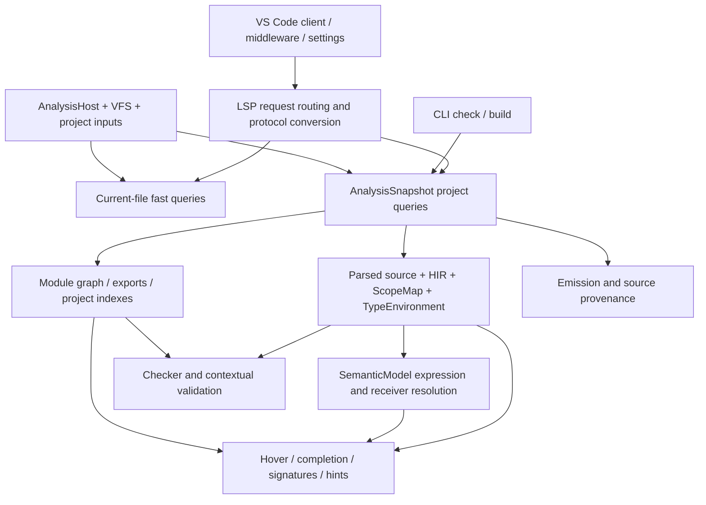

# Architecture and test-oracle map

This is an inspection of revision `d7aed2e`, reconciled with executed probes.
It describes implementation seams, not a proposed rewrite.

## Shared authority and the paths that diverge

| Layer | Key files | Ownership and observations |
|---|---|---|
| Inputs and revisions | `crates/tua-core/src/analysis/host.rs`, `database.rs`, `snapshot.rs`; `project_model`, `vfs` | Host accepts sources/configuration/roots; snapshots own shared immutable facts and revisioned caches. Single-root overlays and watched changes behaved correctly. |
| Parsing and source spaces | `parser/model.rs:9`, `source_text.rs:78`, `analysis/recovery.rs`, `classes.rs` | Native syntax is normalized; parser coordinates and original source coordinates are distinct. HOV-03 bypasses that mapping; WF-01 is a separate UTF-16 transport conversion failure. |
| Lexical and callable identity | `scope/`, `hir/`, `types/environment.rs:296` | Scope/HIR facts exist, but some consumers still fetch function contracts by name. HOV-02 shows why merely making all surfaces share a name lookup is not semantic correctness. |
| Expression types and checking | `semantic.rs:273`, `check/mod.rs:1122`, `:1497`, `:1764`, `:2701`, `types/environment.rs` | Rich editor receiver resolution coexists with simpler checker suffix walks. Contextual callback checking is invoked through some callable variants but not others. TYP-01/02 and value-list defects identify specific seams to unify. |
| Native constructor recovery | `crates/tua-core/src/semantic.rs:1118–1146`; `types/environment.rs:911–924` | Canonical constructor return metadata exists, but local instance recovery scans literal source spelling. CMP-07 demonstrates whitespace dependence; U-01 direct chains remain a separately tested symptom with unresolved attribution. |
| Module identity | `module_graph/mod.rs:136`, `:625`, `:865`; `analysis/module_queries.rs`; `server/analysis.rs:860` | Source paths and project model exist, but require search receives flattened roots. WF-02 is a missing ownership dimension, not merely a stale cache. |
| Editor core queries | `analysis/editor_queries.rs:4`, `:119`, `:391`, `:680`; `hover/`, `completion/`, `signature_help/` | Snapshot queries combine cached facts, module/domain/catalog information and degraded recovery. Direct members/nested calls work; method-token hover and callable metadata still diverge. |
| Protocol scheduling/routing | `crates/tua-lsp/src/server/handlers.rs:747`, `:1390`, `protocol.rs:1518`; `scheduler.rs` | Incremental source updates and stale-worker rejection are separate from outgoing range conversion. Invoked identifier completion early-returns before the project augmentation path (CMP-01). |
| Extension client | `editors/vscode/src/extension.js:313`, `:326`; `src/editor/`; `package.json` | One client serves workspace documents. It uses normal LSP invoked context and UTF-16 edits, making CMP-01 and WF-01 observable in the real editor. Word-based suggestions can appear in provider output even when Tua has no matching semantic candidate. |
| Generated/standard catalogs | core Lua/LOVE catalog consumers and generated LOVE source | Direct Lua/LOVE documentation and method signatures are broadly useful. Catalog coverage tests establish internal agreement, not independent runtime accuracy of every overload. |
| Lowering and emission | `crates/tua-core/src/emit/mod.rs:1638`, `:1656`; `analysis/snapshot.rs:70` | Diagnostic pipelines also ask emission for errors. A token-trivia panic therefore affects `check` and LSP diagnostics, not only `build` (CMP-02). |

## Existing tests and actual gates

The existing workspace suite was executed unchanged and passed; see
[VERIFICATION.md](VERIFICATION.md). Important existing layers include:

- Core `check/tests.rs`, `types/tests.rs`, `hover/tests.rs`, `completion/tests.rs`,
  `signature_help/tests.rs` and `analysis/tests.rs`.
- LSP `server/tests/completion.rs`, `hover.rs`, `signature_help.rs`,
  `scheduling.rs`, `project_layout.rs`, `workspace.rs`, `inline_completion.rs`.
- CLI integration/runtime fixtures, including emitted Lua validation.
- VS Code unit/activation tests and `test/real-server` editor-host coverage.
- Performance replay/representative scripts under `editors/vscode/scripts`.

Trusted gating was inspected, not remotely executed: `.github/workflows/ci.yml`
triggers on `push` to `main`, manual dispatch, and reusable calls. It runs Rust
workspace tests (with native runtime checks on Linux), metadata/lints, extension
checks and real-server VS Code integration, examples/performance-related smoke
checks, and catalog drift checks. `.github/workflows/release.yml:45` calls that
trusted CI workflow; packaging depends on `validate` and `verify`.
`.github/workflows/performance.yml` runs main-branch/scheduled trend profiles.
The deliberate absence of untrusted pull-request execution is **not a finding**.
No remote CI success, platform equivalence or release certification is inferred
from reading those files.

## Highest-value test gaps

| Gap | Escaped behavior | Better oracle / smallest layer | Expected cost / placement |
|---|---|---|---|
| Request-context parity | Auto-import tests use the context-less helper, while normal invoked completion takes another path | Same fixture across omitted/invoked/retrigger; actual VS Code provider smoke | Low; LSP suite + trusted editor gate |
| Original-source edit application | Range tests mostly assert prefix/end positions; Unicode inline tests bypass ordinary conversions | Apply standard completion/rename/action edits with UTF-16 indexing; compare source and parse result | Low–medium; protocol suite plus one GUI/provider regression |
| Workspace ownership | Layout tests choose containing roots but exports do not collide | Same require key, incompatible exports in two roots; query and mutate both | Low; analysis/LSP tests |
| Declaration identity | Same-name values/parameters tested, nested same-name local functions omitted | Inner/outer/sibling functions with different contracts and runtime-compatible expectations | Low; core + LSP |
| Cross-surface semantic equivalence | Hover can know a field/callback type while checker silently uses dynamic fallback | Equivalent split/chained expressions, direct/aliased callbacks; compare exact diagnostic codes and types | Medium; table-driven core analysis fixtures |
| Native binding syntax equivalence | Formatted constructor assignments mask literal source-prefix recovery | Spaced/compact/multiline local bindings plus direct constructor chains; compare checker and editor facts | Low–medium; semantic + LSP |
| Lua value-list semantics | Tests emphasize populated assignment/return slots, not final arguments or absent slots | Scalar/final/nonfinal/parenthesized/vararg value-list matrix and runtime oracle | Medium; checker + Lua/LuaJIT CI oracle |
| Native syntax provenance | Local-name tests pass while expression fallback traverses normalized AST | Prefix-invariance and bounded original-source ranges before/inside/after classes | Low–medium; core semantic/hover + LSP |
| Composed transforms | Typed erasure and suppression independently pass | Apply returned action, run diagnostic pipeline/check on resulting program | Low; LSP + CLI |
| Negative capabilities | Tests ask for snippets without negotiating support | True/false/absent snippet capability on initial and resolved items | Low; protocol suite |

Keep these in existing frameworks. Coverage percentages or more broad golden
snapshots would not detect the demonstrated semantic contradictions by themselves.
Optional-backend tests that return early must be reported as environment-dependent
coverage, even when a test runner labels the function “passed.”
